# 从六阶段到可审计流水线：ReviewAgent-pi 的检视内核设计与负结果复盘

> 面向架构师 / 资深工程师的技术分享。重点不是“我们做了多少功能”，而是**每个机制解决哪一个可度量的问题、代价是什么、什么时候不成立**。

## 目录

- [1. 项目定位：一次 MR 检视，产出可核对的证据链](#1-项目定位一次-mr-检视产出可核对的证据链)
- [2. 两条主线：精准判断与低耗运行](#2-两条主线精准判断与低耗运行)
- [3. 方案与选型：为什么是 pi，为什么工具自己写](#3-方案与选型为什么是-pi为什么工具自己写)
- [4. 总体架构](#4-总体架构)
- [5. 七个核心机制：问题 → 技巧 → 代价](#5-七个核心机制问题--技巧--代价)
- [6. 深潜一：分片并行——先证明“不变”，再证明“变快”](#6-深潜一分片并行先证明不变再证明变快)
- [7. 深潜二：覆盖账本——把“没审到”变成可见状态](#7-深潜二覆盖账本把没审到变成可见状态)
- [8. 深潜三：证据接地与独立证伪——两道门，两种失败](#8-深潜三证据接地与独立证伪两道门两种失败)
- [9. 实验方法：为什么我们最后不信“小样本 + 单次”](#9-实验方法为什么我们最后不信小样本--单次)
- [10. 审计与回放：让“改提示词”不再是盲改](#10-审计与回放让改提示词不再是盲改)
- [11. 设计取舍清单](#11-设计取舍清单)
- [12. 结语](#12-结语)

---

## 1. 项目定位：一次 MR 检视，产出可核对的证据链

ReviewAgent-pi 是运行在 pi 内核上的代码检视 CLI。它的产品形态很克制：

- 输入：一次合并请求的 diff（或一个提交范围）；
- 输出：`reviews_en.json`（英文 findings）+ `reviews_tips_zh.json`（中文按行分组的建议）；
- 副作用：完整审计（每条请求、每次工具调用、每个阶段的阶段记录、usage）；
- 规则能力：以 Agent Skill 的形式加载，而不是硬编码在提示词里。

它的设计约束和很多“AI Review”产品不同：

| 约束 | 具体要求 | 带来的设计后果 |
|---|---|---|
| 确定性 | 同一输入 + 同一配置 → 同一分片计划、同一分母、同一预取包 | 所有“计划类”逻辑必须可离线复现 |
| 可审计 | 每个观点要能回到文件、行号、引文 | 证据 schema + 接地检查 + 独立核验 |
| 可回滚 | 每个优化独立开关、独立 ADR | 失败实验只回退默认值，不删机制 |
| 不追榜 | 不为 benchmark recall 放开风格/测试类噪声 | 很多“能提分”的提示词被主动拒绝 |
| 成本可见 | token、墙钟、工具调用、阶段请求数一起报 | 单看 P/R/B 的结论一律不作为验收 |

---

## 2. 两条主线：精准判断与低耗运行

所有机制最终都服务于两条主线。它们不是并列关系：**精准判断是前提，低耗运行是约束**——不允许用判断质量去换成本。

| 主线 | 要回答的问题 | 手段 | 代价 / 边界 | 当前默认 |
|---|---|---|---|---|
| 精准判断 | 这条意见能被核对吗？ | 文件 / 行号 / 引文确定性接地 | 措辞改写会误判 unverified | `evidence.mode = warn` |
| | 这次到底看了多少？ | 文件 × hunk 三态账本 | 只观测，不自动补 | 账本开，`repair` 关 |
| | 自审可信吗？ | 独立会话证伪，fail-open | reject 过少，不能当 drop 门 | 不接主路径 |
| | 会不会少报？ | `confidence.min = 0.3`、范围门只标注不删 | 低置信长尾保留 | 0.3 |
| 低耗运行 | 成本看得见吗？ | P/R/B + token + 墙钟 + 请求 + 工具一起报 | 报告变长 | 固定口径 |
| | 哪里能确定地省？ | 空回包重试（13/103→0）、分片并发降墙钟 | 并发让 token +40%，省的是时间不是钱 | 重试开，并发默认 1 |
| | 省了会不会伤质量？ | 全量成对复本 + bootstrap CI 才允许改默认 | 实验成本高 | 不过门槛就回退 |

三条纪律：

1. **先能核对，再谈多少**：没有证据接地和覆盖账本，“精准”无法被证伪。
2. **先能度量，再谈节省**：只报 P/R/B 的实验不允许改默认值。
3. **省成本必须过全量门槛**：compact 在 S20 省 12% 请求、B +9.6pp，全量却 ΔB −4.6pp，于是回退；repair 墙钟 +30%，保持关闭。

> 因此“低耗运行”在本项目里的准确含义是：**成本是一等指标、默认值保守、无效的省法会被数据否决**——而不是“每个版本都比上一版更便宜”。

---

## 3. 方案与选型：为什么是 pi，为什么工具自己写

### 3.1 选型总表

| 决策点 | 选择 | 放弃的选项 | 理由 | 记录 |
|---|---|---|---|---|
| 内核 | 上游四包 `@earendil-works/*`，精确锁 `0.85.1` | DSH 内核、自研 harness、通用 coding-agent CLI | 专用产品不需要“Runtime 可复用”；pi 提供 provider / loop / tool / state 原语，核内零定制 | ADR-0009 / ADR-0035 |
| 消费面 | `pi-ai` + `pi-agent-core`（`chord` / `pi-telemetry` 随包锁定，不直接调用） | `pi-coding-agent` 全套 | session / TUI / RPC / compaction 与检视无关，引入即包袱 | 架构方案 §1.3 |
| 产品形态 | CLI + findings / tips / audit | 平台服务、IDE 插件、PR 原生 | 可 CI、可组合、可回放；平台闭环需求证据不足，拆到后续 | ADR-0024 / F-15 |
| 规则形态 | Agent Skill，独立会话加载 | 硬编码提示词、内置规则引擎 | 可插拔、可单测、可移植到其他宿主 | ADR-0012 / ADR-0014 |
| 工具 | 自研只读 `review.*` 工具 | pi / coding-agent 自带工具 | 路径 jail、行区间、预算、ledger、审计、确定性、分片一致 | ADR-0099 / ADR-0107 |
| 并发 | 有界 worker 池 + 片序聚合 | 无界并发 | 429 安全、结果与串行等价 | ADR-0112 |
| 实验方法 | 成对多 run + bootstrap CI | 单次 P/R/B | 同臂跨 run 波动 10–14pp | F-16 |

### 3.2 pi 是什么，我们消费哪一层

把“我们自己的”和“pi 提供的”画在一起，是这样一条消费栈：

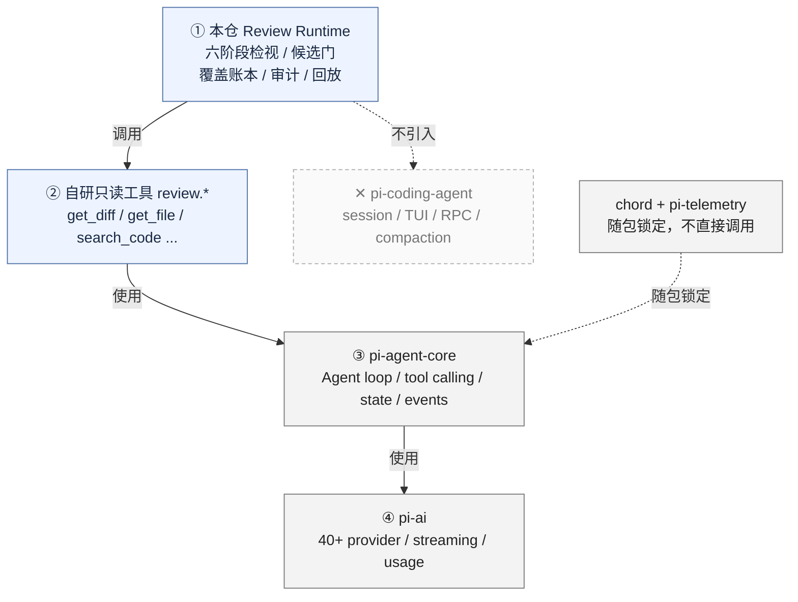

我们依赖前两层；另外两个包随四包成套锁定（`chord` 是服务组合运行时、`pi-telemetry` 是遥测契约），检视路径不直接调用。四包同版本、精确锁 `0.85.1`，**不引入 `pi-coding-agent`**。

| 包 | 我们用它做什么 | 刻意不用的部分 |
|---|---|---|
| `pi-ai` | provider 适配、流式事件、usage 字段、上下文溢出判断 | 与检视无关的 provider 特性 |
| `pi-agent-core` | `Agent`、tool calling、消息/状态模型、三个预定缝 | coding-agent 的 session/TUI/RPC |
| `chord` | 随四包成套锁定 | 检视路径不直接调用 |
| `pi-telemetry` | 随四包成套锁定 | 审计由本仓落盘，不接 exporter |

关键认知：**pi 提供的是“原语”，不是“产品”**。阶段、提示词、工具、候选门、覆盖账本、审计、回放全部在 `packages/review-pi` 里；内核默认零定制，确需修内核走 `pnpm patch`，不维护 fork（ADR-0035）。

### 3.3 为什么选 pi

| 候选 | 它的优势 | 为什么不选 / 什么条件下会改选 |
|---|---|---|
| DSH 内核 | everything-is-plugin，Runtime 可组合、可替换 | 我们的前提是“不做通用 Runtime 复用”（架构方案 §1.3）；插件化优势变不成产品收益，反而继承双客户端、SDK 协议冲突等包袱（ADR-0009） |
| 自研 harness | 完全可控 | provider 适配、流式、工具循环、usage 记账都要自己写；pi 已有且 MIT，自研是重复劳动 |
| **pi** | provider 面广、低层缝足够、TypeScript 原生、无 coding-agent 包袱 | 生态比通用 CLI 小；内核缺口要靠既有缝绕开 |
| Claude Agent SDK / OpenAI Agents SDK / Vercel AI SDK | 成熟、生态好、文档多 | 评估时更贴近单一模型厂商或 UI 流式场景；我们要 provider 中立 + 低层 loop 控制。**未做同条件横评，不作为定论** |

决策链是两次真实的架构迁移：ADR-0009 把 Runtime 从 DSH 迁到 pi（评测装置保留、Runtime 从 0 重写）；ADR-0035 再把 vendoring 改成 npm 依赖、发行面收为单包 `review-pi`。

### 3.4 可替代性：换得掉，但不是换一个 import

| 层 | 归属 | 换内核要做什么 |
|---|---|---|
| 阶段、提示词、候选门、覆盖账本、findings 契约 | 本仓 | 不动 |
| CLI、配置、审计、覆盖投影、回放编排 | 本仓 | 不动；trace 需重录 |
| Agent loop 组装 | `pi-agent-core` 的 `Agent` + 三个缝 | 换 `Agent` 实现，或按 `runAgentLoop` 自研控制器 |
| 流式调用 / provider 适配 | `provider/pi-client.ts` 的 `reviewStreamFn` | 重写适配层 |
| 工具调用协议 / 消息模型 | `pi-agent-core` | 映射到新内核的 schema 与消息 |
| usage / cache 记账 | `pi-ai` usage 字段 | 重做映射与断言（口径必须对齐） |
| 工具实现 | 本仓 `tools/*` | 不动（只要新内核能执行 tool call） |

结论：**产品语义可迁移，运行时接线要重做**。成本主要在适配层、trace 重录、请求字节/行为等价性验证；ADR-0009 的 DSH→pi 迁移就是这个成本的实证——评测装置和数据集留下来了，Runtime 重写了。

### 3.5 为什么自己写工具，不用 pi 自带工具

先澄清一个常见误解：**`pi-agent-core` 只提供 tool calling 机制，并不带检视工具**；带工具的是 `pi-coding-agent`，而它的工具是给“改代码”设计的（read / edit / bash / ls …），我们刻意不引入。

检视工具需要的性质，通用 coding 工具给不了或不该给：

| 需求 | 自研 `review.*` 的做法 | 通用 coding 工具的问题 |
|---|---|---|
| 只读 | `get_diff` / `get_file` / `search_code` / `get_symbol` / `find_references` / `get_call_chain` / `search_rule` / `search_history` | `edit` / `bash` 可写；检视不需要写权限 |
| 路径安全 | 拒绝绝对路径与 `..`，repo / skill pack 双 jail | 通用 read 往往接受任意路径 |
| 成本 | 行区间、字符预算、每文件条数上限、输出截断提示 | 整文件 / 整仓输出，token 不可控 |
| 确定性 | 固定排序、canonical 参数、固定零命中文案 | 输出随实现与环境漂移 |
| 可审计 | 每次调用进 Context Ledger 与审计 | 宿主日志格式不固定 |
| 可回放 | 工具 schema 与结果进 trace 哈希 | 难冻结 |
| 分片一致 | 读 head 侧快照，片内 diff 一致 | 读工作树可能跨片不一致 |

例外只有一处：规则 Skill 会话允许 `bash`，cwd 锁在 skill pack 根（ADR-0014），因为规则包可能带脚本；主检视会话没有 `bash`。skill 读包内文件走 `review.get_file` 的 `skill://` 回退（ADR-0107）。

### 3.6 和 Claude Code / Codex / OpenCode 配 Skill 比，差在哪

先限定：下表是截至 2026-11 的公开形态与我们的接入实践，**不是同条件横评**；这些产品迭代很快，具体能力以各自文档为准。

| 维度 | Claude Code | Codex CLI | OpenCode | ReviewAgent-pi |
|---|---|---|---|---|
| 形态 | 通用编码 Agent（产品） | 通用编码 Agent（开源 CLI） | 通用编码 Agent（开源、provider 中立） | **专用检视 Runtime（CLI）** |
| 流程 | 宿主 agent 自由推进，Skill / 提示词约束 | 同左 | 同左 | 固定阶段，每阶段结构化产出 |
| 工具面 | Read / Grep / Bash / Edit + MCP | shell / 文件 + MCP | 插件 / 自定义工具 | 自研只读 `review.*` |
| 产物 | 会话、补丁、评论 | 同左 | 同左 | findings + tips + 审计 + 覆盖账本 |
| 审计 / 回放 | 会话日志 | 会话日志 | 会话日志 | 请求级审计 + trace 回放 |
| 模型 | Claude 系为主 | OpenAI 系为主 | 多供应商 | pi-ai 多供应商，评测锁 DeepSeek 网关 |
| 规则形态 | Skills / 插件 | AGENTS.md / 插件 | 插件 / 规则 | Agent Skill（唯一形态） |

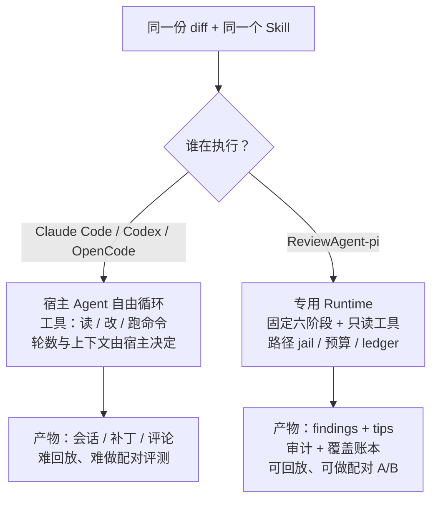

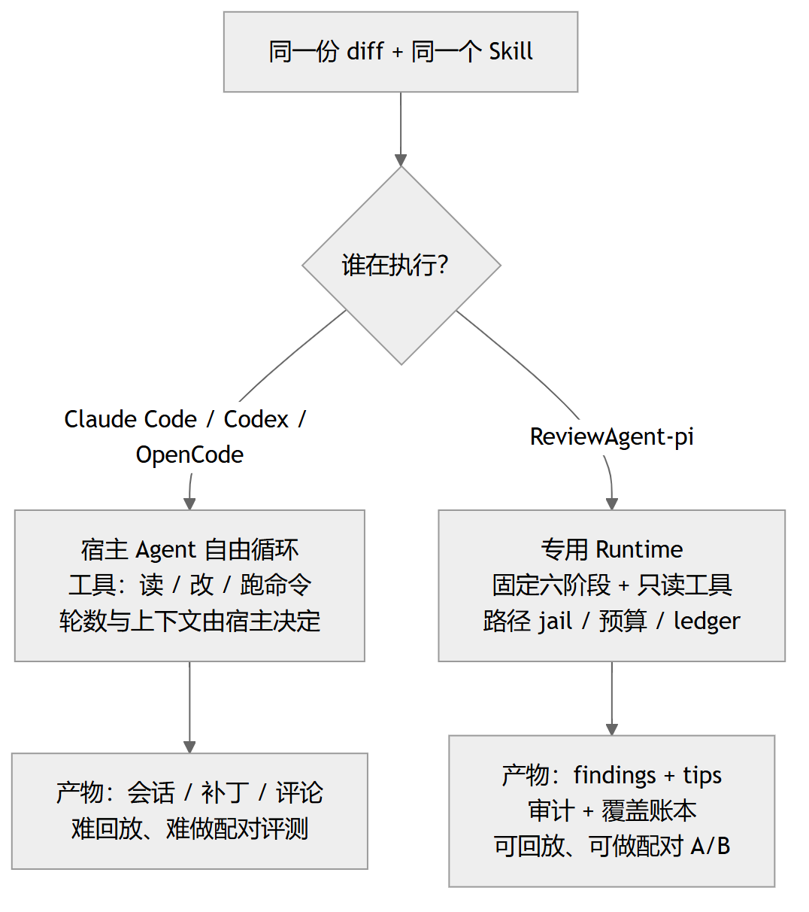

**优势**

1. **任务形状匹配**：检视是“读 → 判 → 取证”，不是“探索 → 改 → 跑”；固定阶段把轮数和工具面钉死。
2. **产物可进 CI**：findings / tips / coverage / audit 是契约，不是聊天记录。
3. **可回放、可评测**：同输入同配置可复现，能做配对 A/B，而不是“感觉这次好一点”。
4. **工具可控**：只读、路径 jail、预算、ledger，出了问题能定位到具体调用。

**代价**

1. 不是通用编码 Agent：不改代码、不跑测试、不做交互式结对。
2. 自建 Runtime 的维护成本、生态规模都不如通用 CLI。
3. 我们也提供 `skills/review-pi/`，让 Claude Code / Codex / OpenCode 调我们的 CLI——**Skill 负责“怎么用”，Runtime 负责“怎么审”**。只装 Skill 不装 CLI，得到的是宿主自己的检视行为，不是这套确定性流程。

> 一句话：通用 CLI + Skill 是“让一个聪明人按手册做事”；ReviewAgent 是“把这件事做成一条有质检工位的流水线”。前者上手快、边界宽；后者成本可控、产物可审计。

---

## 4. 总体架构

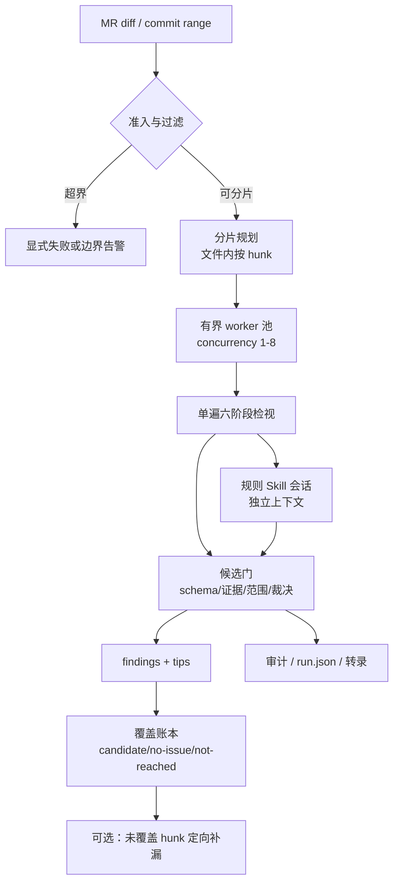

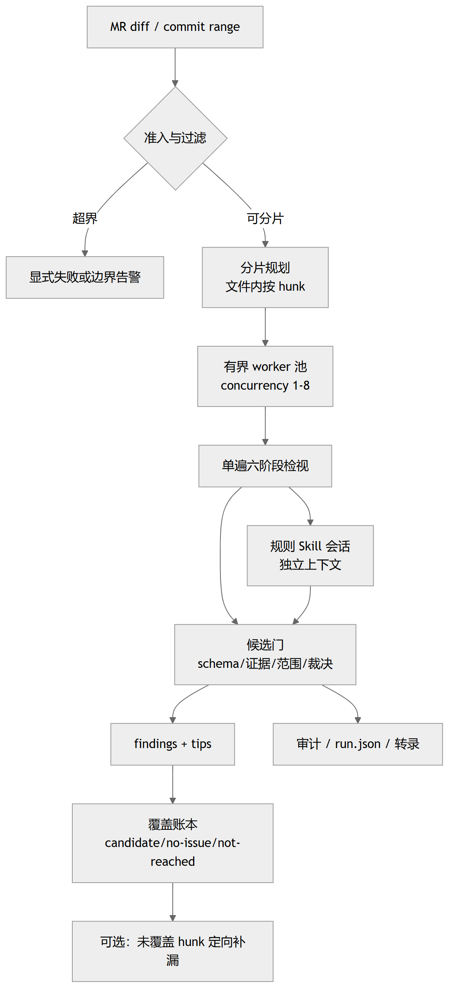

一个容易被忽略的点：**六阶段不是“提示词模板”，而是一个可观测状态机**。每个阶段的请求数、解析失败、恢复来源、备注都进 `phaseLog`；没有这些，后面的“阶段压缩是否有效”根本无法判断。

---

## 5. 七个核心机制：问题 → 技巧 → 代价

| 机制 | 解决的问题 | 技巧 | 代价 / 边界 |
|---|---|---|---|
| 六阶段骨架 | 让模型先理解、再取证、再下结论 | 固定回合边界 + 每阶段机器可读产出 | 每单元固定 6 个请求，Phase 2 一度是死阶段 |
| 分片 + 有界并行 | 大 MR 串行太慢 | 按 hunk 切片、worker 池、片序聚合 | 请求数不变，缓存命中下降；并发过高有 429 风险 |
| 覆盖账本 | “审完了”但没有记录哪些 hunk 没看 | 文件 × hunk 三态 + 缺口补漏 | 补漏本身有成本，候选精度不稳 |
| 证据接地 | 模型编造行号/引文 | 用 head 侧全文做确定性匹配 | 措辞改写会误判 unverified；drop 会误杀 |
| 独立证伪 | 同一会话自审几乎全通过 | 新会话 + 只给片段 + fail-open | 片段不足时大量 uncertain，收益有限 |
| 检索预算 | Phase 4 重复读、零命中搜索 | 工具层计数 + 跳过提示 + 审计 | 阈值过紧会伤 recall |
| 离线 replay | 改提示词后无法回归 | 请求哈希 trace + 冻结场景 | 提示词/工具 schema 一改就要重录 |

下面挑三个最值得讲的展开。

---

## 6. 深潜一：分片并行——先证明“不变”，再证明“变快”

### 6.1 问题

大 MR 在旧版会因为 `maxDiffChars` 在分片规划之前判定而被整条跳过；即便不跳过，5 片串行也要 1266s。OCR 用 8 组并发做到 242s。

### 6.2 设计

- `limits.split.concurrency`：1–8，默认 1；
- 固定 N 个 worker 共享递增片号；
- `ExecutedPass[]` 始终按 descriptor 顺序返回，完成顺序不影响聚合；
- 片级回调（平台上报、报文生成）排队后按片序串行执行；
- 请求时间线用 AsyncLocalStorage 隔离，避免并行片互相覆盖；
- 失败时记录最低片号，停止派发新片，等待在飞片结束。

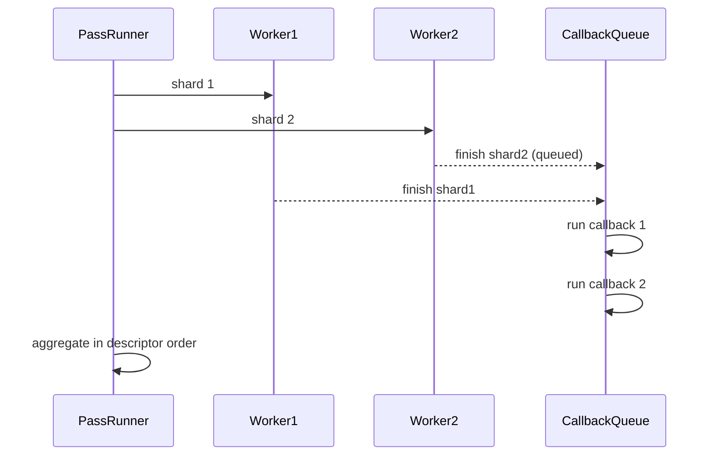

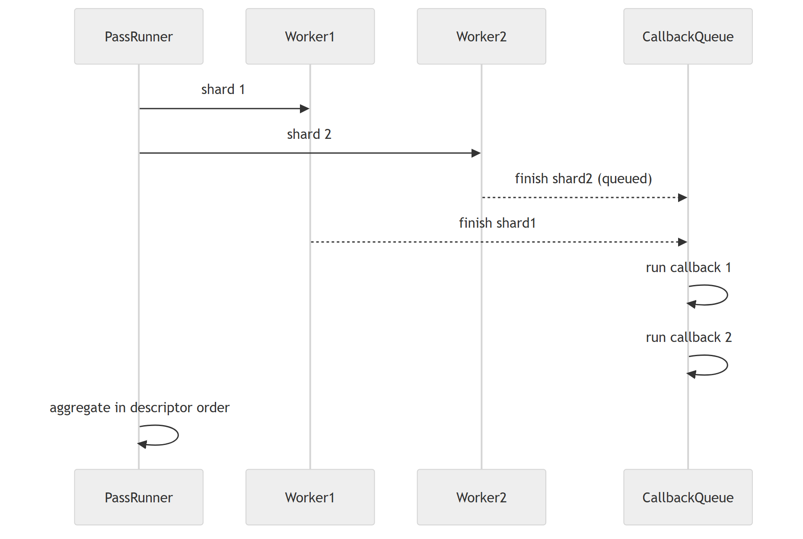

### 6.3 结果

| 样本 | 片数 | 串行 | 并行 c=3 | 加速 |
|---|---:|---:|---:|---:|
| immich | 6 | 1091.9s | 603.4s | 1.81× |
| elasticsearch | 7 | 1288.3s | 513.1s | 2.51× |
| typescript-go | 9 | 2918.7s | 995.3s | 2.93× |
| 合计 | 22 | 5298.9s | 2111.8s | **2.51×** |

429：两批均为 0。token 并行高约 40%，主要是 cache_read 与 live 采样差异，不是调度改变了请求字节。

### 6.4 经验

并行是**延迟特性**，不是质量特性。要证明它没有改变结果，必须用同一 trace 的 replay 做逐字节等价；live A/B 只能证明墙钟和限流安全。

---

## 7. 深潜二：覆盖账本——把“没审到”变成可见状态

### 7.1 问题

历史归因显示：我们漏掉的 GT 中，**56.8% 所在文件没有任何意见**。这不是“判错”，是“没看到”。流程却可以正常 `complete`。

### 7.2 设计

每个 hunk 进入三种状态之一：

| 状态 | 含义 | 来源 |
|---|---|---|
| `candidate` | 至少有一个候选命中该 hunk | 主检视 / 规则 Skill / 补漏 |
| `no-issue` | 模型明确检查后判断无问题 | 阶段产出 + 证据 |
| `not-reached` | 没有被任何候选覆盖 | 账本推断 |

`run.json` 投影 `coverageSummary`：counts、ratios、byCause；逐 hunk 明细留在审计文件。可选补漏只对 `not-reached` 发请求，且每个 pass 有请求数、字符数、hunk 数三重上限。

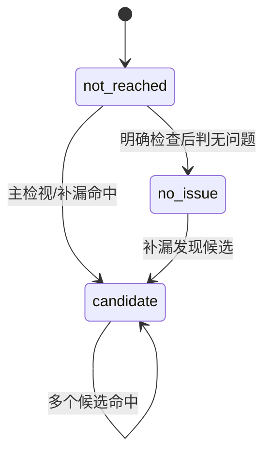

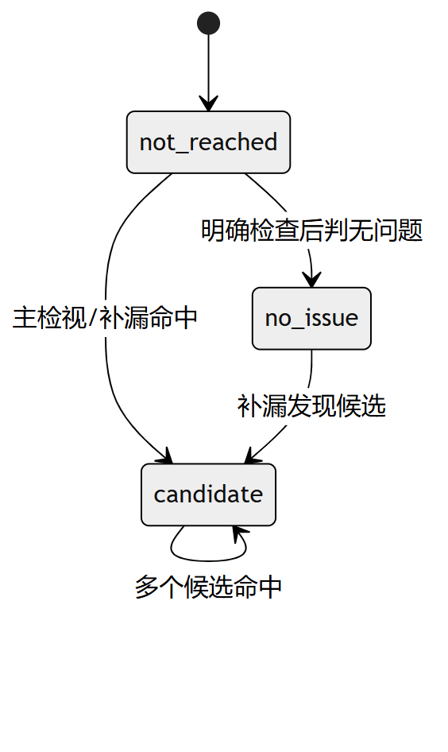

### 7.3 结果与边界

- 零模型账本在 iterF91 上 91/91 可算，22,266 个 hunk；
- 补看能把 `not-reached` 从 89.9% 降到 17.5%，但补看候选的原始精度只有约 26%–31%，要靠验证门捞回；
- 默认关闭；20 例复评 B 提升不显著、墙钟 +30%。

**账本的价值首先是“可观测”，其次才是“补漏”。** 如果只把账本当补漏开关，会高估收益。

### 7.4 历史对照：上下文策略与补看三版

覆盖账本解决“没看”，但“看多少”本身也会影响噪声与召回。Phase 2 在 VUL4J 30 个单缺陷 MR 上做过 A–E 五种配置、每种 3 次复本（450 单元），judge 口径如下：

| 配置 | 上下文 | P | R | B | token/单元 | 零 finding |
|---|---|---:|---:|---:|---:|---:|
| A 零工具 | 仅 MR diff | 72.3% | **50.1%** | 55.2% | **22.6k** | 5/90 |
| B 零工具 + 确定性预取 | diff + 符号/引用/调用链 | **78.3%** | 46.7% | **57.6%** | 49.9k | 10/90 |
| C 全仓注入 | 整个仓库 | 63.5% | **13.4%** | 57.1% | **706.5k** | **69/90（77%）** |
| D 多轮自主检索 | 模型自选工具 | 72.3% | 29.2% | 62.6%* | — | 48/90 |
| E D + 覆盖账本 | 自主检索 + 账本 | 56.9% | 23.6% | 52.0% | — | 55/90 |

`B = 2PR/(P+R)`；D 的 F1 名义最高但跨侧不稳定，不作为稳定对照；E 在 D 上加账本后召回三侧一致下降。

- **C 全仓注入**：召回最低、77% 单元零 finding、token 为 A 的 31 倍——“看得多”直接把模型淹没；
- **A 仅 diff**：召回最高、token 最低，说明检视的真实信息需求很窄；
- **B 确定性预取**：精度与 F1 最高，但召回比 A 低 3.4pp、token 为 A 的 2.2 倍，是“用召回换精度”；
- **D/E 多轮 + 账本**：没有质量优势，只增加 token；账本本身不是噪声解药。

补看三版（iterB10，10 例）：

| 版本 | P | R | B | 关键变化 |
|---|---:|---:|---:|---|
| 不补看 | 50.0% | 31.6% | 38.7% | 基线 |
| v1 | 44.9% | 35.8% | 39.8% | 召回涨、精度掉 |
| v2 | 43.9% | 43.2% | 43.5% | `no-issue` 必须带证据，召回 +11.6pp、精度 −6.1pp |
| v3 | **52.2%** | **40.0%** | **45.3%** | 补看候选再过验证门：26 请求 / 拒 17 / 收 9，召回 +8.4pp、精度 +2.2pp、B +6.6pp |

> 边界：10 例；20 例复评 B 仅 +3.65pp、95% CI 跨 0、墙钟 +30%，因此 `coverage.repair` 默认关闭。

硬筛同样不成立：F-04 把 103 条 unverified 全删，P +4.7pp 但 R −6.3pp、B −4.3pp；置信度 0.5 会砍 26 条含 6 条 TP。噪声治理的前提是“不误杀”。

---

## 8. 深潜三：证据接地与独立证伪——两道门，两种失败

### 8.1 证据接地（确定性）

对每个候选，用 head 侧全文核对：

1. 文件在 diff 里；
2. 行号在文件范围内；
3. evidence 片段能匹配（整段逐字，或去掉省略号后按窗口匹配）。

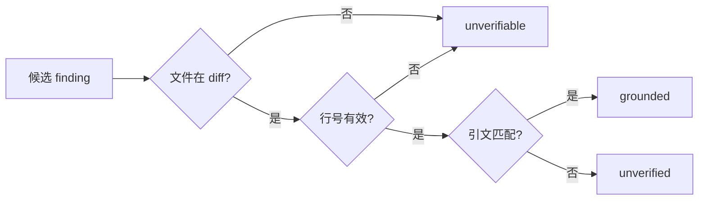

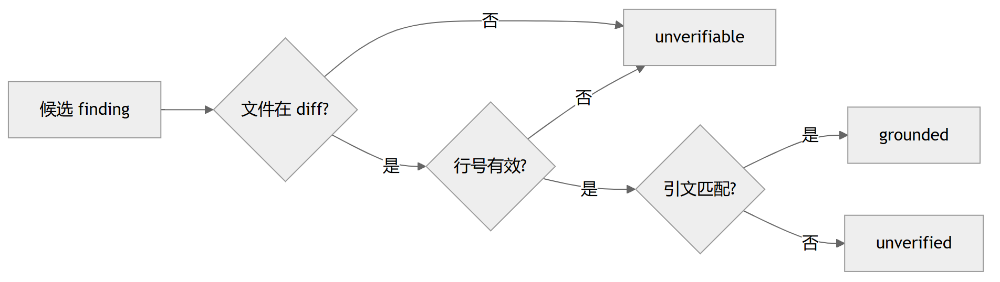

历史 320 条 findings：grounded 217 / unverified 103。若直接 `drop`，会丢掉约 32% 的真值——所以默认只 `warn`，不拒绝。

### 8.2 独立证伪（语义）

对每条候选开一次新会话，只给 finding + 行号附近 80 行片段，要求 `pass/reject/uncertain`；失败/空回包/解析失败都 fail-open 为 uncertain。

回放 103 条 unverified：

| 模型 | pass | reject | uncertain | pass 精度 | 覆盖 GT |
|---|---:|---:|---:|---:|---:|
| flash | 44 | 2 | 57 | 34.1% | 17/39 |
| pro | 54 | 0 | 49 | 33.3% | 21/39 |

结论：**reject 太少，不能当 drop 门；pass 有弱区分度，但单次 80 行片段不足**。瓶颈是证据窗口，不是模型档位。

---

## 9. 实验方法：为什么我们最后不信“小样本 + 单次”

我们一度在小样本上得到非常漂亮的结果：

- S20 compact：B 35.4% vs off 25.8%，请求 −12%，token −5%，ΔB 的 bootstrap 95% CI 跨出 0。

但全量 iterF91（91 条 / 588 GT）结果是：

| 指标 | 当前默认实验 | v3 baseline |
|---|---:|---:|
| Precision | 36.0% | 38.1% |
| Recall | 17.7% | 24.5% |
| Balanced | **23.7%** | **29.8%** |
| token | 60.77M | 53.10M |

ΔB = −4.6pp，95% CI [−8.3, −1.1]，显著负向。分 GT 规模看：GT≤2 的样本 11→13，GT 3–5 的 35→23，GT>5 的 76→59。**小样本的收益是真的，但它不能外推到中大型 MR。**

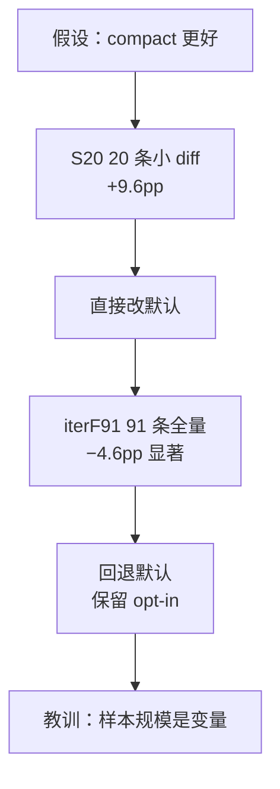

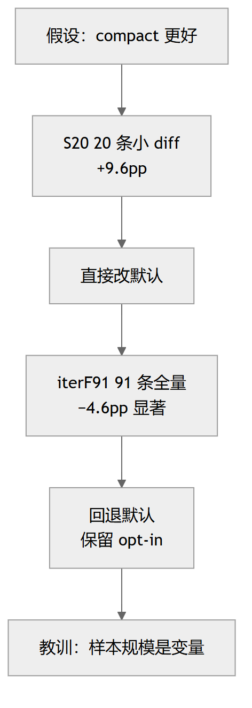

这条负结果链路本身是项目最有价值的资产之一：它迫使我们把“实验方法学”也做成任务（成对多 run + bootstrap CI + token/墙钟/工具一起报），而不是继续用单次运行下结论。

### 9.1 所有省 token 的策略（和它们的边界）

成本可以拆成四个乘子：**上下文基数 × 轮数 × 计价 × 输出/工具浪费**。我们的策略分别压其中一项：

| 杠杆 | 策略 | 省在哪 | 现状 |
|---|---|---|---|
| 基数 | diff-first，按需取符号/引用 | 不默认全仓注入 | 开 |
| 基数 | 工具结果 8k 字符上限、行边界截断 | 单次结果 ≈2k token | 开 |
| 基数 | 搜索封顶（每文件 20 / 全局 50 / 单行 200 字符） | 防一次搜索灌满上下文 | 开 |
| 轮数 | 六阶段 + 每阶段单一 JSON | 禁止自由长文，路径有界 | 开 |
| 轮数 | `maxRounds = 3`、工具调用硬上界 | 轮数是线性放大器，必须有顶 | 开 |
| 单价 | 稳定前缀 + append-only 消息 | 缓存命中按约 1/30 计价 | 开 |
| 单价 | Context Ledger | 重复读取返回引用，不返原文 | 开 |
| 浪费 | 证据门 / 空回包重试 / 窗口预算 | 少返工、少 400 | 开 |
| 实验 | 检索预算 3/4/40 万 | S20 token −12% | 0（off） |
| 实验 | 阶段压缩 | S20 请求 −12%、token −5% | off（全量回退） |
| 非 token | 分片 + 并发 | 省墙钟，不省 token | 开 / 可配 |

关键数字：Phase 2 上 A（仅 diff）22.6k token/单元、C（全仓）706.5k（31 倍）、B（确定性预取）49.9k（C 的 7%）；cacheHit B 0.8114 vs A 0.3678。但 compact + 预算的组合在全量上是 60.77M vs 53.10M（+14%）、ΔB −4.6pp，所以默认只保留确定不伤质量的项。

---

## 10. 审计与回放：让“改提示词”不再是盲改

每次 run 落盘：

| 产物 | 内容 | 用途 |
|---|---|---|
| 审计 JSON | 请求字节、工具调用、阶段记录、拒绝链、usage | 复盘、对账、回放 |
| run.json | findings、轮次、usage、覆盖摘要、过滤计数 | 产品消费与 CI |
| 转录 | 会话消息与工具结果 | 人工定位 |
| 请求时间线 | 首字、流时长、断流、错误 | 延迟归因 |

离线 replay 用请求哈希匹配 trace；任何提示词/工具 schema 改动都会让旧 trace 失效。我们在 F-07 改提示词后就踩过一次：6 个场景全 FAIL。处理方式不是“关掉 replay”，而是重录 trace，并把 `stageCompression` 冻进场景，确保回放的是录制时那一版行为。

---

## 11. 设计取舍清单

| 决策 | 选择 | 不选 | 原因 |
|---|---|---|---|
| 大 MR | 分片 + 有界并行 | 整条跳过 / 单遍硬扛 | 容量与延迟 |
| 覆盖率 | 账本 + 定向补漏 | 全量二次扫描 | 请求数可控 |
| 证据 | 确定性接地 + 可选独立证伪 | 只靠模型自审 | 可核对、可审计 |
| 默认值 | 失败实验回退 opt-in | 为小样本收益改默认 | 全量负结果 |
| 提示词 | 规则 Skill 独立会话 | 把规则塞进主提示词 | 注意力置换真实存在 |
| 评测 | 成对多 run + CI | 单次 P/R/B | 运行方差 10–14pp |

---

## 12. 结语

这个项目最值得分享的不是“六阶段”本身，而是三件事：

1. **每个机制都要能回答“解决哪个可度量的问题”**；答不上来的阶段（Phase 2）就应该合并或删除。
2. **确定性、可审计、可回滚**比单次指标更重要；它们决定了你能不能从失败实验里学到东西。
3. **负结果要归档**。S20 的 +9.6pp 和全量的 −4.6pp 同时存在，才是真实的工程结论。

> 代码与实验数据分别在 `packages/review-pi/` 与 `bench/experiments/`；本文所有数字均来自仓库归档，未做二次修饰。
