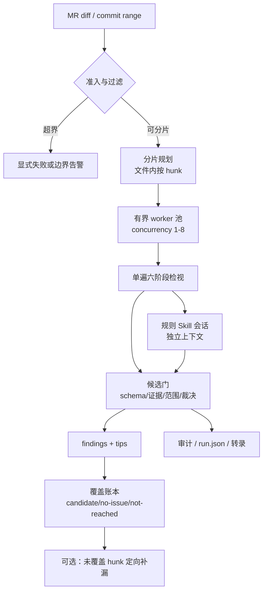
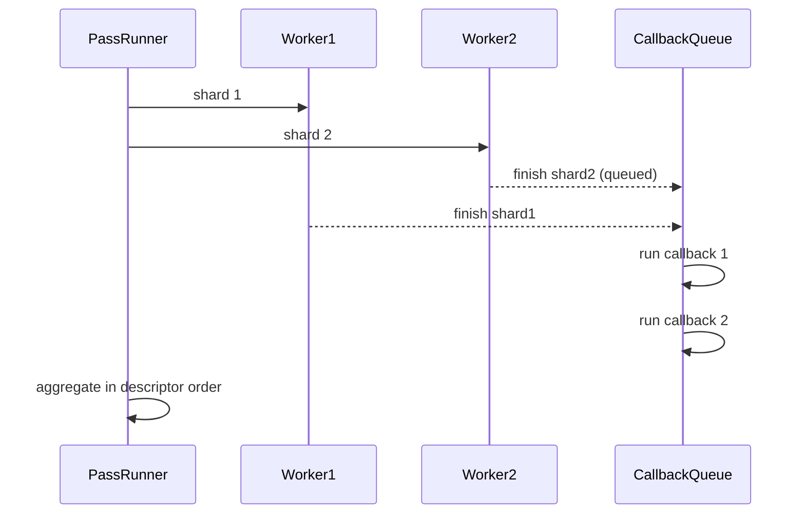
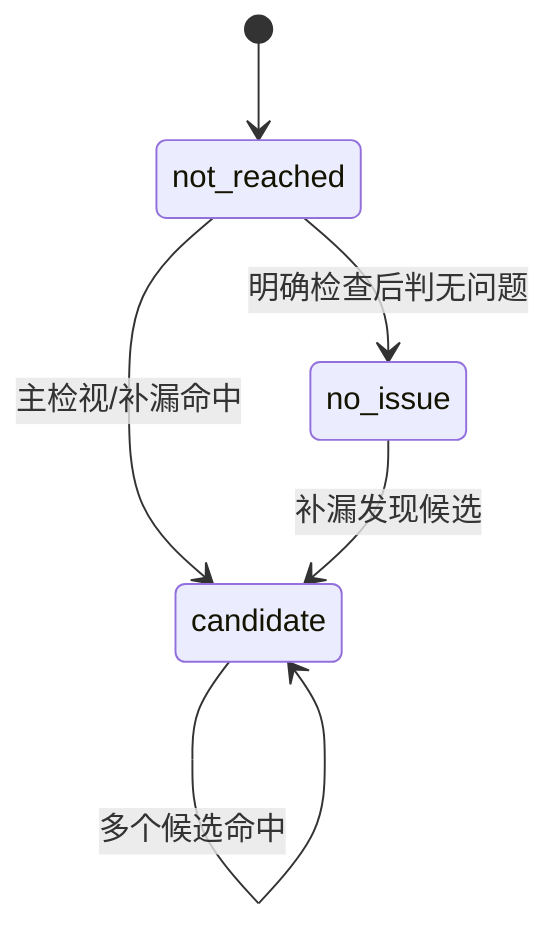
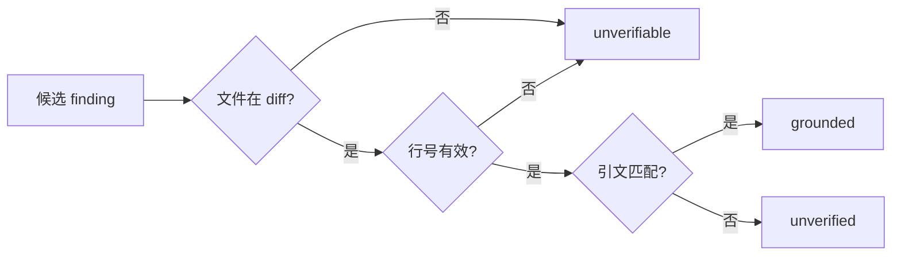
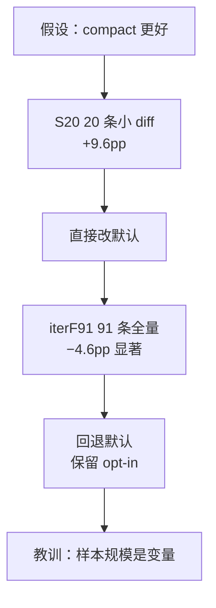

# 从六阶段到可审计流水线：ReviewAgent-pi 的检视内核设计与负结果复盘

> 面向架构师 / 资深工程师的技术分享。重点不是“我们做了多少功能”，而是**每个机制解决哪一个可度量的问题、代价是什么、什么时候不成立**。

---

## 1. 项目定位：一次 MR 检视，产出可核对的证据链

ReviewAgent-pi 是运行在 pi 内核上的代码检视 CLI。它的产品形态很克制：

- 输入：一次合并请求的 diff（或一个提交范围）；
- 输出：`reviews_en.json`（英文 findings）+ `reviews_tips_zh.json`（中文按行分组的建议）；
- 副作用：完整审计（每条请求、每次工具调用、每个阶段的阶段记录、usage）；
- 规则能力：以 Agent Skill 的形式加载，而不是硬编码在提示词里。

它的设计约束和很多“AI Review”产品不同：

| 约束 | 具体要求 | 带来的设计后果 |
|---|---|---|
| 确定性 | 同一输入 + 同一配置 → 同一分片计划、同一分母、同一预取包 | 所有“计划类”逻辑必须可离线复现 |
| 可审计 | 每个观点要能回到文件、行号、引文 | 证据 schema + 接地检查 + 独立核验 |
| 可回滚 | 每个优化独立开关、独立 ADR | 失败实验只回退默认值，不删机制 |
| 不追榜 | 不为 benchmark recall 放开风格/测试类噪声 | 很多“能提分”的提示词被主动拒绝 |
| 成本可见 | token、墙钟、工具调用、阶段请求数一起报 | 单看 P/R/B 的结论一律不作为验收 |

---

## 2. 总体架构

一个容易被忽略的点：**六阶段不是“提示词模板”，而是一个可观测状态机**。每个阶段的请求数、解析失败、恢复来源、备注都进 `phaseLog`；没有这些，后面的“阶段压缩是否有效”根本无法判断。

---

## 3. 七个核心机制：问题 → 技巧 → 代价

| 机制 | 解决的问题 | 技巧 | 代价 / 边界 |
|---|---|---|---|
| 六阶段骨架 | 让模型先理解、再取证、再下结论 | 固定回合边界 + 每阶段机器可读产出 | 每单元固定 6 个请求，Phase 2 一度是死阶段 |
| 分片 + 有界并行 | 大 MR 串行太慢 | 按 hunk 切片、worker 池、片序聚合 | 请求数不变，缓存命中下降；并发过高有 429 风险 |
| 覆盖账本 | “审完了”但没有记录哪些 hunk 没看 | 文件 × hunk 三态 + 缺口补漏 | 补漏本身有成本，候选精度不稳 |
| 证据接地 | 模型编造行号/引文 | 用 head 侧全文做确定性匹配 | 措辞改写会误判 unverified；drop 会误杀 |
| 独立证伪 | 同一会话自审几乎全通过 | 新会话 + 只给片段 + fail-open | 片段不足时大量 uncertain，收益有限 |
| 检索预算 | Phase 4 重复读、零命中搜索 | 工具层计数 + 跳过提示 + 审计 | 阈值过紧会伤 recall |
| 离线 replay | 改提示词后无法回归 | 请求哈希 trace + 冻结场景 | 提示词/工具 schema 一改就要重录 |

下面挑三个最值得讲的展开。

---

## 4. 深潜一：分片并行——先证明“不变”，再证明“变快”

### 4.1 问题

大 MR 在旧版会因为 `maxDiffChars` 在分片规划之前判定而被整条跳过；即便不跳过，5 片串行也要 1266s。OCR 用 8 组并发做到 242s。

### 4.2 设计

- `limits.split.concurrency`：1–8，默认 1；
- 固定 N 个 worker 共享递增片号；
- `ExecutedPass[]` 始终按 descriptor 顺序返回，完成顺序不影响聚合；
- 片级回调（平台上报、报文生成）排队后按片序串行执行；
- 请求时间线用 AsyncLocalStorage 隔离，避免并行片互相覆盖；
- 失败时记录最低片号，停止派发新片，等待在飞片结束。

### 4.3 结果

| 样本 | 片数 | 串行 | 并行 c=3 | 加速 |
|---|---:|---:|---:|---:|
| immich | 6 | 1091.9s | 603.4s | 1.81× |
| elasticsearch | 7 | 1288.3s | 513.1s | 2.51× |
| typescript-go | 9 | 2918.7s | 995.3s | 2.93× |
| 合计 | 22 | 5298.9s | 2111.8s | **2.51×** |

429：两批均为 0。token 并行高约 40%，主要是 cache_read 与 live 采样差异，不是调度改变了请求字节。

### 4.4 经验

并行是**延迟特性**，不是质量特性。要证明它没有改变结果，必须用同一 trace 的 replay 做逐字节等价；live A/B 只能证明墙钟和限流安全。

---

## 5. 深潜二：覆盖账本——把“没审到”变成可见状态

### 5.1 问题

历史归因显示：我们漏掉的 GT 中，**56.8% 所在文件没有任何意见**。这不是“判错”，是“没看到”。流程却可以正常 `complete`。

### 5.2 设计

每个 hunk 进入三种状态之一：

| 状态 | 含义 | 来源 |
|---|---|---|
| `candidate` | 至少有一个候选命中该 hunk | 主检视 / 规则 Skill / 补漏 |
| `no-issue` | 模型明确检查后判断无问题 | 阶段产出 + 证据 |
| `not-reached` | 没有被任何候选覆盖 | 账本推断 |

`run.json` 投影 `coverageSummary`：counts、ratios、byCause；逐 hunk 明细留在审计文件。可选补漏只对 `not-reached` 发请求，且每个 pass 有请求数、字符数、hunk 数三重上限。

### 5.3 结果与边界

- 零模型账本在 iterF91 上 91/91 可算，22,266 个 hunk；
- F-01b v3（带验证门）：P 0.522 / R 0.400 / B 0.453，对比 arm A B 0.387；
- 但补漏候选精度大约只有 26.7%，且默认关闭；全量复评时 B 提升不显著、墙钟 +30%。

**账本的价值首先是“可观测”，其次才是“补漏”。** 如果只把账本当补漏开关，会高估收益。

---

## 6. 深潜三：证据接地与独立证伪——两道门，两种失败

### 6.1 证据接地（确定性）

对每个候选，用 head 侧全文核对：

1. 文件在 diff 里；
2. 行号在文件范围内；
3. evidence 片段能匹配（整段逐字，或去掉省略号后按窗口匹配）。

历史 320 条 findings：grounded 217 / unverified 103。若直接 `drop`，会丢掉约 32% 的真值——所以默认只 `warn`，不拒绝。

### 6.2 独立证伪（语义）

对每条候选开一次新会话，只给 finding + 行号附近 80 行片段，要求 `pass/reject/uncertain`；失败/空回包/解析失败都 fail-open 为 uncertain。

回放 103 条 unverified：

| 模型 | pass | reject | uncertain | pass 精度 | 覆盖 GT |
|---|---:|---:|---:|---:|---:|
| flash | 44 | 2 | 57 | 34.1% | 17/39 |
| pro | 54 | 0 | 49 | 33.3% | 21/39 |

结论：**reject 太少，不能当 drop 门；pass 有弱区分度，但单次 80 行片段不足**。瓶颈是证据窗口，不是模型档位。

---

## 7. 实验方法：为什么我们最后不信“小样本 + 单次”

我们一度在小样本上得到非常漂亮的结果：

- S20 compact：B 35.4% vs off 25.8%，请求 −12%，token −5%，ΔB 的 bootstrap 95% CI 跨出 0。

但全量 iterF91（91 条 / 588 GT）结果是：

| 指标 | 当前默认实验 | v3 baseline |
|---|---:|---:|
| Precision | 36.0% | 38.1% |
| Recall | 17.7% | 24.5% |
| Balanced | **23.7%** | **29.8%** |
| token | 60.77M | 53.10M |

ΔB = −4.6pp，95% CI [−8.3, −1.1]，显著负向。分 GT 规模看：GT≤2 的样本 11→13，GT 3–5 的 35→23，GT>5 的 76→59。**小样本的收益是真的，但它不能外推到中大型 MR。**

这条负结果链路本身是项目最有价值的资产之一：它迫使我们把“实验方法学”也做成任务（成对多 run + bootstrap CI + token/墙钟/工具一起报），而不是继续用单次运行下结论。

---

## 8. 审计与回放：让“改提示词”不再是盲改

每次 run 落盘：

| 产物 | 内容 | 用途 |
|---|---|---|
| 审计 JSON | 请求字节、工具调用、阶段记录、拒绝链、usage | 复盘、对账、回放 |
| run.json | findings、轮次、usage、覆盖摘要、过滤计数 | 产品消费与 CI |
| 转录 | 会话消息与工具结果 | 人工定位 |
| 请求时间线 | 首字、流时长、断流、错误 | 延迟归因 |

离线 replay 用请求哈希匹配 trace；任何提示词/工具 schema 改动都会让旧 trace 失效。我们在 F-07 改提示词后就踩过一次：6 个场景全 FAIL。处理方式不是“关掉 replay”，而是重录 trace，并把 `stageCompression` 冻进场景，确保回放的是录制时那一版行为。

---

## 9. 设计取舍清单

| 决策 | 选择 | 不选 | 原因 |
|---|---|---|---|
| 大 MR | 分片 + 有界并行 | 整条跳过 / 单遍硬扛 | 容量与延迟 |
| 覆盖率 | 账本 + 定向补漏 | 全量二次扫描 | 请求数可控 |
| 证据 | 确定性接地 + 可选独立证伪 | 只靠模型自审 | 可核对、可审计 |
| 默认值 | 失败实验回退 opt-in | 为小样本收益改默认 | 全量负结果 |
| 提示词 | 规则 Skill 独立会话 | 把规则塞进主提示词 | 注意力置换真实存在 |
| 评测 | 成对多 run + CI | 单次 P/R/B | 运行方差 10–14pp |

---

## 10. 结语

这个项目最值得分享的不是“六阶段”本身，而是三件事：

1. **每个机制都要能回答“解决哪个可度量的问题”**；答不上来的阶段（Phase 2）就应该合并或删除。
2. **确定性、可审计、可回滚**比单次指标更重要；它们决定了你能不能从失败实验里学到东西。
3. **负结果要归档**。S20 的 +9.6pp 和全量的 −4.6pp 同时存在，才是真实的工程结论。

> 代码与实验数据分别在 `packages/review-pi/` 与 `bench/experiments/`；本文所有数字均来自仓库归档，未做二次修饰。
