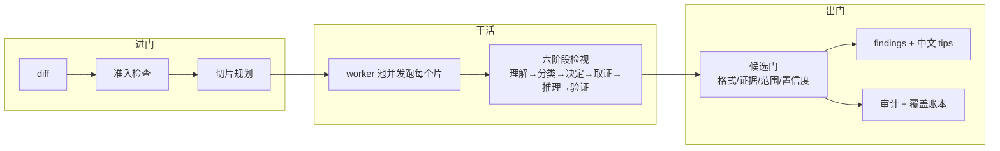
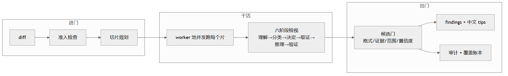
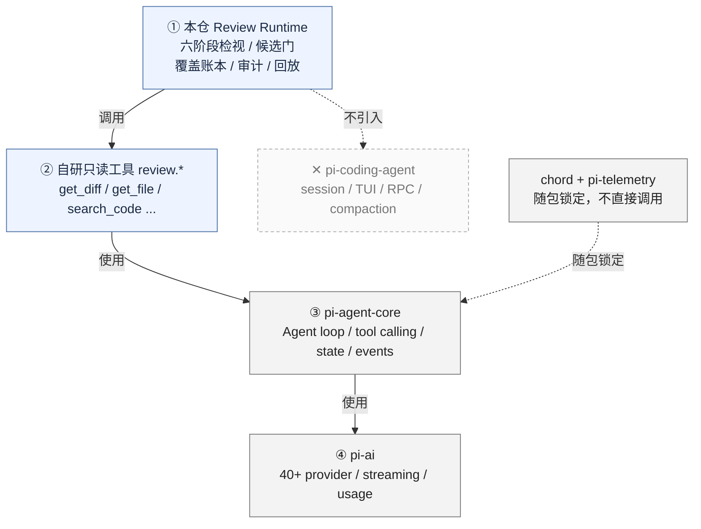
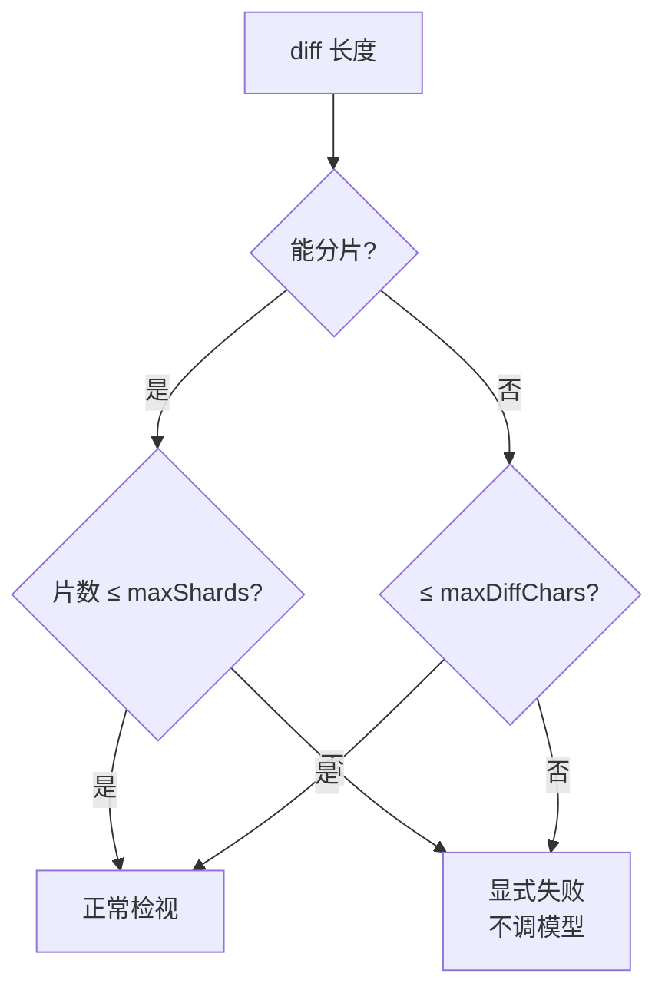
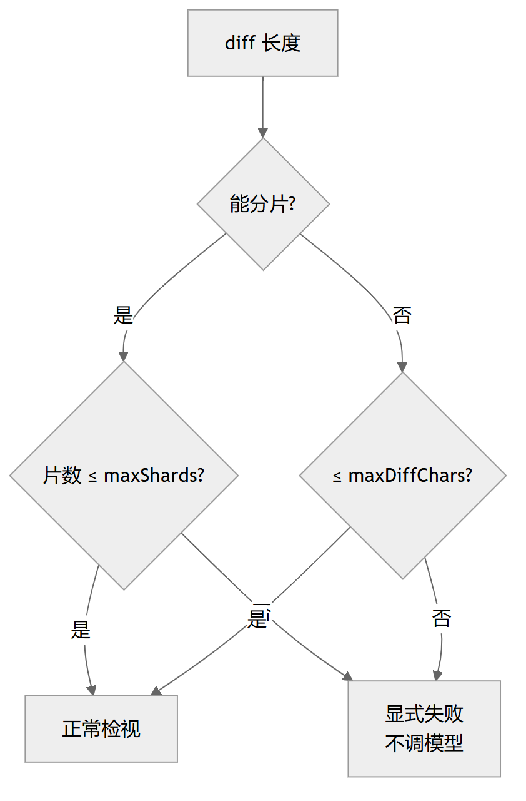
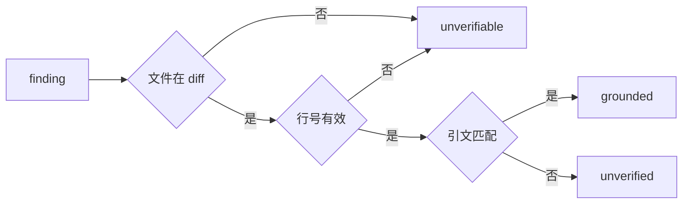
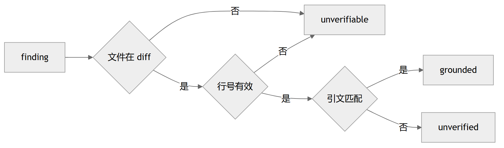
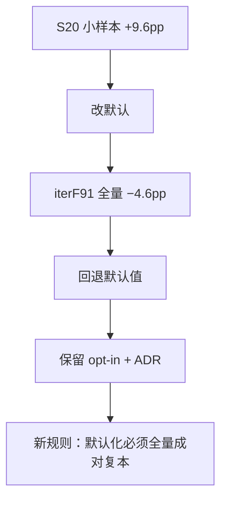
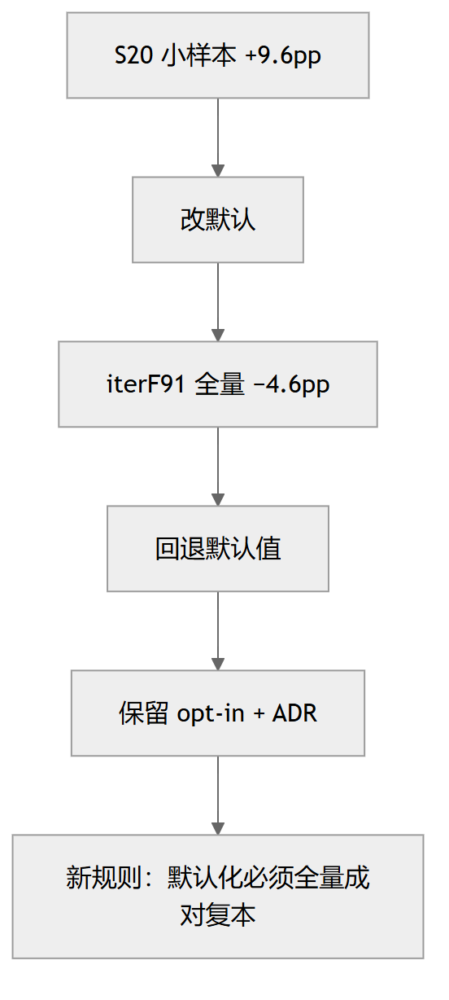

# 我们给 AI 代码检视器做了一年“体检”：哪些招数真有效，哪些只是自我感觉良好

> 团队技术博客体。写给同样在做 AI Review / Agent 工具链的同学：不讲宏大叙事，只讲我们踩过的坑、留下的机制，以及一堆**打脸但有用**的数字。

---

## 0. 一句话背景

我们做了一个代码检视 CLI：给一次 MR 的 diff，它输出若干条带文件、行号、证据的建议。模型走网关，每条建议要能被人核对。我们花了很长时间优化“检视流程”本身——不是换更大的模型，而是改流程。

一年下来最深的感受是：

> **在 LLM 应用里，最贵的不是 token，是“你以为有效”的错觉。**

下面是我们用来对抗这种错觉的几件工具，以及它们各自翻过的车。

---

## 1. 先看全景：一条 diff 进去，发生了什么





这条链路上每个方框都对应一个**曾经出过问题**的地方：

| 方框 | 曾经的问题 | 现在的做法 |
|---|---|---|
| 准入检查 | 大 MR 直接报“跳过”，用户以为审过了 | 先分片，再判容量；超上限显式失败 |
| 切片规划 | 整个文件塞不进去 | 文件内按 hunk 切，片数有上限 |
| worker 池 | 大 MR 串行 20 分钟 | 1–8 并发，默认保守 |
| 六阶段 | 模型上来就给结论，证据靠编 | 固定阶段边界，每阶段交结构化产出 |
| 候选门 | 行号越界、引文不存在 | 确定性接地 + 范围检查 |
| 覆盖账本 | 不知道哪些 hunk 根本没看 | 三态账本，缺口可补 |

---

## 2. 两条主线：精准判断，低耗运行

内部衡量这个工具，其实只用两句话：

- **精准判断**：提的每条意见，人能翻到原文核对；没提的地方，能说清是“看过没问题”还是“根本没看”。
- **低耗运行**：知道钱花在哪，只在确定不伤质量的地方省；省不动的，就承认省不动。

| 目标 | 我们做了啥 | 效果 | 代价 | 现在默认 |
|---|---|---|---|---|
| 精准 | 证据三件套核对 | 217/320 对得上；103 条存疑只标记 | 噪声仍在 | `warn` |
| 精准 | hunk 点名册 | 22,266 个 hunk 全部有状态 | 补看四条里三条是废话 | 账本开，补看关 |
| 精准 | 找另一个 AI 复核 | 它几乎不说“错” | 当不了删除门 | 不接 |
| 低耗 | 四个数一起报 | 能看出“更快但更贵” | 报告更长 | 固定口径 |
| 低耗 | 空答案自动重试 | 13/103 失败 → 0 | 偶尔多一次调用 | 开 |
| 低耗 | 合并工位 / 限制读文件 | 小样本省 12% 请求 | 全量 −4.6pp / 收益不显著 | 都回退了 |

最后一行是重点：**我们不是“省成功了”，而是建立了“省不成功就回退”的机制。** 低耗不是一句口号，而是三件事：成本可度量、默认值保守、改默认要过大考。

---

## 3. 为什么是 pi？为什么工具都自己写？

### 3.1 我们只用了 pi 的两层

pi 上游是分层的：




| 层 | 提供什么 | 我们用不用 |
|---|---|---|
| `pi-ai` | 统一 40+ provider 的 LLM API、流式、usage | **用** |
| `pi-agent-core` | Agent loop、tool calling、state、events | **用** |
| `pi-coding-agent` | 完整 coding CLI（session / TUI / RPC / compaction） | **不用** |
| `chord` / `pi-telemetry` | 服务组合运行时 / 遥测契约 | 随包锁定，检视路径不直接调用 |

四个包同版本、精确锁 `0.85.1`，从 npm 直接装。**我们没有选“整车”**：coding-agent 那套 session、TUI、RPC 跟检视没关系，引进来只会多一层要维护的东西。

一句话概括分工：**pi 提供发动机和变速箱，检视流程、工具、仪表盘、行车记录仪都是我们自己造的。**

### 3.2 为什么不是 DSH、不是自己写

- **不是 DSH**：DSH 的强项是“everything is a plugin”、Runtime 可以复用到很多 Agent。但我们明确不做通用 Runtime 复用，这个优势换不成产品收益，反而要继承双客户端、SDK 协议冲突这些历史包袱。ADR-0009 从 DSH 迁到 pi 时，评测装置和数据集都留下了，Runtime 重写了。
- **不是自己写 harness**：provider 适配、流式事件、工具循环、usage 记账，这些 pi 已经写好且是 MIT；自己写是重复劳动，还容易在缓存、重试、截断这些细节上踩坑。
- **不是其他 Agent SDK**：Claude Agent SDK、OpenAI Agents SDK、Vercel AI SDK 都很成熟，但评估时它们更贴近单一模型厂商或 UI 流式场景；我们要的是 provider 中立 + 低层 loop 可控。**这是评估判断，不是同条件横评。**

### 3.3 换得掉吗？换得掉，但要重新接线

| 换内核**不用**重做的 | 换内核**要**重做的 |
|---|---|
| 六阶段、提示词、候选门 | 流式调用适配层（`reviewStreamFn`） |
| 覆盖账本、findings/tips 契约 | Agent / 消息 / 工具调用协议映射 |
| CLI、配置、审计投影 | usage / cache 记账口径 |
| 评测方法与数据集 | 回放 trace（哈希全变，必须重录） |

结论：**产品语义是我们的，运行时接线是 pi 的。** 换内核不是改一个 import，而是“适配层 + trace 重录 + 等价性验证”。ADR-0009 的 DSH→pi 迁移就是这个成本的实证。

### 3.4 为什么不用 pi 自带工具

先纠正一个误解：`pi-agent-core` 只有 tool calling 机制，**没有现成的检视工具**；带工具的是 `pi-coding-agent`，而它的 read / edit / bash / ls 是给“改代码”设计的。

检视只需要“看”和“查”，而且要求很具体：

| 要求 | 自研 `review.*` 怎么满足 |
|---|---|
| 只读 | 八工具全是读：diff、文件、搜索、符号、引用、调用链、规则、历史 |
| 路径安全 | 拒绝绝对路径和 `..`，仓库 / skill 包双 jail |
| 成本 | 行区间、字符预算、每文件条数上限 |
| 确定性 | 固定排序、canonical 参数、固定零命中文案 |
| 可审计 | 每次调用进 ledger 和审计 |
| 可回放 | 工具 schema 与结果进 trace 哈希 |
| 分片一致 | 读 head 侧快照，不读会跨片漂移的工作树 |

唯一例外：规则 Skill 会话允许 `bash`，cwd 锁在 skill 包根（规则包可能带脚本）；主检视会话没有 `bash`。

### 3.5 和 Claude Code / Codex / OpenCode 配 Skill 比

截至 2026-11 的公开形态，**不是同条件横评**：

| 维度 | Claude Code | Codex CLI | OpenCode | 我们 |
|---|---|---|---|---|
| 定位 | 通用编码 Agent | 通用编码 Agent（开源） | 通用编码 Agent（开源、多供应商） | **专用检视 Runtime** |
| 流程 | 宿主自由推进 + Skill 约束 | 同左 | 同左 | 固定阶段 + 结构化产出 |
| 工具 | Read/Grep/Bash/Edit + MCP | shell/文件 + MCP | 插件/自定义 | 自研只读 `review.*` |
| 产物 | 会话/补丁/评论 | 同左 | 同左 | findings + tips + audit + 覆盖 |
| 回放 | 会话日志 | 会话日志 | 会话日志 | 请求级审计 + trace |
| 模型 | Claude 系为主 | OpenAI 系为主 | 多供应商 | pi-ai 多供应商，评测锁 DeepSeek |

**我们占的便宜**：任务形状匹配（读→判→取证，不是探索→改→跑）、产物能直接进 CI、可回放可做 A/B、工具只读可控。

**我们付的代价**：不是通用编码 Agent（不改代码、不跑测试）、自建 Runtime 的维护和生态成本。

补充一句：我们也提供 `skills/review-pi/`，让这些宿主调我们的 CLI。**Skill 管“怎么用”，Runtime 管“怎么审”**；只装 Skill 不装 CLI，跑的是宿主自己的检视行为。

---

## 4. 六阶段：听起来很唬人，其实是被逼出来的

最初的提示词是一大段“请你仔细审查以下代码……”。结果：

- 模型先输出结论，再回头找理由；
- 行号经常是编的；
- 同一个会话里让它“再检查一遍”，它几乎永远说“没问题”。

于是我们把它拆成六个阶段，每个阶段只干一件事、只输出一小段 JSON：

| 阶段 | 干什么 | 输出 | 实际价值 |
|---|---|---|---|
| 1 理解变更 | 这段 diff 在改什么 | `summary` | 给后续阶段建立上下文 |
| 2 风险分类 | 属于哪类风险 | `riskClass` | **后来发现没人读，被合并掉了** |
| 3 上下文决策 | 还需要看什么 | `neededContext[]` | 决定要不要检索 |
| 4 上下文检索 | 调工具读文件/搜索 | 工具调用 | 成本中心，占 60% 请求 |
| 5 深度推理 | 形成候选 | `findings[]` | 主产出 |
| 6 证据核验 | 自检证据 | 修正后的 findings | 有效，但不如独立会话来劲 |

**第一个坑**：阶段 2 的 `riskClass` 从上线起就没有消费者。它每个单元固定多花一个请求，持续了很久没人发现。这告诉我们：**流程里的每个阶段都必须有下游消费者，否则就是纯成本。**

**第二个坑**：阶段 6 的“自检”在同一会话里做，模型倾向于维护自己刚说的话。后来我们试了独立会话证伪（F-05），才发现自检的通过率虚高。

---

## 5. 大 MR：先把“不跳过”做对，再谈快

### 3.1 一个很蠢但真实的问题

旧逻辑先判断“diff 超过 8000 字符？超过就 skipped”。于是 17,227 字符的 cline MR 直接没了。用户看到的是 `skipped`，但很多人不会细看状态字段，以为“审过了，没问题”。

修复分两步：

1. **准入顺序反过来**：先看能不能分片，能分片就不因为总长度跳过；
2. **分片也放不下**（超过 `maxShards`）：在调模型之前**显式失败**，绝不静默。





验收就一条：同一个 17,227 字符的样本，从 `skipped` 变成 `ok` 且带 `shards[]`。

### 3.2 并发：2.5 倍是真的，但要证明“结果没变”

| 样本 | 片数 | 串行 | 并行 3 | 加速 |
|---|---:|---:|---:|---:|
| immich | 6 | 1091.9s | 603.4s | 1.81× |
| elasticsearch | 7 | 1288.3s | 513.1s | 2.51× |
| typescript-go | 9 | 2918.7s | 995.3s | 2.93× |
| 合计 | 22 | 5298.9s | 2111.8s | **2.51×** |

但墙钟只是故事的一半。并行最容易出的问题是“顺序变了，聚合结果就变了”。我们做了三件事：

- worker 只负责“跑第 N 片”，不负责“决定第 N 片是谁”；
- 结果数组永远按片号排序，跟谁先跑完无关；
- 片级回调（上报、生成报文）进队列，按片序串行执行。

429 呢？两批 live 都是 0。但我们没敢把默认并发开到 8——**默认值是一种承诺**，用户没配就该最稳。

---

## 6. 覆盖账本：把“我没看到”变成一种状态

### 4.1 问题的发现方式很扎心

我们统计了历史漏掉的 GT（标准答案里应该有、我们没提的问题），发现 **56.8% 落在“这个文件我们一条意见都没提”**。

不是判错，是根本没看。但流程依然返回 `complete`。

### 4.2 三态账本

每个 hunk 只能处于三种状态：

| 状态 | 含义 | 谁来写 |
|---|---|---|
| `candidate` | 至少有一条候选落在它身上 | 主检视 / 规则 Skill / 补漏 |
| `no-issue` | 明确检查过，判断没问题 | 补漏回执（必须带 evidence） |
| `not-reached` | 没有任何信号 | 收口时推断 |

三个数必须满足恒等式：

```text
candidate + no-issue + not-reached == hunk 总数
```

这个恒等式比任何指标都重要——它保证账本不会“丢 hunk”。

### 4.3 补漏：想法很美好，数据很诚实

只对 `not-reached` 的 hunk 发一次结构化请求，让它逐 hunk 回 `no-issue` 或 `candidate`。

iterB10 十道题上的成绩：

| 版本 | P | R | B | 备注 |
|---|---:|---:|---:|---|
| 不补漏（arm A） | 50.0% | 31.6% | 38.7% | 基线 |
| 补漏 v1 | 44.9% | 35.8% | 39.8% | 召回涨了，精度掉了 |
| 补漏 v2（no-issue 必须带证据） | 43.9% | 43.2% | 43.5% | 召回大涨 |
| 补漏 v3（候选再过一道验证门） | 52.2% | 40.0% | 45.3% | 精度反超基线 |

看起来 v3 很好？但注意两点：

- 这是 **10 条**样本；
- 补漏候选的原始命中率只有约 **26.7%**，换句话说四分之三是噪声，靠后面的验证门捞回来。

后来在 20 条上复评，B 只 +3.65pp，置信区间跨 0，墙钟 +30%。所以我们把 `coverage.repair` 保持默认关闭。

> 经验：**账本的第一价值是“可观测”，第二才是“自动补”。** 先能看见缺口，再谈补缺口；否则就是拿钱买噪声。

---

## 7. 证据：模型说“第 42 行有 bug”，你得真的去第 42 行看

### 5.1 确定性接地

每条 finding 带 `file` / `line` / `evidence`。我们写了一个纯函数去核对：

1. 文件在本次 diff 里吗？
2. 行号在文件范围内吗？
3. evidence 能在 head 侧原文里匹配上吗？（整段逐字，或去掉 `...` 后按窗口匹配）





在 320 条历史 findings 上：grounded 217，unverified 103。

### 5.2 为什么不直接丢掉 unverified

因为里面还有真问题。103 条 unverified 里，30 条是 TP，覆盖 39 个 GT。直接 `drop` 会丢 29 个 TP。

所以默认 `warn`：只计数、不拒绝。产品能看到“这次有多少条证据没对上”，但不会因此少报。

### 5.3 那再找个模型复核呢？

我们试了独立会话证伪：只给 finding + 行号前后 80 行，问它 pass / reject / uncertain。

| 模型 | pass | reject | uncertain | pass 精度 |
|---|---:|---:|---:|---:|
| flash | 44 | 2 | 57 | 34.1% |
| pro | 54 | 0 | 49 | 33.3% |

`reject` 几乎不出现。验证器看到片段不够，会说“不确定”，而不是“你错了”。**它不是一个可用的 drop 门。**

结论：瓶颈不在模型档位，在证据窗口。80 行不够，要么给更多上下文，要么别做语义证伪。我们暂时不接主路径。

---

## 8. 最贵的一课：小样本 +9.6pp，全量 −4.6pp

这段值得单独讲。

### 6.1 我们做了什么

把六个阶段压成四到五个：Phase 1 一次请求同时产出 summary + riskClass，Phase 2 不发；Phase 3 说不需要上下文时跳过 Phase 4。并且禁止 Phase 1 调工具（不禁的话它会重复 Phase 4 的检索）。

### 6.2 小样本结果好得不像话

iterS20，20 条小 diff，各 5 并发：

| 臂 | P | R | B | 请求 | token |
|---|---:|---:|---:|---:|---:|
| 六阶段 | 31.4% | 21.9% | 25.8% | 308 | 6.60M |
| 压缩（禁 Phase 1 工具） | 42.9% | 30.1% | **35.4%** | **271（−12%）** | **6.27M（−5%）** |

ΔB +9.6pp，bootstrap 95% CI **+1.35 ~ +15.63pp**，跨出 0。请求也降了。

我们很高兴，把默认值改成了 `compact`。

### 6.3 全量打脸

iterF91：91 条、588 个 GT。

| 指标 | 压缩 + 预算默认 | 旧基线 |
|---|---:|---:|
| Precision | 36.0% | 38.1% |
| Recall | **17.7%** | **24.5%** |
| Balanced | **23.7%** | **29.8%** |
| token | 60.77M | 53.10M |

ΔB = −4.6pp，95% CI **[−8.3, −1.1]**，显著负向。

按 GT 数量拆开看，真相很清楚：

| GT 规模 | 压缩命中 | 基线命中 |
|---|---:|---:|
| ≤ 2（小 diff） | 13 | 11 |
| 3–5 | 23 | 35 |
| > 5 | 59 | 76 |

**小 diff 确实变好了，中大型 MR 明显变差。** 我们优化的其实不是“检视流程”，是“20 条小样本上的检视流程”。

### 6.4 我们怎么收场

- 默认值回退成 `off` / 不限额；
- 功能全部保留为 opt-in，代码、审计、测试都不删；
- 写了一份 ADR 专门记录“为什么回退”；
- 保留 S20 的实验归档，作为“小样本结论的边界”证据。





### 6.5 教训

1. **样本规模本身是变量。** 20 条小 diff 和 91 条混合规模，测的不是同一件事。
2. **同一配置跨 run 波动 10–14pp。** 我们在 S10 做过两对复本，方向一正一负（−9.9pp / +14.1pp）。单次运行根本不足以判断。
3. **judge 确定性不代表实验确定性。** judge 每次都给同样的分，但模型这次跑出来的 findings 本身在变。

---

## 9. 我们现在的 A/B 规矩

被上面那一课教育之后，实验流程固定成：

| 规矩 | 具体做法 |
|---|---|
| 成对 | 每个结论至少两对独立 run，同模型、同配置只差一个变量 |
| 报区间 | 按实例 bootstrap 2 万次，报 Δ 的 95% CI |
| 四项一起报 | P/R/B + token + 墙钟 + 工具调用 |
| 分开列 | 大 MR 和小 diff 分开，不聚合 |
| 不追榜 | 不为 benchmark recall 放开风格/测试类意见 |

工具就是一个 200 行的脚本 `compare_arms.py`，读两份 metrics JSON，输出 Δ 和 CI。没有它，人很容易只盯着那个变好的数字。

### 一个具体的反例：F-06 被否掉

我们曾想加“六项镜头”（安全性、并发、错误处理……）作为固定检查清单，benchmark 上肯定能提分。但一看来源：这六项是**按测评集 GT 类别反推**出来的。也就是说，它优化的是这份卷子，不是代码。

我们把它标记为 DROPPED，理由写进 ADR：**针对测评集的固定清单 = 过拟合。**

---

## 10. 工程细节：那些不出现在 PPT 里的东西

### 8.1 审计不是日志，是数据结构

每次 run 都落：请求字节、工具调用、每阶段请求数、拒绝原因、usage、覆盖摘要、检索预算跳过次数。

为什么这么细？因为“压缩到底省了哪几个请求”这种问题，靠日志文本是答不出来的。审计 JSON 里 Phase 2 写 `requestCount: 0`，你才能确认它真的没发。

### 8.2 离线 replay：改了提示词，先问 trace 答不答应

我们把请求和响应冻成 trace，回放时按请求哈希匹配。好处是零成本回归；坏处是——**提示词一改，哈希全变，trace 全失效**。

F-07 改阶段提示词后，`test:replay` 六个场景全 FAIL。第一反应是“逻辑坏了”，其实是 trace 过期。后来我们养成了习惯：改提示词先看 trace 时间戳，再判断是不是回归。

处理方式也不是关掉 replay，而是重录：5 个场景用预置语料重录，大 MR 那个必须真网关重录（20 次交互、42 条 findings）。

### 8.3 推理模型会“把预算花在看不见的地方”

做独立验证时，103 条里有 13 条返回空 content。原因：模型把 1024/1536 的 token 预算全用在隐藏推理上，还没开始写答案就截断了。

修法很朴素，但很关键：

- 检测 `finish_reason == "length"` 或空 content；
- 预算翻倍，**只重试一次**；
- usage 相加，不丢账；
- 审计里记重试次数。

修完 13 → 0。这个补丁后来统一进了 one-shot 调用层，tips、补漏、验证器都受益。

### 8.4 一个 0x08 字节引发的血案

验证器判定的正则本该是 `/^uncertain:/i`，源码和构建产物里却是一个字面退格符（0x08）。结果所有“不确定”都被归成“reject”，整轮 pilot 数据作废。

从那以后，我们对“隐藏字符”有了 PTSD：改完正则先 `xxd` 看一眼，全仓扫 `\x08`。

---

## 11. 一张表总结：哪些做了、哪些没做、为什么

| 机制 | 状态 | 关键数字 | 结论 |
|---|---|---|---|
| 分片准入（不再静默跳过） | 默认开 | 17,227 字符样本由 skipped → ok | 纯正确性修复 |
| 分片并发 | opt-in，默认 1 | 2.51× 墙钟，429 = 0 | 延迟特性，不影响质量 |
| 覆盖账本 | 默认开（观测） | iterF91 91/91 可算，22,266 hunk | 可观测性基础设施 |
| 覆盖补漏 | 默认关 | B +3.65pp（CI 跨 0），墙钟 +30% | 成本换不确定收益 |
| 证据接地 | 默认 warn | 217 grounded / 103 unverified | 只观测，不误杀 |
| 独立证伪 | 不接主路径 | reject 仅 2/0 条 | 证据窗口不足 |
| 阶段压缩 | opt-in，默认 off | S20 +9.6pp → 全量 −4.6pp | 小样本结论不可外推 |
| 检索预算 | opt-in，默认 0 | 请求 −6%，B −0.7pp | 护栏可以，收益存疑 |
| 空回包重试 | 默认开 | 13/103 失败 → 0 | 纯鲁棒性 |

---

## 12. 如果只能带走三句话

1. **给每个机制配一个“它解决哪个数字”的问题。** 答不上来的阶段，最后都会变成成本。
2. **默认值要按全量数据定，opt-in 可以按小样本定。** 我们在这上面栽过一次，值得。
3. **负结果要写下来。** 那份“全量回退 ADR”比任何一个 +2pp 的实验都更有用，因为它防止我们下次再犯。

---

> 数据和代码都在仓库里：`bench/experiments/` 是实验归档，`docs/adr/0113`–`0116` 是这一段的决策记录。本文没有修饰任何数字——包括那些不好看的。
