# 让 AI 帮你审代码，怎么才能不瞎审？——一个检视工具的“大白话”说明书

> 不需要懂大模型，也不需要懂编译器。你只要知道“审代码”这件事本身有多容易糊弄，就能看懂这篇。

## 目录

- [一、先说清楚我们在做什么](#一先说清楚我们在做什么)
- [二、这个工具只追两件事](#二这个工具只追两件事)
- [三、为什么用 pi？为什么工具自己造？](#三为什么用-pi为什么工具自己造)
- [四、它是怎么“审”的：一条流水线](#四它是怎么审的一条流水线)
- [五、大改动怎么办：先别急着说“太大了，跳过”](#五大改动怎么办先别急着说太大了跳过)
- [六、怎么知道它“真的看了”？——点名册](#六怎么知道它真的看了点名册)
- [七、它说的话，得能对上原文](#七它说的话得能对上原文)
- [八、最贵的一课：小测验考了高分，大考却退步了](#八最贵的一课小测验考了高分大考却退步了)
- [九、我们给自己定的“考试规矩”](#九我们给自己定的考试规矩)
- [十、还有些“看不见”的功夫](#十还有些看不见的功夫)
- [十一、一张总表：哪些开着，哪些关着，为什么](#十一一张总表哪些开着哪些关着为什么)
- [十二、如果只记三句话](#十二如果只记三句话)

---

## 一、先说清楚我们在做什么

想象你们团队每次合并代码前，都有一位“审稿人”先看一遍，然后贴几条意见：

- “第 42 行这里可能会空指针”；
- “这个文件打开了没关，会漏资源”；
- “这个参数没做校验，可能被注入”。

我们做的就是这位审稿人，只不过它是 AI。它的名字叫 ReviewAgent-pi，用法是命令行：

```bash
review-pi --diff change.diff
```

跑完会给你两个文件：

| 文件 | 里面是什么 | 给谁看 |
|---|---|---|
| `reviews_en.json` | 英文的“问题清单”，每条带文件、行号、证据 | 机器、CI、平台 |
| `reviews_tips_zh.json` | 中文的“修改建议”，按行分组 | 人 |

听起来简单。但“审代码”这件事，最容易出现三种糊弄：

1. **没看**，却说“审完了”；
2. **看了**，但说错了行号、编了证据；
3. **说对了方向**，但绝大多数是废话，真正的问题没提。

我们这一年主要就在跟这三种糊弄打架。下面按“它怎么工作 → 我们怎么防止它糊弄 → 我们交了哪些学费”讲。

---

## 二、这个工具只追两件事

说复杂也复杂，说简单就两句话：

1. **精准判断**：它说的每个问题，你都能翻到原文核对；它没说的，也能告诉你“是看过没问题”，而不是“压根没看”。
2. **低耗运行**：知道钱花在哪，只在确定不影响准确率的地方省；省不动的，就老实承认省不动。

| 想要 | 做法 | 结果 | 现在 |
|---|---|---|---|
| 说得准 | 每条意见必须带文件、行号、原文 | 320 条里 217 条对得上，103 条存疑 | 只标记，不删 |
| 不漏看 | 给每个改动片段“点名” | 两万多个片段都有状态 | 开 |
| 不乱删 | 存疑的不直接删 | 那 103 条里藏着 30 个真问题 | 不删 |
| 知道花多少 | 准确率、召回率、花费、耗时一起报 | 能发现“更快但更贵” | 固定 |
| 该省的省 | 空答案自动重试 | 13 条失败变 0 条 | 开 |
| 不该省的别省 | 合并工位、限制读文件 | 小测验省 12%，大考退步 4.6 分 | 都关了 |

一句话：**“低耗”不是“每一版都更便宜”，而是“不拿准确率换便宜；换不到就改回去”。**

---

## 三、为什么用 pi？为什么工具自己造？

### 3.1 打个比方：pi 是发动机，检视流程是我们造的车

pi 不是一个“成品检视工具”，它更像一套零件：

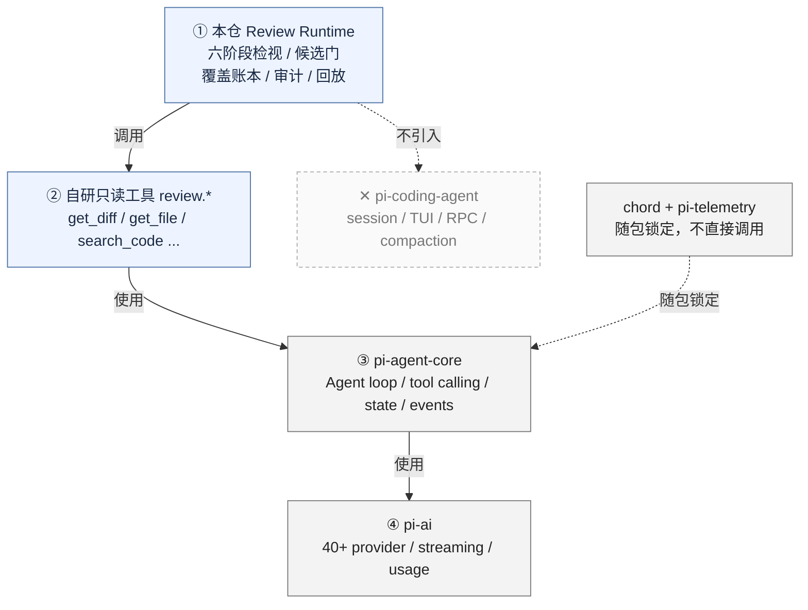


| 零件 | 它管什么 | 我们怎么用 |
|---|---|---|
| `pi-ai` | 跟各种大模型说话：流式输出、用量统计 | 用 |
| `pi-agent-core` | 一轮轮调用、工具调用、消息和状态 | 用 |
| `pi-coding-agent` | 一整套“写代码”的成品车：会话、界面、命令 | **不用** |
| `chord` / `pi-telemetry` | 服务组合 / 遥测契约 | 随包锁定，不直接用 |

我们只买零件，不买整车。因为我们要造的是“检视车”，不是“通用越野车”——整车的大部分功能（改代码、跑命令、交互界面）我们不需要，还要跟着它的节奏走。

一句话：**pi 提供发动机和变速箱，六个工位、工具、仪表盘、行车记录仪都是我们自己造的。**

### 3.2 为什么选 pi，不选别的

- **不选 DSH**：DSH 的本事是“什么都能插拔、能复用到很多产品”。但我们不打算把它改成别的产品，这个本事用不上，历史包袱还得背。
- **不自己造发动机**：模型对接、流式输出、工具循环、用量记账，都是脏活累活；pi 已经干好了，还是 MIT 许可。
- **不选其他 Agent SDK**：也能用，但评估时它们更绑定某一家模型、或者更偏界面场景；我们要能换模型、能控流程。**这是评估判断，没做同条件比赛，不算定论。**

选 pi 不是因为它最强，而是因为它**刚好够用，又不挡路**。

### 3.3 换得掉吗？能换，但要重新接线

| 换发动机**不用**重做的 | 换发动机**要**重做的 |
|---|---|
| 六个工位、规则、点名册 | 怎么跟模型流式对话 |
| 意见格式、审计、评测方法 | 怎么执行工具调用 |
| 命令行、配置 | 消息怎么存、用量怎么算 |
| 数据集和实验方法 | 录像带要重录 |

就像换发动机：车厢、座椅、仪表盘还是你的，但接口要改、要试车、行车录像要重录。**产品逻辑是我们的，运行时接线是 pi 的。**

### 3.4 工具为什么自己造

先纠正一个误解：`pi-agent-core` 只给了“工具调用”这个插座，**没给工具本身**；`pi-coding-agent` 给的是“改代码”的工具箱：读文件、改文件、跑命令。

我们只需要“看”和“查”，而且要求很具体：

| 要求 | 自己造的工具怎么做到 |
|---|---|
| 只读 | 八个工具全是读：看改动、读文件、搜代码、查符号/引用/调用链 |
| 门禁 | 不许读仓库外的路径，不许用 `..` 跳出去 |
| 限额 | 一次只读一段、只搜几条，防止一口气烧光预算 |
| 登记 | 读过什么、搜过什么，全部记账 |
| 录像 | 同样的输入能重放，方便对比 |
| 分片一致 | 大改动切开后，每一片读到的内容一致 |

借来的工具箱里有锤子和电钻，我们只需要手电筒和放大镜——而且手电筒要带门禁、限额和记账。

### 3.5 和 Claude Code / Codex / OpenCode 配 Skill 比

这些工具都能装 Skill，也都能“审代码”。区别不在能不能，而在**谁在控制流程**：

| | Claude Code | Codex | OpenCode | 我们 |
|---|---|---|---|---|
| 是什么 | 通用写代码助手 | 通用写代码助手 | 通用写代码助手 | **专用检视员** |
| 怎么干活 | 自己决定步骤，Skill 给规矩 | 同左 | 同左 | 固定六步，每步交作业 |
| 能用什么工具 | 读、改、跑命令 | 同左 | 同左 | 只能读和查 |
| 交什么 | 聊天记录、代码改动 | 同左 | 同左 | 问题清单 + 中文建议 + 审计 |
| 能不能重放 | 难 | 难 | 难 | 能 |

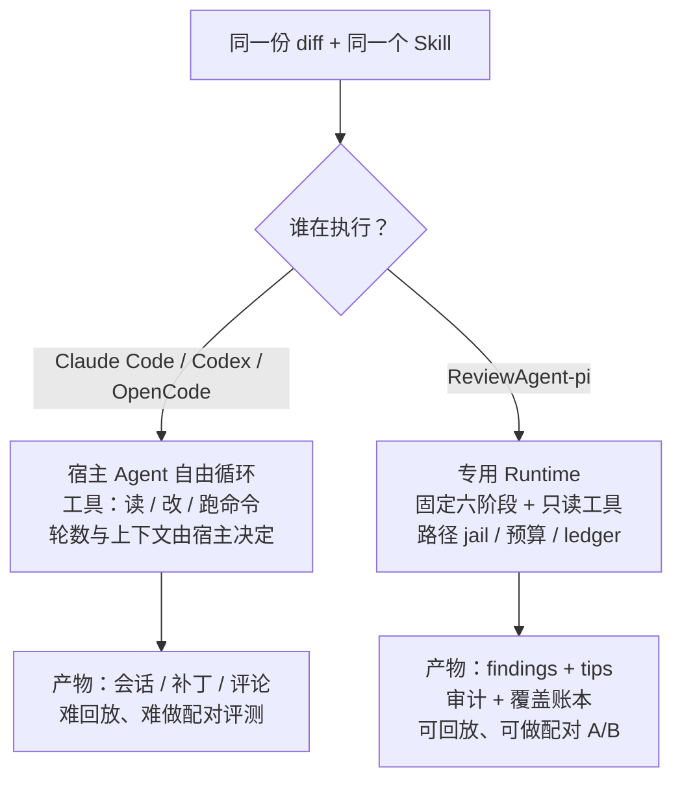

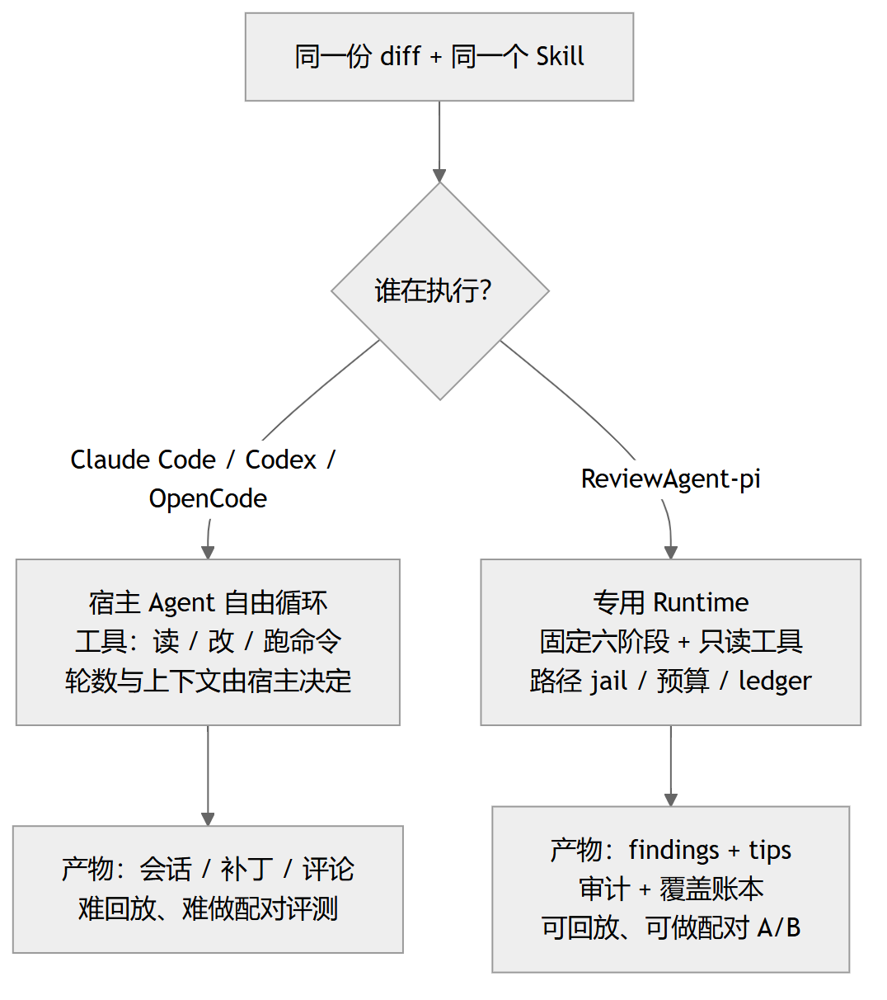

**我们占的便宜**：流程固定、产物能直接进 CI、能重放做对比、工具只读可控。

**我们付的代价**：不会改代码、不会跑测试、不做结对编程；自己维护一套 Runtime，生态也比不过通用工具。

补充：我们也提供 `skills/review-pi/`，让这些工具调我们的命令行。**Skill 管“怎么用”，Runtime 管“怎么审”**；只装 Skill 不装命令行，跑的还是宿主自己的检视方式。

> 一句话：通用助手 + Skill 是“让一个聪明人按手册做事”；我们是一条“有质检工位的流水线”。前者上手快、边界宽；后者成本可控、产物可审计。

---

## 四、它是怎么“审”的：一条流水线

AI 不是看一眼就出结论。它被安排在一条流水线上，每个工位只干一件小事：

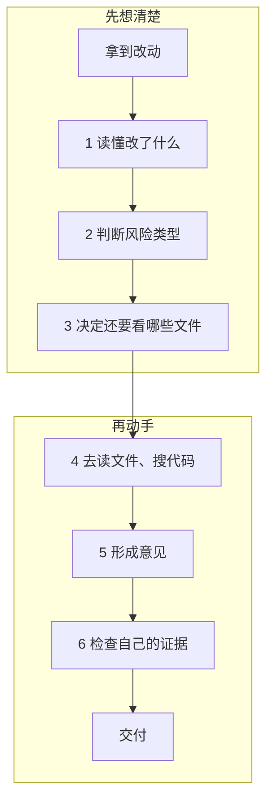

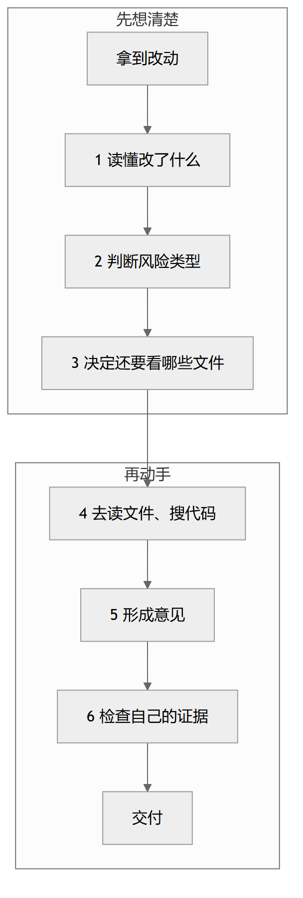

| 工位 | 它在干嘛 | 打个比方 |
|---|---|---|
| 1 读懂变更 | 总结这段改动想做什么 | 先看目录和摘要 |
| 2 风险分类 | 判断属于哪类风险 | 给文章贴标签 |
| 3 上下文决策 | 列出“我还需要看什么” | 列参考文献清单 |
| 4 上下文检索 | 真的去打开文件、搜索 | 跑图书馆 |
| 5 深度推理 | 写出候选意见 | 动笔写批注 |
| 6 证据核验 | 回头检查引文对不对 | 校对引文页码 |

### 为什么要拆成六个工位？

因为一开始我们让它“一口气审完”，结果它总是**先有结论，再找理由**。拆开工位以后，每一步都只输出一小段固定格式的内容，我们就可以检查它每一步有没有偷懒。

### 但这里有个真实的浪费

工位 2“风险分类”干了很多活，产出一个叫 `riskClass` 的结果——然后**没有任何人用**。它每个文件都白干一次，持续了很久我们才发现。

> 教训一：流水线上每个工位，都必须有人接收它的产出。否则就是白烧钱。

后来我们把工位 1 和工位 2 合并了，省下一个请求。这件事后面还有更大的反转，先记着。

---

## 五、大改动怎么办：先别急着说“太大了，跳过”

### 3.1 一个让人后背发凉的老毛病

以前的逻辑是：改动超过 8000 个字符，就直接标记“跳过”。

有一次一个 17,227 字符的改动被跳过了。用户在结果里看到的是 `skipped`——但很多人根本不会看这个字段，只会觉得“哦，审过了，没问题”。

**这就是第一种糊弄：没看，但看起来像看过了。**

### 3.2 现在的做法：切开来审

就像一本厚书，一个人看不完，就分成几章给几个人。

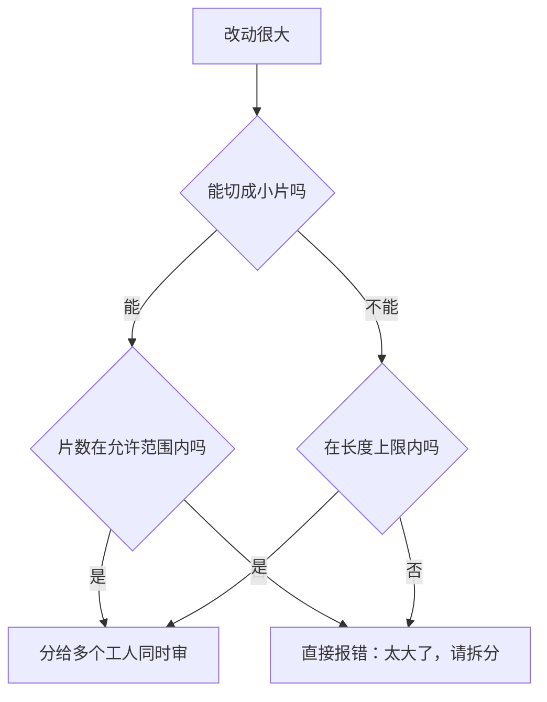

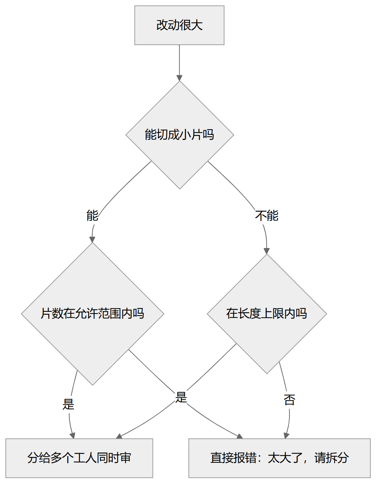

两条规矩：

- **能切就切**，不因为总长度大就放弃；
- **切不了就明确报错**，绝不在没看的情况下说“审完了”。

### 3.3 切开之后，让它们同时干活

原来 5 片要排队审，一片接一片。现在可以 3 个工人同时审：

| 项目 | 片数 | 排队审 | 3 人同时审 | 快了多少 |
|---|---:|---:|---:|---:|
| immich | 6 | 1091.9 秒 | 603.4 秒 | 1.81 倍 |
| elasticsearch | 7 | 1288.3 秒 | 513.1 秒 | 2.51 倍 |
| typescript-go | 9 | 2918.7 秒 | 995.3 秒 | 2.93 倍 |
| 合计 | 22 | 5298.9 秒 | 2111.8 秒 | **2.51 倍** |

从 88 分钟压到 35 分钟。

有人会问：同时干活，会不会乱？我们做了三件事防止乱：

- 每个人只负责“审第几片”，不负责“决定自己审哪片”；
- 最后汇总永远按片号顺序，谁先审完都一样；
- 上报、生成报告这些“有顺序要求”的动作，排队一个个做。

> 教训二：并发是“快”的技术，不是“准”的技术。要证明它没把结果搞乱，得单独验证。

---

## 六、怎么知道它“真的看了”？——点名册

### 4.1 一个扎心的发现

我们把历史上“标准答案里有、但我们没提”的问题翻出来，一条条查原因。

结果：**超过一半（56.8%）落在“这个文件我们一条意见都没提”**。

不是判断错了，是**根本没看**。但流程照样显示“完成”。

这就像老师收了作业，没批，却打了“已阅”。

### 4.2 点名册：每个改动片段都要有状态

我们把每个改动片段（术语叫 hunk，就是 diff 里一段连续的修改）都登记进一本“点名册”，只有三种状态：

| 状态 | 白话解释 |
|---|---|
| `candidate` | 有人对它提了意见 |
| `no-issue` | 有人认真看过，判断没问题 |
| `not-reached` | 没人碰过它 |

而且必须满足一道小学算术：

```text
提了意见的 + 看过没问题的 + 没人碰过的 = 全部片段
```

一个都不能少。这样我们随时能回答：“这次到底有多少片段是没人看的？”

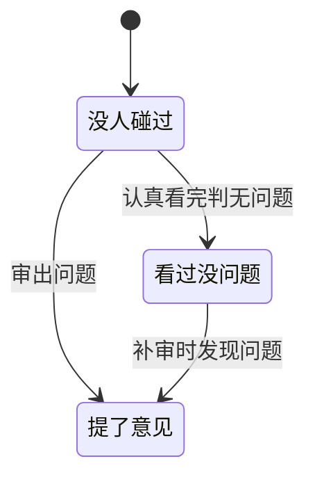

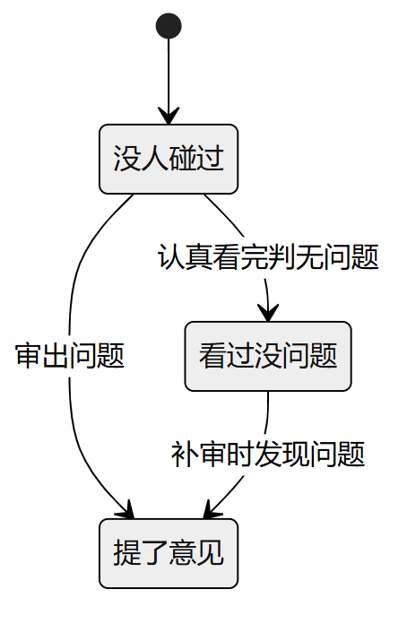

### 4.3 那没人看的，再找人补看一遍？

想法很自然：只把“没人碰过”的片段挑出来，再发一次请求专门看它们。

在 10 道测试题上试了三个版本：

| 版本 | 准确率 | 召回率 | 综合分 | 发生什么 |
|---|---:|---:|---:|---|
| 不补看 | 50.0% | 31.6% | 38.7% | 基线 |
| 补看 v1 | 44.9% | 35.8% | 39.8% | 多提了，但废话也多 |
| 补看 v2（说“没问题”必须给证据） | 43.9% | 43.2% | 43.5% | 召回明显变好 |
| 补看 v3（补出来的意见再过一道检查） | 52.2% | 40.0% | 45.3% | 综合分反超基线 |

看起来 v3 很棒。但还有两个不好看的数字：

- 补看提出的意见，原始命中率只有约 **26.7%**——**四条里三条是废话**；
- 换到 20 道题上再测：综合分只高 3.65 个百分点，统计上说不准，而且**耗时多 30%**。

所以我们最后的决定是：**点名册默认开着（能看见缺口），自动补看默认关着。**

> 教训三：能“看见问题”本身就有价值，不一定非要马上“自动解决”。自动补看的性价比还没算过来。

---

## 七、它说的话，得能对上原文

### 5.1 三种常见的“编”

AI 提意见时，最容易犯三种错：

1. 说“第 42 行有问题”，但那文件只有 20 行；
2. 说“这里写着 `foo()`”，但原文里根本没有这句话；
3. 说的文件压根不在此次改动里。

### 5.2 我们的办法：拿原文核对

每条意见都必须带三样东西：**文件、行号、原文片段**。然后我们写了一个“死脑筋”的检查程序，一步一步对：

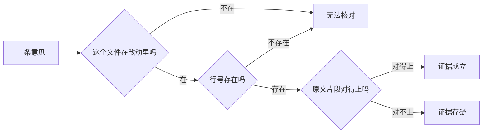

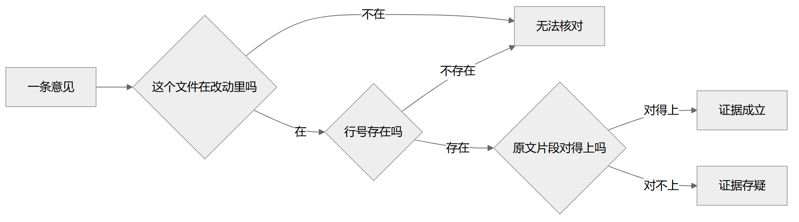

这个检查程序不懂语义，只做“字面对不对”，所以**不会偏心**。

### 5.3 那证据存疑的，直接删掉？

我们拿 320 条历史意见试了一下：

| 类别 | 条数 |
|---|---:|
| 证据成立 | 217 |
| 证据存疑 | 103 |

如果直接删掉“存疑”的 103 条，会连**真正的 bug 一起删掉**——那里面藏着 30 条真问题。

所以现在的策略是：**只做标记、只统计、不删除**。产品能看到“这次有多少条证据没对上”，但不会因此少报问题。

> 教训四：自动过滤听起来很爽，但你得先知道它会误伤多少。

### 5.4 那找另一个 AI 来复核呢？

我们试过：把意见和它周围 80 行代码交给另一个 AI，问它“这条对不对”。

结果很有意思：

| 复核模型 | 说“对” | 说“错” | 说“不确定” |
|---|---:|---:|---:|
| flash（便宜） | 44 | 2 | 57 |
| pro（更贵） | 54 | 0 | 49 |

它几乎从不说“错”，绝大多数时候说“信息不够，我不确定”。

也就是说，**它当不了“删除意见”的裁判**。这不是模型不够聪明，是我们只给了 80 行——**证据不够，谁也不敢下结论**。

> 教训五：让 AI 复核 AI，先问“我给的信息够它判断吗”。信息不够时，得到的不是答案，是“不确定”。

---

## 八、最贵的一课：小测验考了高分，大考却退步了

这一段是整年最值得讲的。

### 6.1 我们想省点钱

流水线有六个工位，每个工位都要花一次请求。我们想着：工位 2 没人用，工位 1 和 2 干脆合并吧？另外工位 3 如果判断“不用再查资料”，工位 4 就别跑了。

### 6.2 小测验成绩漂亮得不像话

我们用 20 个小改动的测试集对比：

| 方案 | 准确率 | 召回率 | 综合分 | 请求数 | 花费 |
|---|---:|---:|---:|---:|---:|
| 六个工位 | 31.4% | 21.9% | 25.8% | 308 | 6.60M |
| 压缩成四五个工位 | 42.9% | 30.1% | **35.4%** | **271（少 12%）** | **6.27M（少 5%）** |

综合分高了 9.6 个百分点，花的钱还少了。统计检验也说“这不像巧合”。

于是我们信心满满地把默认方案改成了压缩版。

### 6.3 大考成绩打脸

换成 91 个真实项目的改动（共 588 个标准答案）再跑：

| 指标 | 压缩版 | 原来的方案 |
|---|---:|---:|
| 准确率 | 36.0% | 38.1% |
| 召回率 | **17.7%** | **24.5%** |
| 综合分 | **23.7%** | **29.8%** |
| 花费 | 60.77M | 53.10M |

综合分**低了 4.6 个百分点**，而且统计上明确不是巧合（区间 [−8.3, −1.1]，整个区间都在 0 以下）。

更关键的是，把样本按“改动大小”拆开看，真相一目了然：

| 改动里标准答案数量 | 压缩版找到 | 原方案找到 |
|---|---:|---:|
| 只有 1–2 个（小改动） | 13 | 11 |
| 3–5 个（中等） | 23 | 35 |
| 超过 5 个（大改动） | 59 | 76 |

**小改动确实变好了，中等和大改动明显变差。**

我们优化的其实不是“审代码的流程”，而是“20 个小改动上的审代码流程”。

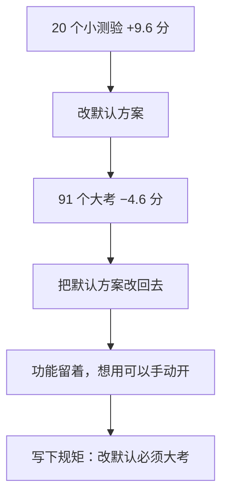

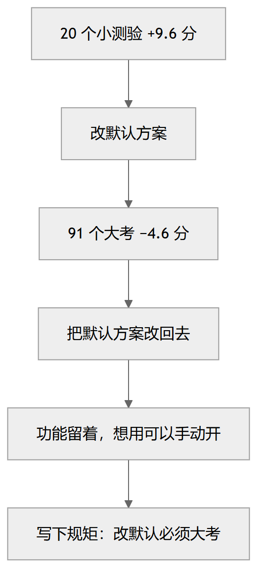

### 6.4 我们学到了什么

1. **测验卷的难度，本身就是变量。** 20 道小题和 91 道混合题，考的不是一回事。
2. **同一个方案跑两次，分数能差 10–14 个百分点。** 我们做过两组对照，一组说“好了 14 分”，一组说“差了 10 分”。**只跑一次，根本说明不了问题。**
3. **“打分员很稳定”不等于“考试很稳定”。** 打分员每次给分都一样，但 AI 每次审出来的东西不一样。

### 6.5 更早的一个反例：被我们否掉的“六项检查”

我们一度想加一个“固定检查清单”：安全性、并发、错误处理、性能、可读性、测试。

在测试集上肯定能加分。但一看这六项的来源——它们是**照着测试集的标准答案类别反推出来的**。

换句话说，它优化的不是代码质量，是**这份卷子**。

我们把它否掉了。理由只有一句：**照着答案出的复习提纲，不算学会了。**

---

## 九、我们给自己定的“考试规矩”

被上面那一课教育之后，我们定了几条硬规矩：

| 规矩 | 白话解释 |
|---|---|
| 至少跑两组对照 | 不能只跑一次就下结论 |
| 报“误差范围” | 不只看高了几个点，还要看这个差距稳不稳 |
| 四个数一起报 | 准确率、召回率、花费、耗时，少一个都不算数 |
| 大改动和小改动分开看 | 不能混在一起算平均，否则大改动的问题会被小改动掩盖 |
| 不为考试加分而改产品 | 卷子上能加分但代码里没意义的规则，不加 |

这几条听起来像常识，但每一条都是踩坑换来的。

---

## 十、还有些“看不见”的功夫

前面讲的都是“审得对不对”。还有一半功夫在“出了事能不能查”。

### 8.1 每一次审，都留一份完整档案

| 档案 | 记什么 | 有什么用 |
|---|---|---|
| 请求记录 | 每次问 AI 了什么、它答了什么 | 复盘、对账 |
| 工具记录 | 它读了哪些文件、搜了什么 | 看它是不是在瞎翻 |
| 工位记录 | 每个工位发了几次请求 | 确认“合并工位”是不是真的省了 |
| 花费记录 | 用了多少 token | 算钱 |
| 点名册 | 每个片段的状态 | 看有没有漏 |

没有这些，我们连“压缩方案到底省了哪几个请求”都答不出来。

### 8.2 录像回放

我们把每一次“提问 + 回答”录下来，做成“录像带”。以后改了提示词，可以拿录像带快速回放，不用真的花钱调 AI。

但有个坑：**提示词一改，录像带就对不上了**——因为录像带是按“问题原文”匹配的。

我们改过一次提示词，六个回放场景全部失败。第一反应是“代码坏了”，其实是**录像带过期了**。

现在的习惯是：改提示词之前先看录像带是什么时候录的；改完必须重录。大改动的录像带没法用假数据，只能真花钱重录一次。

> 教训六：回放工具很好用，但它有保质期。过期了不是坏了。

### 8.3 推理模型会把钱花在“看不见的地方”

有一次做复核，103 条里有 13 条返回**空白答案**。

查下来原因很朴素：这种模型会先在“脑子里”想很久，我们给的思考预算太少，它想到一半就被掐断了，还没来得及写答案。

修法：

- 发现答案是空的，或者被截断了；
- 把预算翻倍，**只重试一次**；
- 花费照实累加，不丢账。

修完以后，13 条变成 0 条。

### 8.4 一个不可见的字符，废掉了一整轮数据

有一次复核程序的正则表达式里，混进了一个**看不见的退格符**。结果所有“不确定”都被当成了“错误”。

那一轮的实验数据全部作废，重跑。

现在的习惯：改完正则，先用十六进制看一眼。

---

## 十一、一张总表：哪些开着，哪些关着，为什么

| 功能 | 现在默认 | 一句话理由 |
|---|---|---|
| 大改动切片审 | 开 | 不许“没看却说看完” |
| 多人同时审 | 关（可手动开） | 快 2.5 倍，但默认要稳 |
| 点名册（覆盖记录） | 开 | 能看见哪里没人看 |
| 自动补看 | 关 | 四条里三条废话，还慢 30% |
| 证据核对 | 开（只标记） | 能看见多少条对不上，但不误删 |
| 找另一个 AI 复核 | 不接主流程 | 它几乎从不说“错” |
| 合并工位（省请求） | 关（可手动开） | 小测验好，大考差 |
| 限制读文件次数 | 关（可手动开） | 省一点，但不明显 |
| 空答案自动重试 | 开 | 纯属修 bug |

---

## 十二、如果只记三句话

1. **“审完了”必须是一个能被检查的状态，不能是一句口头承诺。** 点名册、证据核对、显式报错，都是为了让这句话有据可查。
2. **小测验的高分，可能是卷子太简单。** 我们的方案在 20 道小题上高 9.6 分，在 91 道真题上低 4.6 分。
3. **失败要写下来。** 我们把“为什么改回去”写成正式文档，比任何一次成功都更值钱——因为它让我们下次不会再犯。

---

> 这个工具的所有实验记录都在仓库的 `bench/experiments/` 里，包括那些不好看的数字。这篇没有隐藏任何一次失败。

> 续篇：[白话版 2：四种糊弄，四道防线](04-白话版2-四种糊弄四道防线.md)
