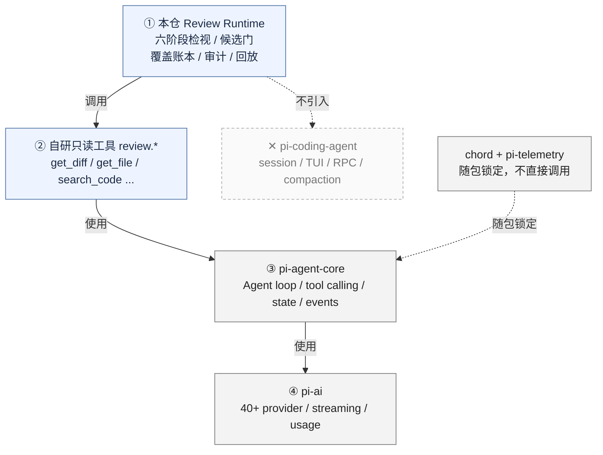
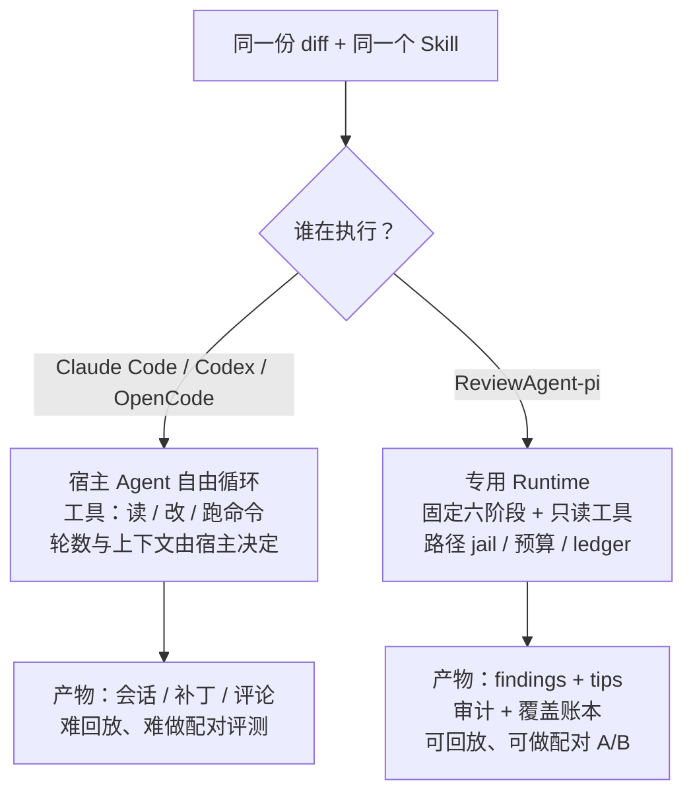
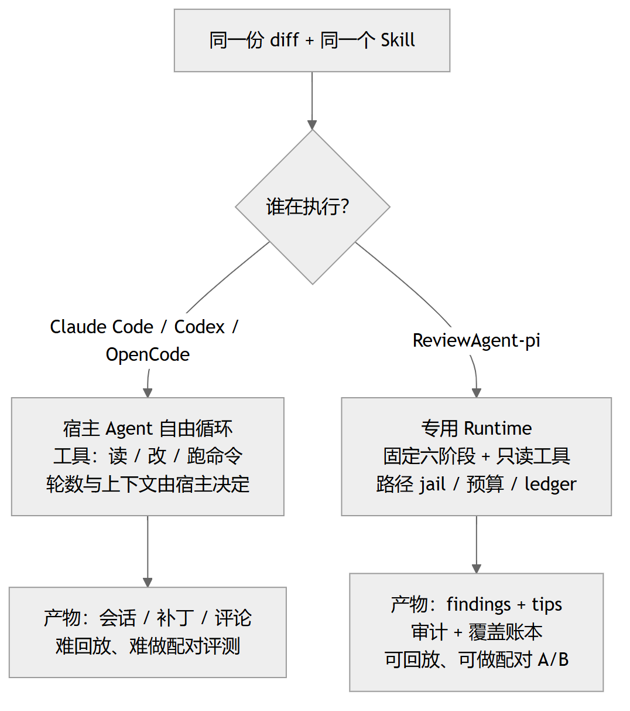
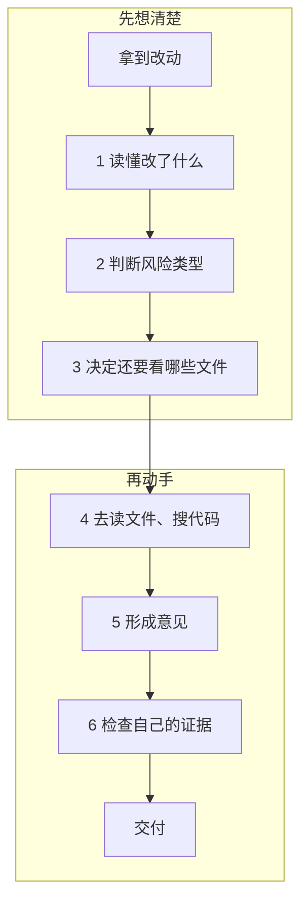
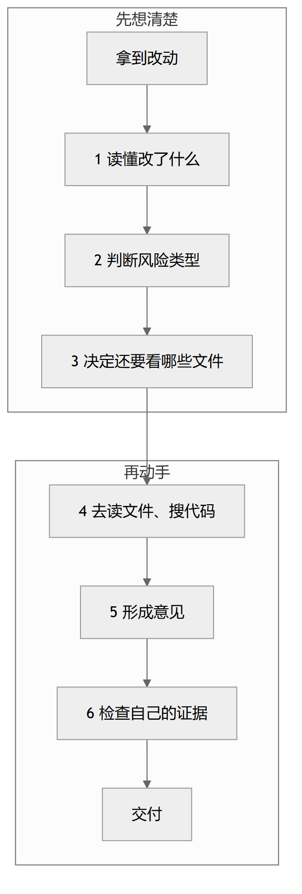
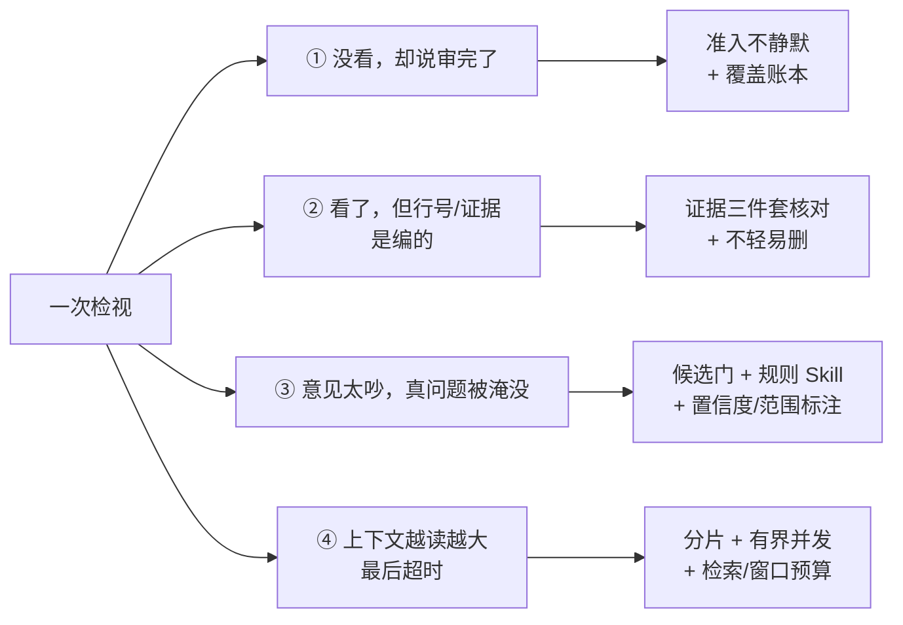
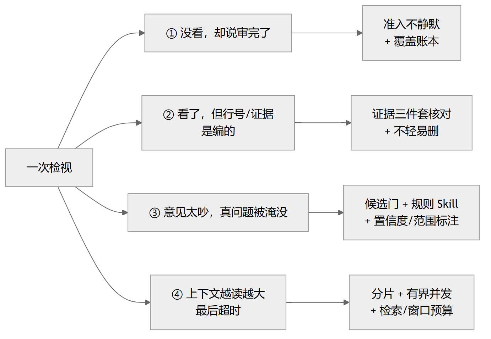

# 白话版 2：四种糊弄，四道防线——把“审代码”做成可验收的流程

> 这是白话版的续篇。上一篇讲“它怎么审”；这一篇只讲四件事：**没看、看错、太吵、失控**。每一件都说清三句话：怎么防、花多少、有没有用。
>
> 上一篇：[白话版：让 AI 帮你审代码，怎么才能不瞎审？](03-白话版-让AI帮你审代码怎么才能不瞎审.md)

## 目录

- [一、先看选型：为什么是 pi](#一先看选型为什么是-pi)
- [二、再看架构：一条流水线，两道主线](#二再看架构一条流水线两道主线)
- [三、流程：六个工位，四道防线](#三流程六个工位四道防线)
- [四、问题一：没看，却说“审完了”](#四问题一没看却说审完了)
- [五、问题二：看了，但说错行号、编了证据](#五问题二看了但说错行号编了证据)
- [六、问题三：意见太吵，真问题反而没提](#六问题三意见太吵真问题反而没提)
- [七、问题四：上下文越读越大，最后超时](#七问题四上下文越读越大最后超时)
- [八、一张总表：四道防线的成本与效果](#八一张总表四道防线的成本与效果)
- [九、如果只记三句话](#九如果只记三句话)

---

## 一、先看选型：为什么是 pi

### 1.1 pi 是零件，不是成品

pi 不是一个“开箱即用的检视工具”，它是一套 Agent 零件：

| 零件 | 管什么 | 我们怎么用 |
|---|---|---|
| `pi-ai` | 跟各种大模型说话：流式输出、用量统计 | 用 |
| `pi-agent-core` | 一轮轮调用、工具调用、消息和状态 | 用 |
| `pi-coding-agent` | 一整套“写代码”的成品车：会话、界面、命令 | **不用** |
| `chord` / `pi-telemetry` | 服务组合 / 遥测契约 | 随包锁定，不直接用 |




### 1.2 为什么选 pi，不选别的

- **不选 DSH**：DSH 的本事是“什么都能插拔、能复用到很多产品”。我们不打算把检视 Runtime 复用到别的产品，这个本事用不上，历史包袱还得背。
- **不自己造发动机**：模型对接、流式输出、工具循环、用量记账都是脏活累活；pi 已经干好了，还是 MIT 许可。
- **不选其他 Agent SDK**：也能用，但评估时它们更绑定某一家模型、或者更偏界面场景；我们要能换模型、能控流程。**这是评估判断，没做同条件比赛，不算定论。**

选 pi 不是因为它最强，而是因为它**刚好够用，又不挡路**。

### 1.3 换得掉吗？能换，但要重新接线

| 换发动机**不用**重做的 | 换发动机**要**重做的 |
|---|---|
| 六个工位、规则、点名册 | 怎么跟模型流式对话 |
| 意见格式、审计、评测方法 | 怎么执行工具调用 |
| 命令行、配置 | 消息怎么存、用量怎么算 |
| 数据集和实验方法 | 录像带要重录 |

**产品逻辑是我们的，运行时接线是 pi 的。** 换内核不是改一个 import，而是“适配层 + 录像重录 + 等价性验证”。

### 1.4 工具为什么自己造

先纠正一个误解：`pi-agent-core` 只给了“工具调用”这个插座，**没给工具本身**；`pi-coding-agent` 给的是“改代码”的工具箱：读文件、改文件、跑命令。

我们只需要“看”和“查”，而且要求很具体：

| 要求 | 自己造的工具怎么做到 |
|---|---|
| 只读 | 八个工具全是读：看改动、读文件、搜代码、查符号/引用/调用链 |
| 门禁 | 不许读仓库外的路径，不许用 `..` 跳出去 |
| 限额 | 一次只读一段、只搜几条，防止一口气烧光预算 |
| 登记 | 读过什么、搜过什么，全部记账 |
| 录像 | 同样的输入能重放，方便对比 |
| 分片一致 | 大改动切开后，每一片读到的内容一致 |

### 1.5 和其他 CLI 配 Skill 比，差在哪

这些工具都能装 Skill，也都能“审代码”。区别不在能不能，而在**谁在控制流程**：

| | Claude Code | Codex | OpenCode | 我们 |
|---|---|---|---|---|
| 是什么 | 通用写代码助手 | 通用写代码助手 | 通用写代码助手 | **专用检视员** |
| 谁控制流程 | 宿主自己决定步骤 | 同左 | 同左 | 固定六步 |
| 能用什么工具 | 读、改、跑命令 | 同左 | 同左 | 只能读和查 |
| 交什么 | 聊天记录、代码改动 | 同左 | 同左 | 问题清单 + 中文建议 + 审计 |
| 能不能重放 | 难 | 难 | 难 | 能 |





> 一句话：通用助手 + Skill 是“让一个聪明人按手册做事”；我们是一条“有质检工位的流水线”。

---

## 二、再看架构：一条流水线，两道主线

### 2.1 一条流水线





| 工位 | 它在干嘛 | 大白话 |
|---|---|---|
| 1 读懂变更 | 总结这段改动想做什么 | 先看目录和摘要 |
| 2 风险分类 | 判断属于哪类风险 | 给文章贴标签 |
| 3 上下文决策 | 列出“我还需要看什么” | 列参考文献 |
| 4 上下文检索 | 真的去打开文件、搜索 | 跑图书馆 |
| 5 深度推理 | 写出候选意见 | 动笔写批注 |
| 6 证据核验 | 回头检查引文对不对 | 校对页码 |

### 2.2 两道主线

| 主线 | 一句话 | 具体做什么 |
|---|---|---|
| 精准判断 | 说的每条都能核对，没说的能说清 | 证据接地、覆盖账本、不轻易删、独立复核 |
| 低耗运行 | 知道钱花在哪，只在确定不伤质量的地方省 | 四项一起报、重试、分片降墙钟、改默认要过大考 |

**精准是前提，低耗是约束**——不拿判断质量换成本。

---

## 三、流程：六个工位，四道防线

四道防线不是四个新功能，而是四个“检查点”：





| 问题 | 在哪一步发生 | 防线 | 防线的本质 |
|---|---|---|---|
| ① 没看却说审完 | 准入、收口 | 准入不静默 + 覆盖账本 | 让“没看”变成可见状态 |
| ② 看错、编证据 | 第 5/6 工位、候选门 | 证据三件套核对 | 让“对不上”可被机器发现 |
| ③ 噪声过大 | 候选门、规则 Skill | 候选门 + 置信度/范围 | 让每条意见能解释去留 |
| ④ 上下文膨胀/超时 | 第 4 工位、整条链 | 分片 + 并发 + 预算 + 窗口 | 把“无界”变成“有界” |

下面逐条讲。

---

## 四、问题一：没看，却说“审完了”

### 4.1 长什么样

旧逻辑先看“改动是不是超过 8,000 字符”，超过就直接标记“跳过”。

有一次一个 17,227 字符的改动被跳过了。结果里写的是 `skipped`，但很多人不会看这个字段，只会觉得“审过了，没问题”。

我们后来统计历史漏掉的标准答案，发现 **56.8% 落在“这个文件我们一条意见都没提”**——不是判错，是根本没看。

### 4.2 怎么防

1. **准入不静默**：能切片就切片；切不了（超过片数上限）就在调模型之前**明确报错**，绝不假装审完。
2. **点名册**：每个改动片段必须有状态——`candidate`（提了意见）、`no-issue`（看过没问题）、`not-reached`（没人碰过）。三者相加必须等于片段总数。
3. **可选补看**：只对“没人碰过”的片段再发一次请求；补不出来就保持 `not-reached`，不硬编“已阅”。

### 4.3 花多少

| 手段 | 成本 |
|---|---|
| 点名册 | 零模型调用，纯确定性计算 |
| 准入切片 | 请求数不变，只是把一次大请求拆成几次 |
| 定向补看 | 每个缺口一次请求；有请求数/字符数/hunk 数三重上限 |

### 4.4 有没有用

| 指标 | 数据 |
|---|---|
| 账本可算率 | iterF91 91/91，22,266 个 hunk 全部有状态 |
| 缺口下降 | iterB10：`not-reached` 89.9% → 17.5% |
| 补看质量 | 10 道题上 B 0.387 → 0.453；补看候选的原始命中率约 **26%–31%**，要靠后面的验证门捞回 |
| 20 道题复评 | B +3.65pp，置信区间跨 0；墙钟 +30% |
| 当前默认 | 账本开；自动补看**关** |

**结论**：先让“没看”可见，这一步很值；自动补看目前还没算过账，所以默认不开。

---

## 五、问题二：看了，但说错行号、编了证据

### 5.1 长什么样

AI 提意见时最容易犯三种错：

1. 说“第 42 行有问题”，但文件只有 20 行；
2. 说“这里写着 `foo()`”，原文里根本没有；
3. 说的文件压根不在此次改动里。

### 5.2 怎么防

1. **证据三件套**：每条意见必须带文件、行号、原文片段。
2. **机器核对**：文件在不在 diff 里 → 行号存不存在 → 原文片段对不对得上。三步都是死规矩，不掺语义判断。
3. **不轻易删**：对不上的只标记，不直接丢弃。
4. **独立复核**：另开一个会话，只给意见和附近代码，问它“对不对”。这是可选项，不接主流程。

### 5.3 花多少

| 手段 | 成本 |
|---|---|
| 证据核对 | 读 head 侧原文，纯本地计算 |
| 独立复核 | 每条意见一次调用；103 条约 24–28 万 token，占全量基准的 1.4%–1.7% |
| 置信度过滤 | 纯本地计算 |

### 5.4 有没有用

| 指标 | 数据 |
|---|---|
| 历史 320 条意见 | 217 条证据成立，103 条存疑 |
| 直接删掉存疑 | 会丢 30 条真问题、39 个标准答案；B 从 29.8% 掉到 25.5% |
| 独立复核（便宜模型） | 说“对”44 条、说“错”2 条、说“不确定”57 条；通过精度 34.1% |
| 独立复核（更贵模型） | 说“对”54 条、说“错”0 条、说“不确定”49 条；通过精度 33.3% |
| 置信度阈值 | 0.5 会砍 26 条（含 6 条真问题）；0.3 全保留 |
| 当前默认 | 证据核对 `warn`（只标记）；独立复核不接主路径；置信度 0.3 |

**结论**：先把“对不上”标出来，不要急着删；删之前先证明不会误杀。独立复核证明了“自己审自己”不可信，但 80 行上下文还不够它当裁判。

---

## 六、问题三：意见太吵，真问题反而没提

### 6.1 长什么样

这两个毛病经常一起出现：

- 提了很多格式、命名、测试缺失类的意见（**噪声**）；
- 真正的问题没提，或者被埋在最后（**漏检**）。

共同点：模型“看太多、抓不住重点”。

这里有一组反直觉的历史数据：**让模型“看整个仓库”，不是看得更准，而是更差。**

### 6.2 历史实验：五种“给它看什么”

Phase 2 在 VUL4J 30 个单缺陷 MR 上跑过 A–E 五种配置，每种 3 次复本（共 450 单元）。下表是 judge 口径的 P/R/F1，翻译成大白话，就是“给它看多少、让它自己找多少”：

| 配置 | 给它看什么 | 精确率 P | 召回率 R | 平衡分 B | token/单元 | 一条意见都没有 |
|---|---|---:|---:|---:|---:|---:|
| A 零工具 | 只看这次 MR 的 diff | 72.3% | **50.1%** | 55.2% | **22.6k** | 5/90 |
| B 零工具 + 确定性预取 | diff + 符号/引用/调用链 | **78.3%** | 46.7% | **57.6%** | 49.9k | 10/90 |
| C 全仓注入 | 整个仓库都塞进去 | 63.5% | **13.4%** | 57.1% | **706.5k** | **69/90（77%）** |
| D 多轮自主检索 | 自己决定搜什么、读什么 | 72.3% | 29.2% | 62.6%* | — | 48/90 |
| E D + 覆盖账本 | 自主检索 + 点名册 | 56.9% | 23.6% | 52.0% | — | 55/90 |

> **B 的口径**：B = 2PR / (P + R)，是精确率和召回率的调和平均（F1），不是“另一种 precision”。只看 P 会被“少提”骗，只看 R 会被“乱提”骗。
>
> \*D 的 F1 名义最高（62.6%），但跨侧不稳定，不作为稳定对照；E 在 D 上加账本，召回三侧一致下降。

读法：

1. **C 全仓注入：看得最多，结果最差。** 召回只有 13.4%，77% 的单元一条意见都没有，token 是 A 的 31 倍。上下文不是证据越多越好，多了会把模型淹没。
2. **A 只看 diff：看得最少，召回最高。** 50.1% 的召回、22.6k token；说明检视任务的真实信息需求很窄。
3. **B 加确定性预取：精度和 F1 最高。** P 78.3%、F1 57.6%，代价是召回比 A 低 3.4pp、token 是 A 的 2.2 倍。它用一点召回换精度，不是白拿。
4. **D/E 多轮工具 + 账本：没有质量优势，只多花 token。** E 加了账本，召回反而从 29.2% 掉到 23.6%。多轮和账本都不是噪声的解药。

**结论**：先砍掉“自由探索”和“全仓注入”，比加更多工具更能同时压噪声、提召回。这也是后来“diff-first、按需取上下文”的直接依据。

### 6.3 补看 + 验证门：把漏掉的真问题找回来

Phase 2 的 A–C 对比说明“少而准”的上下文更好，但召回还是有上限。于是我们试了“只对没覆盖的片段补看”，在 iterB10 十道题上对比了三个版本：

| 方案 | 精确率 P | 召回率 R | 平衡分 B |
|---|---:|---:|---:|
| 不补看（A） | 50.0% | 31.6% | 38.7% |
| 补看 v1 | 44.9% | 35.8% | 39.8% |
| 补看 v2：说“没问题”必须带证据 | 43.9% | 43.2% | 43.5% |
| 补看 v3：补出的候选再过验证门 | **52.2%** | **40.0%** | **45.3%** |

- v2 把召回从 31.6% 拉到 43.2%（**+11.6pp**），但精度从 50.0% 掉到 43.9%（**−6.1pp**）：补出来的东西里噪声不少。
- v3 给补看候选加一道独立验证门：26 次请求，拒 17、收 9；最终 13 条补看意见、4 条命中。精度回到 52.2%（比不补看还高 2.2pp），召回 40.0%（**+8.4pp**），B 45.3%（**+6.6pp**）。
- 这是“有效果”的直接证据：**召回涨了，精度没掉。** 代价是补看请求和验证请求。
- 但只有 10 道题。换到 20 道题复评，B 只 +3.65pp、置信区间跨 0，墙钟 +30%。所以机制有效，还不够稳，**默认不开**。

### 6.4 反向证据：为什么不能靠“硬删”

噪声最直觉的解法是“筛狠一点”。我们试过，数据不支持：

| 做法 | 结果 |
|---|---|
| 证据存疑的 103 条全删 | 精度 +4.7pp，但召回 −6.3pp，平衡分 **−4.3pp** |
| 置信度阈值从 0.3 提到 0.5 | 砍掉 26 条，其中 6 条是真问题 |
| 范围外的意见全删 | 11 条里 8 条是真问题 |
| 加固定“六项镜头” | 测评集上能提分，但属于照着答案出复习提纲，放弃 |
| 按 severity 硬过滤 | 不同规模改动上的区分度不稳定，不做 |

一句话：**硬删看起来干净，实际是拿召回换精度，甚至两头都输。**

### 6.5 现在怎么做

- **上下文**：diff-first，按需取符号/引用/调用链；不默认全仓注入。
- **候选门**：格式、行号、范围先过机器检查。
- **规则 Skill**：独立会话，不塞进主提示词。
- **置信度 0.3**：保留长尾，不硬砍。
- **范围 / 证据**：标注，不直接删，交给下游判断。
- **效果**：换到 iterF91 全量，v3 基线是 P 38.1% / R 24.5% / B 29.8%。它和 Phase 2 的 VUL4J 配置不能直接比绝对值，只看方向：**少而准的上下文 + 可解释的候选门，比“多读 + 硬筛”更稳。**

---

## 七、问题四：上下文越读越大，最后超时

### 7.1 长什么样

通用 Agent 的检视姿势是“探索驱动”：搜一下、读一段、再搜、再读。每读一次，工具结果就塞进上下文；上下文越滚越大，最后：

- 要么撞模型窗口，比如输入 172,033 + 输出 32,768 = 204,801，超过 204,800，一个 400 就把整次检视杀掉；
- 要么任务侧到了默认上限（两小时），整次超时。

### 7.2 怎么防

1. **分片**：大改动按文件内 hunk 切开，单片的字符数有上限（默认 120,000），片数也有上限（默认 12）。
2. **有界并发**：1–8 个工人同时审，默认 1；结果永远按片号聚合，谁先跑完都不影响顺序。
3. **检索预算**：同一文件最多读 3 次、连续 4 次空搜索就停、整个 run 读文件字符总量 40 万。
4. **阶段压缩**：把第 1、2 工位合并，第 3 工位说“不需要上下文”时跳过第 4 工位。
5. **窗口预算**：发请求前先算“输入 + 输出”会不会超窗；超了就收窄输出预算；真撞了 400，就把输出预算减半重试，最多两次。
6. **超时**：单轮 180 秒、规则 Skill 会话 20 分钟、一次性调用 5 分钟；任务侧还有总上限。

### 7.3 花多少、有没有用

| 手段 | 成本 | 效果 | 当前默认 |
|---|---|---|---|
| 分片 | 请求数不变，片数变多 | 22 片：5298.9 秒 → 2111.8 秒（**2.51 倍**），429 为 0 | 开 |
| 并发 | 并行批次 token 记录高约 40%（缓存命中差异） | 墙钟下降；默认保守为 1 | 可配 1–8 |
| 检索预算 | 每文件 3 次、连续空搜 4 次、40 万字符 | S20 请求 −6%、token −12%，B −0.7pp（区间跨 0）；全量触发 106 次跳过 | **0（关）** |
| 阶段压缩 | 合并工位、条件跳过 | S20 请求 −12%、token −5%、B +9.6pp；全量 ΔB −4.6pp（显著负向） | **off** |
| 窗口预算 | 可能多一条重试请求 | 400 不再杀死整次 run；可用输出不足 2,048 时本地直接失败 | 开 |
| 超时 | 到点即停 | 内部调用有界；全量 91/91 完成，平均 203 秒/条，无超时 | 任务侧 + 内部上限 |

**结论**：先把“无界”变成“有界”，这一步是确定收益；再谈“省请求/省 token”，就必须过大考。阶段压缩和检索预算都是小样本好看、全量回退，所以默认关掉、保留手动开关。

### 7.4 所有省 token 的策略：一张全景表

先看钱是怎么花出去的。一次检视的计费成本大致是：

```text
首请求输入（全未命中）
+ Σ 后续轮次的新增后缀（缓存命中按约 1/30 价）
+ Σ 输出
+ 工具成本
```

四个乘子：**上下文基数 × 轮数 × 计价 × 输出/工具浪费**。我们所有的省 token 策略，都在压其中一个。

| 杠杆 | 策略 | 怎么省 | 现在 | 实测 / 边界 |
|---|---|---|---|---|
| 基数 | diff-first | 只带 diff，符号/引用按需取，不默认全仓 | 开 | Phase 2：C 全仓 706.5k → A 仅 diff 22.6k token/单元 |
| 基数 | 确定性预取 | 固定 Symbol → Reference → Call Chain 管线，零工具轮 | 历史实验 | B 49.9k = C 的 7%，P 78.3%；当前未默认 |
| 基数 | 工具结果 8k 字符上限 | 行边界截断 + 显式提示 | 开 | 单次结果 ≈2k token，不静默丢 |
| 基数 | 搜索封顶 | 每文件 20 条、全局 50（上限 200）、单行 200 字符 | 开 | 防止一次搜索灌满上下文 |
| 基数 | 文件/测试过滤 | `mrFilter` 排除非代码；测试文件可跳 | 部分 | 测试默认不跳过，按项目配 |
| 轮数 | 六阶段 + 每阶段 JSON | 禁止自由长文，推理路径有界 | 开 | 每阶段一个结构化回包 |
| 轮数 | `maxRounds = 3` | 轮数硬上界；每轮重发全部历史，轮数是线性放大器 | 开 | 到顶诚实截断，不静默续跑 |
| 轮数 | 工具调用硬上界 | 超出返回“预算耗尽”，强制收尾 | 开 | 当前 100；主要防失控，不是精细预算 |
| 轮数 | 阶段压缩 | 合并 Phase 1+2、Phase 1 禁工具、条件跳过 Phase 4 | **off** | S20 请求 −12%、token −5%；全量 ΔB −4.6pp，回退 |
| 轮数 | Phase 5 补扫关闭 | 不做额外第二遍扫描 | 开（false） | 补扫默认不跑 |
| 单价 | 稳定前缀（system / tools 字节稳定） | system / tools 字节稳定，消息只追加不改写 | 开 | Phase 2：B cacheHit 0.8114 vs A 0.3678 |
| 单价 | 工具 schema 固定 | 8 个只读工具、顺序与 canonical 序列化固定 | 开 | 前缀不漂移，缓存可复用 |
| 单价 | Context Ledger | 同一请求第二次读返回 `Already loaded: ctx#…`，不返原文 | 开 | 重复读取不再注入原文 |
| 单价 | Cache Break 观测 | 只归因、不改请求字节 | 开 | 命中率下降可定位是 system/tools/消息哪层变了 |
| 浪费 | 证据门 / 候选门 | 无证据不产出、重复候选去重 | 开 | 不靠“少报”省 token |
| 浪费 | 空回包 / 截断重试 | 预算翻倍重试一次 | 开 | 13/103 空回包 → 0，避免整批重跑 |
| 浪费 | 窗口预算 | 发送前收窄输出；400 溢出时减半重试 | 开 | 防止一条 400 杀死整次 run |
| 浪费 | 检索预算 | 每文件 3 次、连续空搜 4 次、40 万字符 | **0（off）** | S20 token −12%、B −0.7pp；全量不显著 |
| 非 token | 分片 + 并发 | 省的是墙钟，不是 token | 开 / 可配 | 2.51×；并行批次 token 记录高约 40% |
| 非 token | 覆盖补看 | 提召回，但增加请求 | **off** | +51 请求、墙钟 +30%、B +3.65pp 不显著 |

三条纪律：

1. **省 token 不能靠少报。** 证据门和候选门先保证“该报的报”，再谈省。
2. **所有省法都要一起量。** P/R/B + token + 墙钟 + 工具调用，少一个都不算数。
3. **省法要过大考。** compact + 预算在 S20 上省 12% 请求、5% token，全量组合却是 60.77M vs 53.10M（+14%）、ΔB −4.6pp，于是回退。

> 所以“低耗”不是“每一版都更便宜”，而是“默认只留确定不伤质量的项，实验性省法保留手动开关”。

---

## 八、一张总表：四道防线的成本与效果

| 问题 | 防线 | 成本 | 效果 | 现在默认 |
|---|---|---|---|---|
| ① 没看却说审完 | 准入不静默 + 覆盖账本 | 账本零模型；补看 +51 请求、墙钟 +30% | 缺口可见；补看 B +3.65pp 不显著 | 账本开，补看关 |
| ② 看错、编证据 | 证据三件套 + warn | 读 head 原文；复核占 1.4%–1.7% token | 217/320 成立；不误杀 30 条真问题 | warn，不删 |
| ③ 噪声过大 | 候选门 + 规则 Skill + 置信度 | 规则会话多一次请求；长尾保留 | Phase 2：C 全仓 R 13.4% vs A 50.1%；补看 v3 B +6.6pp（10 例） | 置信度 0.3 |
| ④ 上下文膨胀/超时 | 分片 + 并发 + 预算 + 窗口 | 并行 token +40%；预算 −12% token | 2.51 倍墙钟；预算/压缩全量回退 | 分片开，并发 1，预算 0，压缩 off |

---

## 九、如果只记三句话

1. **先让问题可见，再谈自动解决。** 点名册、证据标记、审计，都是“先看见”。
2. **删之前先证明不会误杀。** 存疑意见里有 30 条真问题，范围外意见 11 条里 8 条是真的。
3. **省成本要过大考，过不了就回退。** 小样本 +9.6 分，全量 −4.6 分，那就把默认改回去，功能留着。

---

> 这篇的所有数字都来自仓库归档：`bench/experiments/`、`docs/adr/0113`–`0116`。不好看的数字也在里面。
