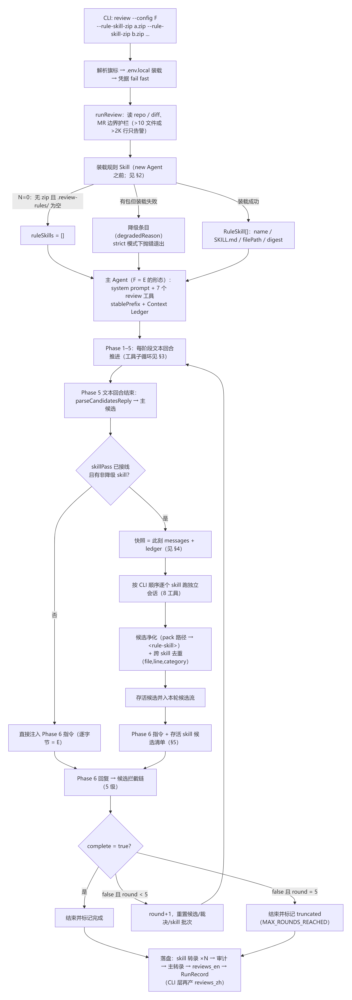
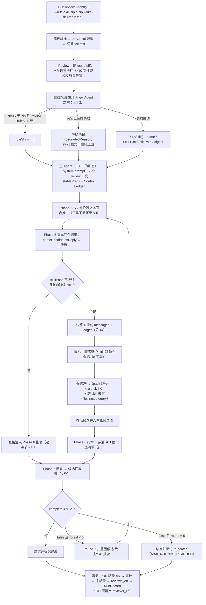
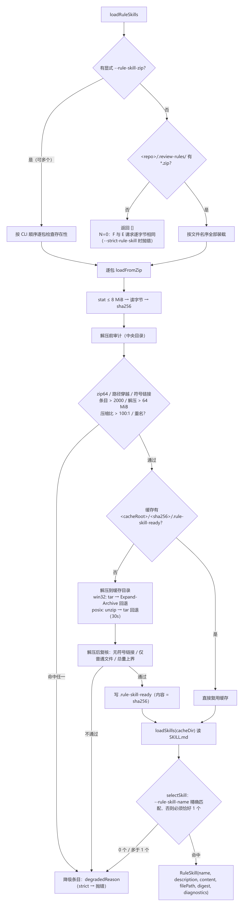
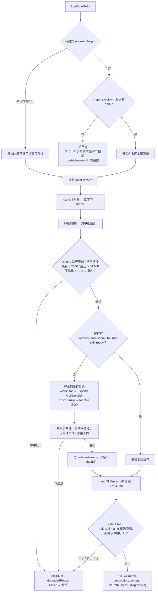
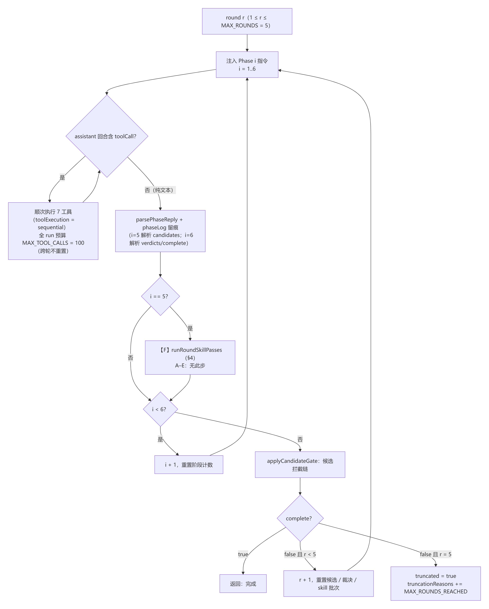
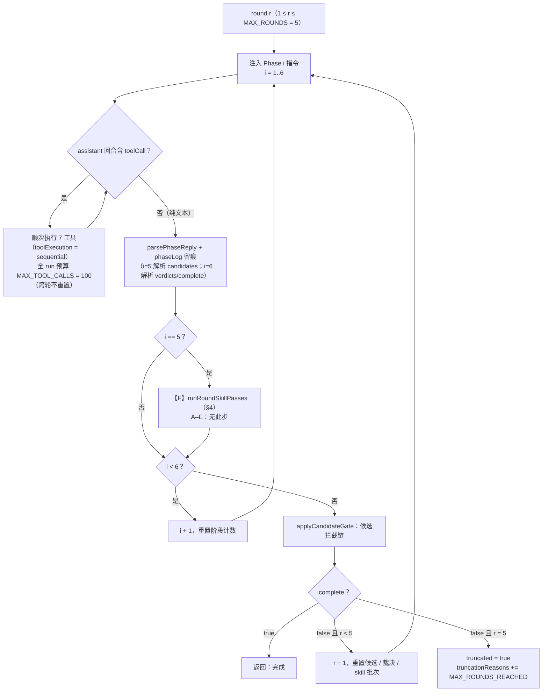
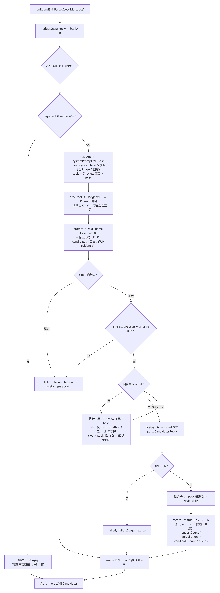
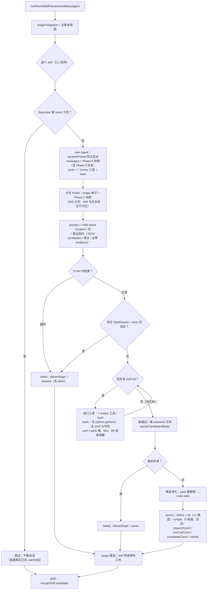
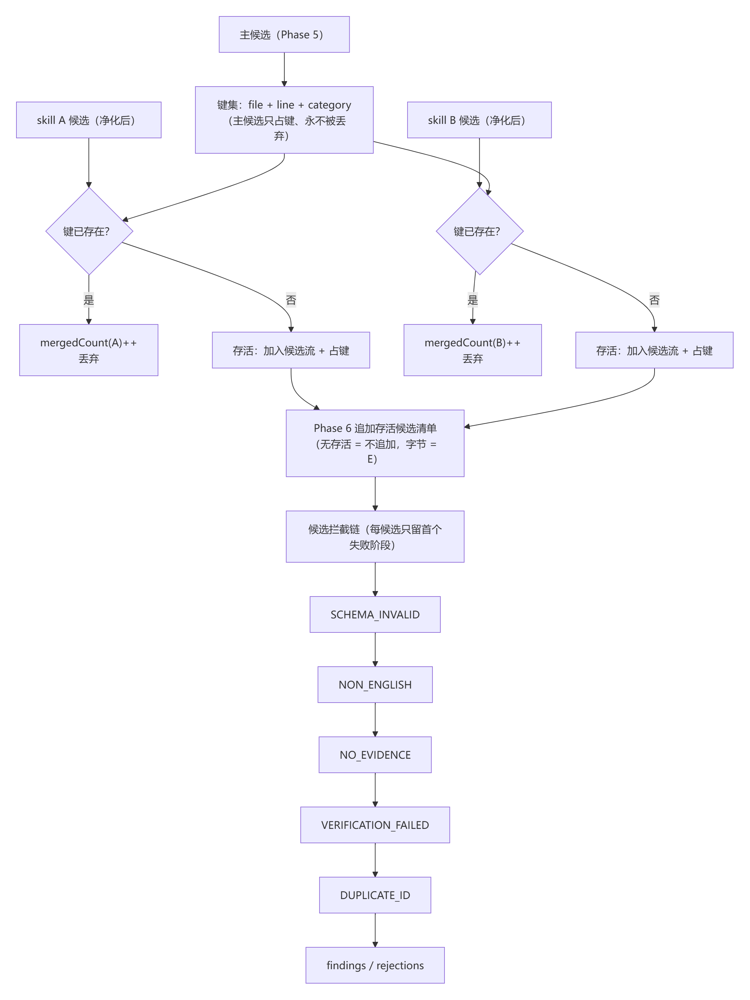
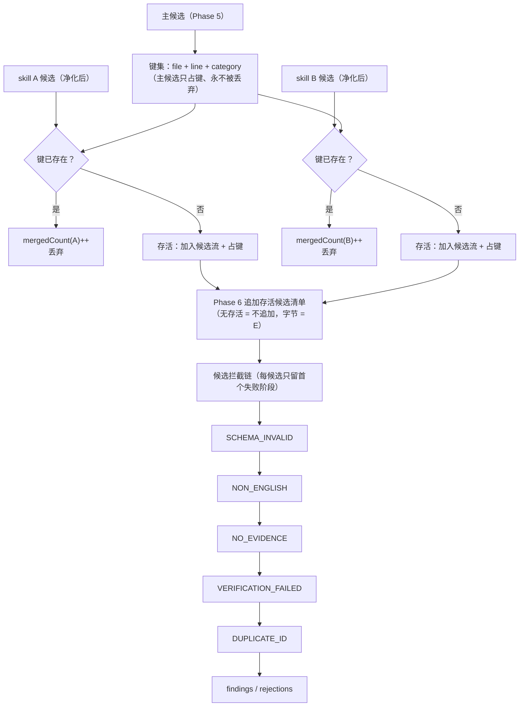

# Config F 完整流程图（现行口径：Phase 5 之后追加独立 Skill 检视会话）

> **定位**：`packages/review-pi` 的 config F 端到端流程单页图。F 不在 A–E 冻结矩阵内——它是 E 之上的扩展位（`F = E + ruleSkill`），用于「项目自带规则 Skill 参与检视」。
> **口径来源**：ADR-0014（取代 ADR-0012 的 Phase 5 简报注入形态与单包限定）＋当前源码。图与文字按代码实际行为绘制，不按设计意图。
> **代码锚点**：`contracts/config.ts:33`、`run/review-run.ts:307-343`、`loop/agent-review-loop.ts:295-390`、`knowledge/rule-skill.ts:124-157`、`knowledge/skill-pass.ts:74-223`、`knowledge/skill-pass-brief.ts:89-113`、`gate/candidate-merge.ts:48-82`、`gate/candidate-gate.ts:25-42`、`tools/skill-bash.ts:219-269`。

---

## 1. 端到端总流程

**图 1｜端到端总流程**



<details>
<summary>Mermaid 源（改动后需重新导出 PNG）</summary>



</details>

**一句话**：F 只改两件事——**在 Phase 5 之后多跑若干独立会话**，以及**在 Phase 6 指令尾部追加存活候选清单**；Phase 1–5 的请求字节、system prompt、七工具 schema 与 E 完全相同。

---

## 2. 装载期：从 zip 到 `RuleSkill`（`new Agent` 之前，不执行包内脚本）

**图 2｜装载期：zip → RuleSkill**



<details>
<summary>Mermaid 源（改动后需重新导出 PNG）</summary>



</details>

装载期边界：

| 项 | 值 / 行为 |
|---|---|
| 缓存位置 | `<out>/<experimentId>/.cache/rule-skills/<sha256>/`，**绝不写回被检仓库** |
| 单包上界 | 8 MiB；条目 ≤ 2000；解压总量 ≤ 64 MiB；压缩比 ≤ 100:1 |
| 解压超时 | 30 s（超时即失败 → 降级或 strict 抛错） |
| 多包顺序 | 显式列表 = CLI 顺序；约定目录 = 文件名序；**执行顺序同此** |
| 多 skill 包 | 必须 `--rule-skill-name` 消歧，否则降级 |
| `--strict-rule-skill` | **只作用于装载期**：任一包失败即抛错；skill 会话失败不中止 run |
| N=0 | `ruleSkill: []`、`skillPassLog: []`，无 skill 会话 |

---

## 3. 主循环（每轮六阶段；F 的插入点在 Phase 5 与 Phase 6 之间）

**图 3｜主循环：六阶段与 F 插入点**



<details>
<summary>Mermaid 源（改动后需重新导出 PNG）</summary>



</details>

要点：

- **阶段推进只由文本回合触发**；工具回合不推进阶段，也不消耗轮次。
- `MAX_TOOL_CALLS = 100` 只约束**主会话**；skill 会话另有 5 min 会话上界，**没有工具预算**。
- 候选解析在 Phase 5；裁决与 `complete` 在 Phase 6，二者都是每轮一次。
- F 的 skill 会话是**每轮都跑**（不是每 run 一次），多轮时成本按轮数放大。

---

## 4. Skill 检视会话（每个 skill 一个独立 Agent）

**图 4｜Skill 检视会话**



<details>
<summary>Mermaid 源（改动后需重新导出 PNG）</summary>



</details>

单会话形态：

| 维度 | 值 |
|---|---|
| 种子 | 主会话 Phase 5 结束时的 `messages` 快照（**含 Phase 5 回复**，即主候选对 skill 可见） |
| 首条 user 消息 | `<skill name="…" location="…">` + `References are relative to …` + SKILL.md 正文 + 输出契约 |
| 工具面 | 7 个 review 工具（同一 schema）＋ `bash`（第 8 只，仅 skill 会话有） |
| 模型 | 与主会话同一 model id / baseUrl / reasoning 档 |
| 结束条件 | 首个**纯文本**回合（skill 只跑一趟，无相位推进） |
| 失败语义 | `failed`（`failureStage: session \| parse`）；`empty` 是合法结果，不是失败 |
| 转录 | 每个会话一份，文件名 `session-<ts>-<config>-<case>-skill-<name>-r<round>.json` |

---

## 5. 候选合流与 Phase 6（两批候选一次裁定）

**图 5｜候选合流与候选门**



<details>
<summary>Mermaid 源（改动后需重新导出 PNG）</summary>



</details>

`Phase 6` 追加段的实际形态（`buildSkillCandidatesBrief`）：

```text
## Rule-skill candidates
Independent rule-skill review passes ran after Phase 5 and produced the candidates below.
Verify them together with your own candidates, applying the same standard.

<skill name="general-code-review">
{"id":"RULE-CHECK@general-code-review@<file>:<line>","severity":…,"category":…,"file":…,"line":…,"title":…,"description":…,"evidence":[…],"rule":"general-code-review","confidence":…}
</skill>

Every candidate id above must appear in your verdicts array. …
```

合流纪律：

| 规则 | 行为 |
|---|---|
| 去重键 | `(file, line, category)`；不同规则/不同主张同键也视为重复，**不合并语义冲突** |
| 主候选优先级 | 主候选先占键，skill 重复项计入该 skill 的 `mergedCount` |
| 跨 skill 顺序 | 先出现的批次胜出（CLI 顺序）；后出现者计入 `mergedCount` |
| schema 非法候选 | **不参与去重**（不查键、不占键），交给候选门以 `SCHEMA_INVALID` 留痕 |
| 账目闭合 | `candidateCount − mergedCount` = 实际并入候选流条数 |
| 候选 id | `RULE-CHECK@<skill>@<file>:<line>`（不含 round，跨轮稳定 → 可被 `DUPLICATE_ID` 拦截） |

---

## 6. 降级与失败矩阵

| 阶段 | 触发 | `--strict-rule-skill` 关（缺省） | `--strict-rule-skill` 开 | 审计留痕 |
|---|---|---|---|---|
| 定位 | zip 缺失 / 目录为空 | 该包降级 / N=0 | 抛错退出 | `ruleSkill[].degradedReason` 或 `ruleSkill: []` |
| 审计 | zip64 / 穿越 / 符号链接 / 超限 / 重名 | 该包降级 | 抛错退出 | 同上 |
| 解压 | 命令失败 / 超时（30s） / 复核不过 | 该包降级 | 抛错退出 | 同上 |
| 装载 | 无 SKILL.md / 0 个或多个 skill 且未消歧 | 该包降级 | 抛错退出 | 同上 |
| 会话 | 异常 / provider error / 超时（5 min） | `status=failed`，run 继续 | **同样不抛**（strict 不覆盖会话） | `skillPassLog[]` + 转录（若发过请求） |
| 解析 | 输出非 JSON / 无 candidates | `status=failed`，`failureStage=parse` | 同上 | 同上 |
| 空产出 | 合法 JSON 但 `candidates: []` | `status=empty`（合法） | 同上 | 同上 |

---

## 7. 审计与产物映射（哪些进账、哪些不进）

| 项 | 主会话 | skill 会话 | 说明 |
|---|---|---|---|
| `audit.requests[]` | ✅ 逐请求 wire | ❌ | skill 属非测量档，F↔E 字节对照只看主链 |
| `audit.toolCallLog[]` | ✅ 逐项 | ❌ | 主会话 7 工具逐条 |
| `audit.phaseLog[]` | ✅ | ❌ | skill 回合不进相位记录（并列而非嵌套） |
| `audit.usage` | ✅ | ✅ | 两者累加（skill 的真实成本不隐藏） |
| `audit.toolCalls` | ✅ | ⚠️ 部分 | 加的是 `skillPassLog[].toolCallCount`，**当前只统计 7 工具、不统计 bash** |
| `audit.ruleSkill[]` | — | — | 每包一条：`source / digest / name / degradedReason / diagnostics` |
| `audit.skillPassLog[]` | — | — | 每条：`round / skill / status / requestCount / toolCallCount / candidateCount / mergedCount / ruleIds / transcriptFile` |
| 转录 | `session-<ts>-<config>-<case>.json` | `session-…-skill-<name>-r<round>.json` | 两者同目录；skill 转录的种子是 Phase 5 快照 |
| `reviews_en.json` | ✅ | — | 导出的是合流后的 findings |
| `reviews_zh.json` | — | — | 仅 CLI 层配置了中文投影引擎时产 |

---

## 8. 与 ADR-0012 旧口径的差异（这张图相对旧图的改动面）

| 维度 | 旧口径（ADR-0012） | 现行口径（ADR-0014 / 本图） |
|---|---|---|
| 注入点 | Phase 5 **消息体内**追加规则简报 | Phase 5 **之后**追加独立会话；Phase 5 消息零修改 |
| skill 的身份 | 规则来源（文本） | 检视者（可调工具、可跑白名单脚本、自出候选） |
| 包数量 | 单包 | 多包，CLI 顺序叠加 |
| 候选合流 | skill 不产候选 | 候选在候选门前跨 skill 去重，Phase 6 一次裁定 |
| 审计 | `ruleSkill` 单对象 | `ruleSkill[]` + `skillPassLog[]` + 独立转录 |
| 脚本执行 | 绝不执行 | 仅 skill 会话内 `bash`：python 白名单、无 shell、cwd=pack 根 |
| F 与 E 的差异 | Phase 5 请求字节不同 | Phase 1–5 相同；仅 Phase 6 在有存活候选时追加清单 |
| N=0 | 需要额外断言 | 天然成立：无包 → 无会话 → 全部请求逐字节相同 |

---

## 9. 一次真实运行的时序（VUL4J-38 / F / general-code-review，2026-10-27）

| 相对时刻 | 事件 | 请求数 |
|---|---|---|
| 0.0 s | CLI 启动 → 装载规则包（缓存命中）→ 主 Agent 开始 | — |
| 0.0–149.5 s | Phase 1–5（Phase 1 占 4 次、Phase 5 占 3 次） | 11 |
| 149.5 s | Phase 5 回复解析出主候选；快照 messages + ledger | — |
| 199.5 s | skill 第 1 次回复（28,291 输入，**cacheRead = 0**） | 1 |
| 199.5–331.9 s | skill 会话余下 4 次请求（其中 2 次命中缓存） | 4 |
| 331.9 s | skill 产出 1 条候选，去重后 `mergedCount = 0`（存活） | — |
| 345.5 s | Phase 6：裁定主候选 + skill 候选 | 1 |
| 358.0 s | 核内完成，转录/审计/RunRecord 落盘 | — |
| ≈466 s | 中文投影完成（8 次翻译请求，**不在审计内**） | 8 |

这次运行的合流结果：4 条 finding，其中 1 条为 skill 产出（`RULE-CHECK@general-code-review@…:167`，P3）。完整成本账见《[运行手册：单次检视](../运行手册-单次检视.md)》与 `runs/f-demo-session-skill2/`。

---

## 10. 已知缺口（读图时的口径提醒，不改变上图语义）

1. **skill 的 bash 调用不进 `toolCallCount`**：`skill-pass.ts` 的计数只挂在 7 工具包装器上，实测 12 次 bash 记成 0。
2. **skill 会话工具面是 8 只、主会话 7 只**：tools 段属稳定前缀，缓存键从 tools 段分叉；实测 skill 前 3 次请求 `cacheRead = 0`（约 8.8 万输入全价）。
3. **对话缓存是 best-effort**：skill 复用主会话 system prompt 与 Phase 1–5 前缀，但命中率受网关前缀门与 tools 面影响，不保证。
4. **`search_rule` / `search_history` 语料恒空**：`runReview` 未给 toolkit 传 `knowledge`，这两个工具在 F/E 下都返回 corpus is empty。
5. **失败路径不落产物**：会话/网关错误时 run 直接抛错，审计与转录都不写（`runs/f-demo-session-skill-2/` 即此形态：只有规则包缓存）。

---

## 11. 相关文档

- `docs/adr/0014-rule-skill-review-pass-after-candidates-phase.md` —— 本图的口径来源（决策 1–15）。
- `docs/adr/0012-project-rules-as-rule-skill-injected-at-candidates-phase.md` —— 被取代的旧注入形态（装载/审计/降级部分仍有效）。
- `docs/design/规则 Skill 与 config F 方案——项目规则检视落地.md` —— zip 定位/审计/解压与降级细节。
- `docs/运行手册-单次检视.md` —— 生产形态命令、产物布局与排障。
- `docs/配置矩阵A-E说明.md` —— A–E 各配置语义（F 是 E 的扩展位）。
