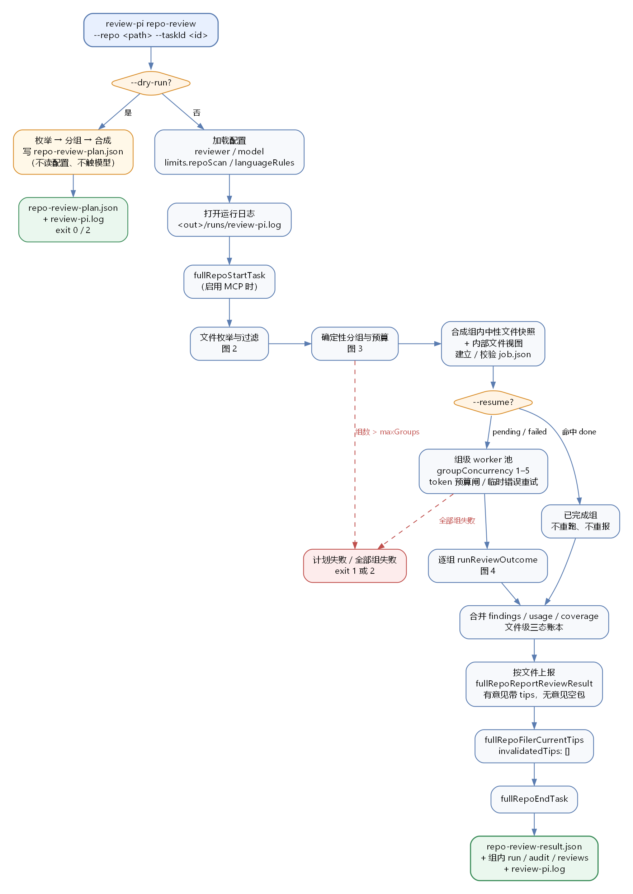
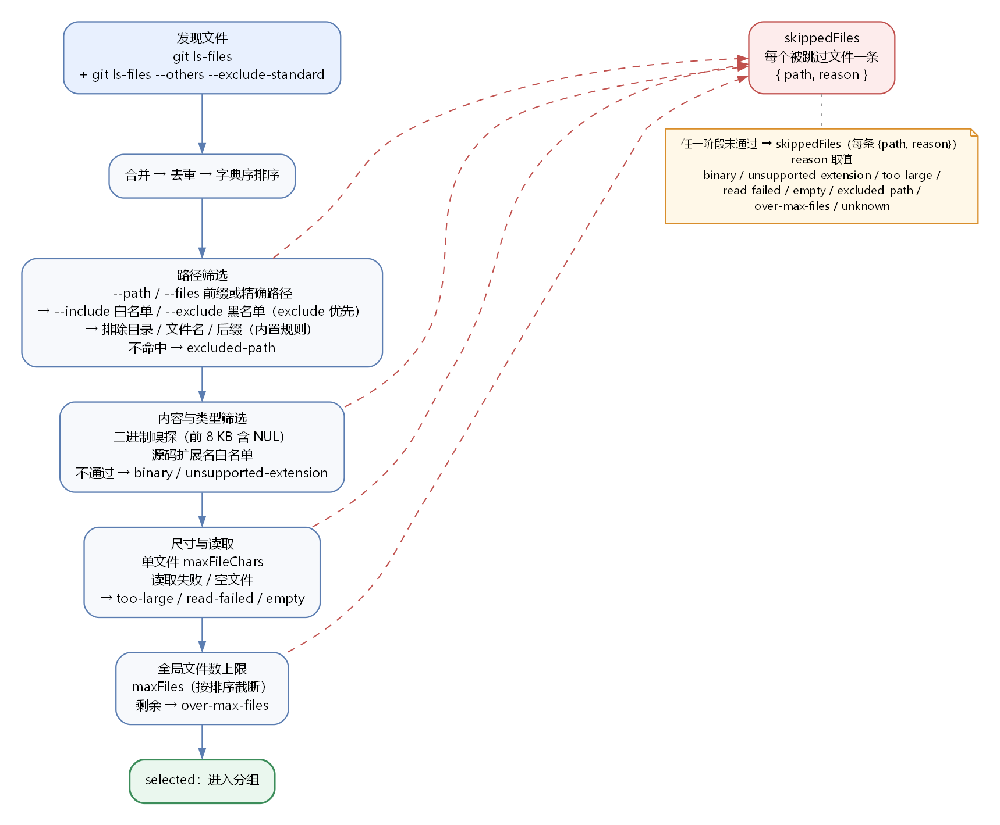
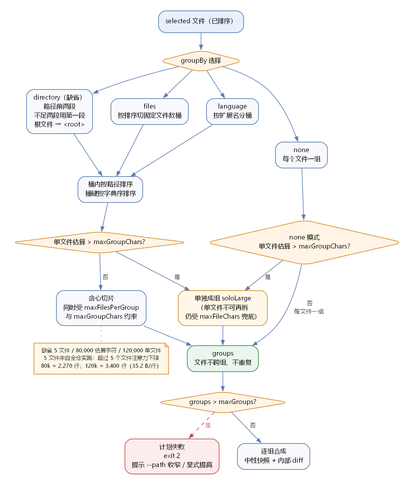
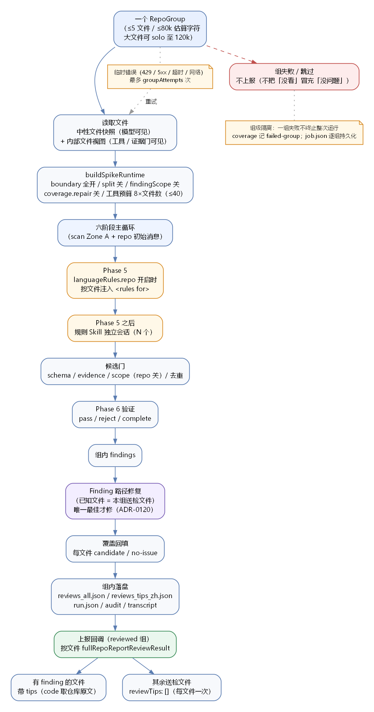
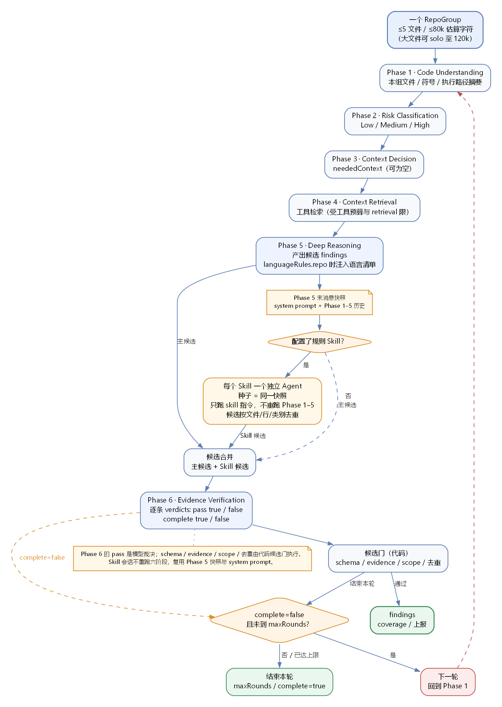
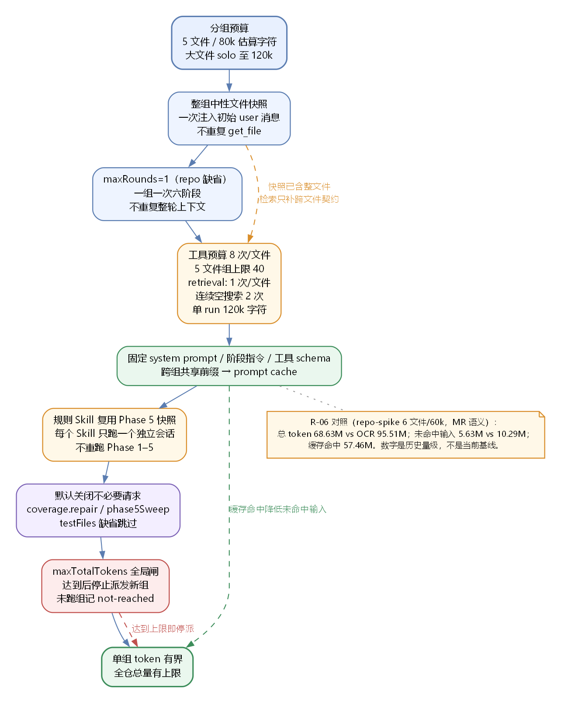

# 全仓扫描：方案与输入契约

**状态**：定稿（2026-11-24，`exp-repo-review`；2026-11-26 增补流程图、R-06 实测对照、v3 91 条单次文件数依据、六阶段/规则 Skill 与全仓 token 策略，缺省为 5 文件 / 80k 组 / 120k 文件）
**范围**：R-01。定义「无变更集的全仓扫描」的输入、单元、行锚点、输出与 CLI 形态；R-02–R-07 按本文实现或明确偏离。
**实现现状**：`src/repo-spike/` 是可运行探针；R-04b（2026-11-25）已接入 `review-pi repo-review`、scan 专用提示词与中性文件快照；R-05b 已接入文件级三态覆盖账本；R-09 已接入 `job.json`、`--resume`、错误重试与总 token 预算；MCP 全仓四工具上报已接入（§6.4，ADR-0117）；语言缺陷清单（§4.4，ADR-0118）、运行日志（`<out>/runs/review-pi.log`）、Finding 路径修复（ADR-0120）、逐文件空 tips 补报（ADR-0119）与大文件单文件成组（ADR-0121）已接入。§8 的差异表保留为拆分时的历史记录。

---

## 流程图

以下按**现行实现**绘制；源文件与 PNG 同目录 [`assets/repo-review-flow/`](assets/repo-review-flow/)，修改后用 Graphviz 重新渲染：

```bash
cd docs/design/assets/repo-review-flow
dot -Tpng -Gdpi=150 01-global.dot -o 01-global.png
```

### 图 1：全局流程



从 CLI 入口到产物收口：`--dry-run` 与真跑分叉；真跑依次加载配置、打开运行日志、
MCP `fullRepoStartTask`、枚举与分组、合成组内快照 / 内部文件视图、建立 / 校验
`job.json`；组级 worker 池逐组执行六阶段，失败组隔离；最后合并 findings /
usage / coverage，按文件上报 `fullRepoReportReviewResult`，再
`fullRepoFilerCurrentTips` → `fullRepoEndTask` → 聚合产物。
MCP 未配置时四个业务 tool 全部跳过，检视与产物不受影响。

### 图 2：文件枚举与过滤



`git ls-files` 与 untracked 文件合并去重排序后，依次做路径前缀 / 正则 / 目录与
后缀、二进制、扩展名、单文件尺寸与读取、全局 `maxFiles` 过滤。任一阶段未通过
都进入 `skippedFiles`，每条带稳定 `reason`；`selected` 才进入分组。

### 图 3：分组与预算



按 `groupBy` 分桶（`directory` / `files` / `language` / `none`），桶内与桶键都
确定性排序；除 `none` 外按 `maxFilesPerGroup` + `maxGroupChars` 贪心切片。
单文件估算超过 `maxGroupChars` 时不再整文件跳过，而是**单独成组**（`soloLarge`）；
单文件体积由枚举阶段的 `maxFileChars` 兜底。组数超过 `maxGroups`
直接失败（exit 2），不静默截断。

### 图 4：单组执行与上报



每个组读取文件生成「中性文件快照 + 内部文件视图」，在 `repo` 运行时覆盖
（boundary 全开、split 关、findingScope 关、coverage.repair 关、工具预算
8 × 组内文件数、单组上限 40）下跑六阶段；Phase 5 可按 `languageRules.repo`
注入语言清单，Phase 5 之后跑规则 Skill 会话。组内 findings 先做路径修复
（ADR-0120）再回填覆盖账本；reviewed 组按文件上报，有意见带 tips，其余送检
文件各补一条 `reviewTips: []`（ADR-0119）；失败 / 跳过组不上报。

### 图 5：六阶段与规则 Skill



每组的执行顺序固定为 Phase 1 Code Understanding → Phase 2 Risk Classification →
Phase 3 Context Decision → Phase 4 Context Retrieval → Phase 5 Deep Reasoning →
Phase 6 Evidence Verification。Phase 5 结束时保留消息快照；配置了规则 Skill 时，
每个 Skill 以同一快照为种子起独立 `Agent`，只跑 Skill 指令，不重跑 Phase 1–5；
主候选与 Skill 候选合并去重后，进入一次 Phase 6 裁决。

### 图 6：全仓 token 策略



整组文件快照只注入一次；repo 缺省 `maxRounds=1`；工具预算按 8 次/文件分配
（5 文件组上限 40 次）与 retrieval 限控制跨文件检索；固定 system prompt /
阶段指令 / 工具 schema 跨组复用前缀缓存；规则 Skill 复用 Phase 5 快照；
`coverage.repair` / `phase5Sweep` / 测试文件缺省关闭；`maxTotalTokens` 作为
全仓闸门。详见 §4.6。

---

## 1. 问题

现有 `review-pi review` 的输入契约是 **MR 变更集**，不只是「多一个参数」：

- 变更集是覆盖分母（哪些文件/行需要看）；
- 变更集是证据范围（finding 必须落在变更 hunk ±N 行）；
- 变更集是提示词语义（「本次新增」「回归风险」）；
- 变更集是行锚点（新侧行号）；
- 变更集是评测口径（iterF91 / AACR 的 GT 都挂在 MR 上）。

全仓扫描没有变更集。若直接把「全仓」塞进现有 `review`，上述五层会同时失真。因此需要一份独立契约，再决定哪些层复用、哪些层新建。

---

## 2. 决策摘要

| # | 决策点 | 结论 |
|---|---|---|
| D1 | 输入 | 仓库快照路径（git 工作树）+ 可选路径前缀；**不接收变更集**。tracked + untracked 都纳入，按确定性规则枚举。 |
| D2 | 检视单元 | **文件**。分组是执行/预算单元，不是语义单元；不把一个文件拆到多个组。 |
| D3 | 行锚点 | **真实文件行号**（1-based）。finding 指向仓库中已存在的行；没有「新增行」概念，不引入 `newLine` / `oldLine` 双坐标。 |
| D4 | 输出 | 新增 `repo-review-result.json` 作为唯一聚合产物；组内保留 MR 兼容的 `reviews_en.json` / `reviews_tips_zh.json`；不写 `mrReviewResult`，不伪造 base/head。 |
| D5 | CLI | 产品化命令 `review-pi repo-review`；`repo-spike` 仅作为探针保留到 R-04 完成。dry-run 零模型、零配置。 |
| D6 | 预算 | 组级 `maxFilesPerGroup` + `maxGroupChars` 双上限；全局 `maxFiles`；组并发 `groupConcurrency`；可选 `maxTotalTokens`（R-04 实现）。 |
| D7 | 覆盖 | 文件 × 区域三态：`candidate` / `no-issue` / `not-reached`；跳过文件必须有原因；失败组必须显式标记。 |
| D8 | 评测 | 全仓 GT 独立构造（注入缺陷 + 模型复核），**不复用** iterF91 / AACR 的 MR 指标，不与 MR 成绩混报。 |

---

## 3. 输入契约

### 3.1 模式

模式由命令决定，不做 `--mode` 开关：

- `review`：现有 MR 检视，输入参数与行为不变；
- `repo-review`：新增全仓检视，输入 `--repo <path>`，不接收变更集。

两条命令共享底层 `runReviewOutcome`，但输入适配层、提示词与产物根独立。

### 3.2 快照

- `--repo` 必须是 git 仓库根（或可被 `git -C` 识别的工作树）。
- 快照 = 当前工作树，不是某个 commit；tracked 文件与 untracked（`--others --exclude-standard`）都纳入。
- 不自动 fetch / checkout / stash；调用方负责把工作树停在要检视的版本。
- `--path <prefix>` 可重复，限定仓库内相对路径前缀；不存在的前缀直接报错，不静默变空。

### 3.3 文件枚举与过滤

确定性顺序：`git ls-files` 与 `git ls-files --others --exclude-standard` 合并 → 去重 → 字典序排序 → 过滤。完整流程见 [图 2](#图-2文件枚举与过滤)。

过滤层次（从高到低）：

1. **路径前缀**：`--path` 命中才保留；
2. **路径正则过滤**：`--include` 白名单（命中任一才保留）、`--exclude` 黑名单（命中即剔除，优先于白名单）；非法正则忽略并提示；
3. **排除目录 / 文件名 / 后缀**：`.git`、`node_modules`、`dist`、`build`、`target`、`vendor`、`generated` 等；
4. **二进制嗅探**：前 8 KB 含 NUL 即跳过；
5. **源码扩展名白名单**：至少覆盖 `java/kt/scala/go/py/ts/tsx/js/jsx/c/cpp/h/hpp/cs/rs/rb/php/swift/m/mm/sql/sh`；
6. **单文件字符上限**：`maxFileChars`，超限跳过并留原因；
7. **全局文件数上限**：`maxFiles`，按排序截断并留原因。

每条跳过都要有 `{ path, reason }`，原因取值固定：`excluded-dir` / `excluded-name` / `excluded-suffix` / `excluded-path` / `binary` / `unsupported-extension` / `too-large` / `over-max-files` / `read-failed`。

> 现状：`repo-spike/enumerate.ts` 已实现 2–6；R-02 需要把排除规则做成配置（`limits.repoScan.*`）并补 `read-failed` 的稳定归因。

### 3.4 不做的事

- 不根据变更集判断「哪些行是新的」；
- 不读取 `.gitignore` 之外的 ignore 文件（v1 只认 git 自带语义 + 内置规则）；
- 不自动识别生成物内容（v1 只按目录/后缀启发式）；
- 不默认扫描测试文件；是否扫测试由 `limits.repoScan.includeTests` 决定（缺省 false）。

---

## 4. 检视单元与分组

### 4.1 单元

一个文件是一个**不可拆**的检视单元。分组只为执行与预算服务：

- 文件不跨组、不重复；
- 组内文件顺序 = 全局排序顺序；
- 组数、组内文件数、组字符量都写入计划产物，dry-run 可审计。

### 4.2 分组策略

分组与预算的完整流程见 [图 3](#图-3分组与预算)。

| 策略 | 键 | 适用 |
|---|---|---|
| `directory`（缺省） | 路径前两段；不足两段用第一段 | 常规仓库，保留模块边界 |
| `files` | 按排序切固定文件数桶 | 路径语义弱、只想控成本 |
| `language` | 扩展名 | 多语言仓库，按语言配规则 |
| `none` | 每文件一组 | 精确定位、单文件重跑 |

每组同时受 `maxFilesPerGroup`（缺省 5）与 `maxGroupChars`（缺省 80,000）约束。
5 文件是**保守默认**：v3 91 条对照显示 1–10 文件稳定，11–20 开始明显下滑
（见 §4.2.1）；80k / 120k 是按 35.2 B/行折算与上下文预算定的字符上限。单文件超过
`maxGroupChars` 时**不截断、不拆分**，也不再整文件跳过，而是单独成组
（`soloLarge`）；单文件体积由枚举阶段 `maxFileChars`（缺省 120,000）兜底，
超过该值才记 `too-large`。

**三段式规则**：

```text
cost = 文件字节数（size） + 256（每文件固定开销）
cost ≤ maxGroupChars                    → 正常与同目录文件装箱，最多 5 个
cost > maxGroupChars 且 size ≤ maxFileChars → 单文件成组（soloLarge）
size > maxFileChars                     → 枚举阶段跳过，reason=too-large
```

按 R-06 实测的 Java 密度 **35.2 B/行**折算：

| 口径 | 字符 | 约合行数 | 说明 |
|---|---:|---:|---|
| 典型 5 文件组 | 5 × 4.8 KB ≈ 24 KB | ≈ 680 行 | 5 文件上限先触发，80k 通常用不到 |
| `maxGroupChars` | 80,000 | ≈ 2,270 行 | 普通多文件组的装箱上限 |
| `maxFileChars` | 120,000 | ≈ 3,400 行 | 单文件硬上限 |
| 大文件 solo 区间（size） | 79,745–120,000 | ≈ 2,265–3,400 行 | 单文件成组，仍受 120k 兜底 |

> 80k 是“普通组”的预算，不是单文件预算；单文件组允许超过 80k，但仍不超过
> 120k。`groupBy=none` 时每个文件本来就是一组，因此所有 ≤120k 的 selected
> 文件都能进入检视。

#### 4.2.1 单次文件数依据（v3 91 条）

数据：`baseline-f91-v3`（2026-11-21，91 条 / 588 GT，P=hit_new_gt，
R=covered_gt）；分档按 coverage 账本的**实际送检文件数**。同一批 91 条固定分档，
可直接对比不同版本。

| 文件数档  |  样本 |  文件 | GT/文件 | GT/hunk | hunks/文件 |     P |     R |     B | token |       时长 |
| ----- | --: | --: | ----: | ------: | -------: | ----: | ----: | ----: | ----: | -------: |
| 1–5   |  57 | 167 |  1.53 |   0.492 |     3.10 | 37.3% | 28.2% | 32.1% | 25.9M | 194.5min |
| 6–10  |  13 | 102 |  1.03 |   0.412 |     2.50 | 43.8% | 27.6% | 33.9% |  5.0M |  50.6min |
| 11–20 |  17 | 247 |  0.71 |   0.275 |     2.58 | 34.8% | 18.9% | 24.5% | 14.7M | 118.2min |
| 21+   |   4 | 109 |  0.49 |   0.210 |     2.31 | 38.5% | 18.9% | 25.3% |  7.6M |  48.9min |
| 合计    |  91 | 625 |  0.94 |   0.354 |     2.66 | 38.1% | 24.5% | 29.8% | 53.1M | 412.2min |

> token 为输入 + 输出 + 缓存命中；时长为各样本 `duration` 串行求和。

判读：

- **1–10 稳定**：1–5 与 6–10 的 B 为 32.1% / 33.9%，R 为 28.2% / 27.6%；
  6–10 只有 13 条样本，且单样本时长更高（3.89 vs 3.41 min），不足以支持把
  默认值提高到 10。
- **11–20 是拐点**：相对 1–5，R 下降 9.3pp、B 下降 7.6pp，单样本 token 从
  0.45M 升到 0.87M（+91%），时长从 3.41 min 升到 6.95 min（+104%）。
- **下滑主要是召回**：P 只从 37.3% 降到 34.8%，不是“报得更多更乱”，而是
  “该看的没看全”。
- **21+ 不作为依据**：只有 4 条样本，B 25.3% 与 11–20 的 24.5% 接近，没有
  继续单调下滑，单条样本即可左右结果。

因此单次送检文件数控制在 **5–10**；默认取 **5**，把单次输入压在一半稳定区，
给大文件单文件组和上下文余量留空间。超过 10 个文件不推荐作为默认。

### 4.3 组数护栏

`maxGroups`（缺省 500）防止误扫超大仓库。大文件单文件成组会增加组数，大文件
多的仓库可能更早触及这一护栏。超过时**不静默截断**：计划失败，提示提高
`maxGroups` 或收窄 `--path`。dry-run 必须先通过这一关。

### 4.4 语言缺陷清单（ADR-0118）

- 只支持 AST 已支持的 5 种语言：java / typescript（ts,tsx,js,jsx,mjs,cjs）/ python / go / cpp（c,h,cc,cpp,cxx,hpp,hh,hxx）；
- 只在 **Phase 5（候选生成）** 追加，不改 system prompt 与其他阶段；
- 按组内实际送检文件选择；混合语言用 `<rules for="path1, path2">` 分块；
- 开关 `limits.languageRules = { mr, repo }`，缺省全关；全仓只看 `repo`；
- 规则为中文、缺陷导向（已删除拼写/命名/注释/格式/风格条目）。

### 4.5 组内执行：六阶段与规则 Skill

完整流程见 [图 5](#图-5六阶段与规则-skill)。

#### 4.5.1 六阶段

每组固定执行六阶段；阶段名与顺序写入审计 `phaseLog`，repo 模式 Phase 1 为
`Code Understanding`（不是 MR 的 `Change Understanding`）。

| # | 阶段 | 产出 | 关键约束 |
|---|---|---|---|
| 1 | Code Understanding | `{"summary": "…"}` | 只理解本组文件，不假设 MR |
| 2 | Risk Classification | `{"riskClass": "Low" / "Medium" / "High", "reason": "…"}` | 用于后续上下文策略 |
| 3 | Context Decision | `{"neededContext": ["…"], "reason": "…"}` | 可为空；compact 模式下为空可跳过 Phase 4（repo 缺省 `stageCompression=off`） |
| 4 | Context Retrieval | `{"notes": "…"}` | 可用工具；受工具预算（8 × 文件数，≤40）与 retrieval 限 |
| 5 | Deep Reasoning | `{"candidates": [Finding, …]}` | `languageRules.repo` 在此注入语言清单 |
| 6 | Evidence Verification | `{"verdicts": [{"id","pass","reason"}], "complete": bool}` | `pass` 是模型裁决；其余由代码候选门复核 |

- Phase 6 的 `pass:false` 只驳回该候选；没有对应裁决也按驳回处理；
- `complete:false` 且未到 `maxRounds` 时回到 Phase 1；repo CLI 缺省
  `--max-rounds 1`，因此一组默认只跑一轮；
- 输出被截断时，即使模型声明 `complete:true`，最终 `outcome.complete` 也为
  `false`（截断优先）。

#### 4.5.2 规则 Skill 加载

规则 Skill 只在 Phase 5 之后、Phase 6 之前加载（ADR-0014），来源为
`--rule-skill*` / `--skill`，每组独立装载：

1. Phase 5 文本回合结束后，保留主会话 messages 快照（system prompt + Phase 1–5
   历史）；
2. 每个未降级的 Skill 起一个**独立 `Agent`**，种子 = 同一快照；首条 user 消息
   是 Skill 指令 + 输出契约；Skill 之间、Skill 与主会话之间互不可见；
3. Skill 会话**不重跑 Phase 1–5**，只跑一次 Skill 回合（可调用检视工具与
   `bash`）；0 候选是合法结果；
4. 主候选与各 Skill 候选按**同根因**跨会话去重（同文件、同 category、行号
   ±5，且 rule 相同或标题相似度 ≥0.5），合并后进入一次 Phase 6 裁决；
5. 装载失败 / 降级的 Skill 不跑会话，只在 `ruleSkill[]` 记录装载事实。

### 4.6 全仓 token 策略（对 repo 有效）

完整关系见 [图 6](#图-6全仓-token-策略)。以下策略只针对全仓组级执行；MR 路径
不变。

| 策略 | 机制 | 对 repo 的效果 / 证据 |
|---|---|---|
| 整组快照一次注入 | `buildRepoInitialUserMessage` 只注入整组文件内容；内部文件视图只供工具 / 证据 / 覆盖账本使用 | 模型不需要为每个文件重复 `get_file`；R-06 每文件总 token 49.4k，低于 OCR 的 68.8k |
| 5 文件 / 80k 分组 | 组级双上限，见 §4.2 | 1–10 文件稳定；11–20 单样本 token +91%、时长 +104%（§4.2.1） |
| `maxRounds=1` | repo CLI 缺省一组一轮 | 不重复发送整轮六阶段上下文；需要二轮时显式提高 |
| 工具预算 `maxToolCallsPerFile=8` / `maxToolCallsPerGroup=40` + retrieval 1/2/120k | 单组执行预算 = `min(40, 8 × 文件数)`；尝试预算 = 执行预算 + 10；5 文件组最多 40 次，1 文件组 8 次 | 历史 255 组中 87% 打满 15、39% hunk 因预算未覆盖；按文件数分配给足检索空间，同时保留 40 次硬上限 |
| 固定 system prompt / 阶段指令 / 工具 schema | 跨组共享前缀，组内容放在后部 | R-06 缓存命中输入 57.46M vs 未命中 5.63M（约 91% 输入走缓存） |
| 规则 Skill 复用 Phase 5 快照 | Skill 会话从快照分叉，不重跑六阶段 | N 个 Skill 只增加 Skill 回合，不增加 N 次 Phase 1–5 |
| 缺省关闭非必要请求 | `testFiles.skip=true`、`coverage.repair=false`、`phase5Sweep=false` | 少选测试文件、少发补漏 / 额外扫描请求 |
| `maxTotalTokens` 全局闸 | 达到预算后停止派发新组 | 全仓总量有上限；未跑组记 `not-reached` |
| 语言清单只在 Phase 5 注入 | 不改 system prompt，只追加该阶段消息 | 保持跨组前缀稳定，避免整段系统提示分叉 |

> **工具预算落地**：`limits.repoScan.maxToolCallsPerFile`（缺省 8）与
> `limits.repoScan.maxToolCallsPerGroup`（缺省 40）；单组执行预算 =
> `min(maxToolCallsPerGroup, maxToolCallsPerFile × 文件数)`，尝试预算固定为
> 执行预算 + 10。5 文件组为 40 / 50，1 文件组为 8 / 18。

> R-06 数字来自 `repo-spike` 历史对照（6 文件/组、60k、MR 语义），用于量级参考，
> 不是当前版本基线。`stageCompression=compact` 在 91 条全量回退（B 23.7% vs
> v3 29.8%），repo 侧不把它当作默认节省策略；需要时显式开启并单独评测。

---

## 5. 行锚点与证据

- `Finding.line` = 文件中的真实行号，1-based。
- 证据摘录必须来自该文件该行附近（±N 行）；行号必须是真实文件行号，不能使用合成行号。
- 不引入 `lineType`（added/context）字段；repo 模式没有这个概念。
- `Finding.file` = 仓库相对路径，统一 `/` 分隔。
- 对「整文件级」问题（如缺少 license、类职责过载），`line` 取该类/文件声明的首行；不允许多行区间字段（v1 保持 Finding 契约不变）。

> 探针用「全新增」合成文件视图复用 MR 流水线，行号恰好等于真实行号，因此锚点语义成立；但提示词仍会把既有代码说成「本次新增」。这是 R-04 要修的语义债，不是锚点债。

---

## 6. 输出契约

### 6.1 聚合产物

`<out>/repo-review-result.json`（`<out>` 缺省 = `<tasks 根>/<taskId>`，可用 `--out` 覆盖）：

```jsonc
{
  "schemaVersion": 1,
  "mode": "repo",
  "generatedAt": "2026-11-24T…",
  "repoPath": "D:/path/to/repo",
  "snapshot": { "head": "<sha|null>", "dirty": true, "untracked": 12 },
  "inventory": {
    "discovered": 2627,
    "selected": 1607,
    "skipped": [{ "path": "…", "reason": "unsupported-extension" }]
  },
  "plan": { "groupBy": "directory", "groups": 161, "maxFilesPerGroup": 5, "maxGroupChars": 80000, "maxFileChars": 120000 },
  "groups": [
    {
      "index": 1,
      "key": "spring-ai-alibaba-graph-core",
      "status": "ok",              // ok | failed | skipped
      "files": ["…"],
      "findingsCount": 3,
      "usage": { "inputTokens": 0, "outputTokens": 0, "cachedInputTokens": 0 },
      "elapsedMs": 12345,
      "error": null
    }
  ],
  "findings": [ /* 合并、去重、重编号后的 Finding[] */ ],
  "usage": { "inputTokens": 0, "outputTokens": 0, "cachedInputTokens": 0 },
  "coverage": {
    "summary": { "selected": 1390, "candidate": 812, "noIssue": 520, "notReached": 58 },
    "files": [
      { "path": "…", "state": "candidate", "findingIds": ["F001"] },
      { "path": "…", "state": "no-issue" },
      { "path": "…", "state": "not-reached", "reason": "too-large" }
    ]
  }
}
```

约束：

- `groups[].findings` 不重复存整份 findings，只存计数；完整列表在顶层 `findings`。
- `groups[].status=failed` 不终止整次运行；失败组的文件在 coverage 中记 `not-reached` + `failed-group`。
- coverage v1 是**文件级**三态；`candidate + noIssue + notReached = selected`，每个 selected 文件恰好一条，按枚举顺序输出。
- `not-reached` 的 reason 取值固定：`failed-group` / `group-too-large` / `too-large` / `binary` / `unsupported-extension` / `excluded-path` / `not-a-regular-file` / `empty` / `read-failed` / `no-reviewable-files` / `budget-exhausted` / `over-max-files` / `unknown`。
- 退出码：0 = 完成；2 = 部分完成（失败组 / 预算停止）；1 = 全部组失败；dry-run 计划失败 = 2。

### 6.2 组内产物与运行日志

每组目录 `<out>/runs/<slug>/`（`slug = g001-<key>`）保留现有流水线产物：

- `runs/reviews_all.json`（组内 findings 真源）；
- `runs/reviews_tips_zh.json`（组内中文 tips）；
- `runs/run.json` / `runs/audit/` / `runs/session-*.json` / `runs/request-timeline.jsonl`。

任务级运行日志 `<out>/runs/review-pi.log`：全仓命令的 stderr 实时镜像（同步
追加），覆盖枚举 / 分组 / 每组进度 / MCP 上报 / 收尾；`--dry-run` 同样写入。
打开或写入失败只告警，不影响检视结果与退出码。

这些文件**只用于逐组复核**，不是对外契约；对外只认聚合产物。

### 6.3 不写什么

- 不写 `mrReviewResult` / `review-result.json` 的 MR 形状；
- 不写 `baseSha` / `headSha` / `mrId` 等伪造字段；
- 不把 repo 结果写到 cwd 的 `.review-pi-session.json` / `review-result.json`。

### 6.4 MCP 上报（ADR-0117）

上报在全局流程中的位置见 [图 1](#图-1全局流程)，单组内按文件上报见
[图 4](#图-4单组执行与上报)。

复用 PR 的 `mcp.report.server` 配置与连接能力，但业务 tool 换成全仓专用一套；
开关仍由 `mcp.report.task` 控制（缺省 true），`mcp` 未配置 = 零建连、零调用。

| 顺序 | tool | 参数 | 时点 |
|---|---|---|---|
| 1 | `fullRepoStartTask` | `{ taskId }` | 枚举 / 分组之前 |
| 2 | `fullRepoReportReviewResult` | `{ taskId, filePath, reviewTips[] }`（与 `mrReviewResult` 同形） | 每个组检视完成后，按文件逐条上报 |
| 3 | `fullRepoFilerCurrentTips` | `{ taskId, invalidatedTips[] }`；v1 恒空数组 | 全部组上报之后 |
| 4 | `fullRepoEndTask` | `{ taskId }` | 收尾（`finally`；start 成功过才发） |

- 每个 reviewed 组上报其**实际送检**的全部文件：有意见的带 tips，无意见的补
  `reviewTips: []`；失败 / 跳过 / 预算停止的组不上报（避免把「没看」冒充成
  「没问题」）。
- `--resume` 跳过的已完成组不重报（v1 避免重复意见）。
- 两段固定沉降沿用 PR 口径：最后一批上报 → `fullRepoFilerCurrentTips`、
  `fullRepoFilerCurrentTips` → `fullRepoEndTask`。
- 任何上报失败只落 stderr 一行，不改变检视结果与退出码。

---

## 7. CLI 契约

```bash
review-pi repo-review --repo <path> --taskId <id> [options]
```

| 旗标 | 缺省 | 说明 |
|---|---|---|
| `--repo` | 必需 | 仓库快照根 |
| `--taskId` | 必需 | 任务 id（单段目录名）；产物落到 `<tasks 根>/<taskId>/` |
| `--tasks-dir` | `~/.PiAgent/tasks` | 只覆盖 tasks 根，taskId 语义不变 |
| `--out` | `<tasks 根>/<taskId>` | 显式输出目录覆盖（实验 / CI 用） |
| `--model` | 无 | 已废弃（ADR-0093 同策略）：接受但忽略，模型取配置 `model.default` |
| `--dry-run` | false | 只枚举/分组/写计划与运行日志，不加载配置、不触模型 |
| `--group-by` | `directory` | `directory` / `files` / `language` / `none` |
| `--max-files-per-group` | 5 | 组内文件数上限 |
| `--max-group-chars` | 80000 | 普通多文件组的估算字符上限；单文件超限时单独成组 |
| `--max-groups` | 500 | 组数护栏 |
| `--max-files` | 2000 | 全局文件数上限 |
| `--max-file-chars` | 120000 | 单文件字符上限；超过才在枚举阶段跳过 |
| `--group-concurrency` | 1 | 组并发；上限 5（v1） |
| `--max-rounds` | 1 | 每组最大轮次 |
| `--max-total-tokens` | 0 | 总 token 预算（含缓存）；0 = 不限；达到后停止派发新组 |
| `--group-attempts` | 2 | 单组尝试次数；只对 429 / 5xx / 超时 / 网络类临时错误重试 |
| `--resume` | false | 读取 `<out>/job.json`，校验快照 / 配置 / 计划 hash 后跳过已完成组 |
| `--path` | 无 | 路径前缀，可重复 |
| `--files` | 无 | 精确文件清单（逗号分隔或重复旗标）；与 `--path` 可叠加 |
| `--include-tests` | false | 是否纳入测试文件（覆盖 `limits.repoScan.includeTests`） |
| `--include` | 无 | 路径白名单正则（仓库相对 POSIX 路径），可重复；非法正则忽略并提示 |
| `--exclude` | 无 | 路径黑名单正则，可重复；命中即剔除，优先于 `--include` |
| `--rule-skill*` / `--skill` | 无 | 规则 Skill 透传，每组独立会话 |
| `--no-progress` | 打印 | 关闭进度行 |

`repo-spike` 保留为同一实现的历史命令名。运行状态写入 `<out>/job.json`；缺省 `<out>` = `<tasks 根>/<taskId>`。退出码：0 = 完成，2 = 部分完成（失败组 / 预算停止），1 = 全部失败。

上表的数值 / 枚举旗标也可写入 `limits.repoScan` 作为缺省（`config init` 会生成带注释的默认块）。优先级：**CLI 显式旗标 > `limits.repoScan` > 内置缺省**；`--include/--exclude` 出现时整体替换对应配置维度，传空值 = 本次清空。`--taskId` / `--tasks-dir` / `--out` / `--model` 不进配置。

`--max-group-chars` 只约束多文件组；单文件超过它但不超过 `--max-file-chars` 时
单独成组（`soloLarge`），这是全仓检视的大文件入口。按 35.2 B/行折算，
80k ≈ 2,270 行、120k ≈ 3,400 行。

### 7.1 `config init` 生成的缺省块

`review-pi config init` 会写入完整的 `limits.repoScan`，数值与内置缺省一致：

```jsonc
"repoScan": {
  "groupBy": "directory",
  "maxFilesPerGroup": 5,
  "maxGroupChars": 80000,
  "maxGroups": 500,
  "maxFiles": 2000,
  "maxFileChars": 120000,
  "maxToolCallsPerFile": 8,
  "maxToolCallsPerGroup": 40,
  "maxRounds": 1,
  "groupConcurrency": 1,
  "maxTotalTokens": 0,
  "groupAttempts": 2,
  "includeTests": false,
  "trackedOnly": true,
  "includeRegex": [],
  "excludeRegex": []
}
```

`trackedOnly` 缺省 `true`：git 仓库只枚举已跟踪文件（`git ls-files`），跳过未被
`.gitignore` 排除的 untracked 文件；设 `false` 才恢复「tracked + untracked」旧口径。
非 git 仓库不生效，仍按文件系统遍历。

已有配置不会被自动改写：旧配置里显式写下的 `60000` / `100000` 仍按
「CLI > 配置 > 内置缺省」优先于新缺省。需要更新旧配置时，手动改这两个值，
或用 `config init --force` 重新生成（会覆盖原文件，先备份）。

语言缺陷清单由 `limits.languageRules.repo` 单独控制（MR 用 `limits.languageRules.mr`），缺省关闭。

---

## 8. 与探针（R-SPK）的差异

| 维度 | `repo-spike` 现状 | 本契约要求 |
|---|---|---|
| 提示词 | 合成「全新增」文件视图，沿用 MR 语义 | scan 专用 Zone A：整文件、既有行、覆盖纪律 |
| 覆盖 | 无文件 × 区域账本 | 三态 coverage + 跳过原因 + 失败组 |
| 预算 | 组级双上限 | 加全局 token 预算与组数护栏 |
| 命令 | `repo-spike` | `repo-review`（产品名） |
| 输出 | `repo-spike-result.json` | `repo-review-result.json` + schema |
| 过滤 | 代码常量 | `limits.repoScan.*` 可配 |
| 审计 | `source=mr` | `source=repo-scan` |
| 评测 | 无 | 独立 GT + 指标 |

探针的价值是证明「合成文件视图 + 逐组 `runReviewOutcome`」这条执行缝可行；它**不是**最终 scan 语义。

---

## 9. 评测契约（R-06）

- GT 来源：在固定快照上注入已知缺陷（合成 GT），或使用真实修复回滚（真实 GT）；两者都按文件/行记录。
- 指标：Precision、Recall、F1、每千行 findings 数、每文件 token、墙钟、失败组率。
- 模型复核：对每条 finding，取文件 ±20 行 + finding 文本，让判定模型输出 `VALID` / `INVALID` / `UNCERTAIN`；Precision 只计 `VALID / (VALID + INVALID)`，`UNCERTAIN` 单列。
- 不与 iterF91 / AACR 的 MR 指标混报；全仓结果单独成表。
- 同一快照、同一模型、同一并发上限（5）、同一时间窗内跑两个工具；token 口径按各工具自报 usage，注明是否含缓存命中。

### 9.1 实测结果（R-06，2026-11-25）

> **口径**：本节是 R-06 的历史对照，当时代码是 `repo-spike` 探针（`dcdebb6`），
> 采用 6 文件/组与 MR 语义提示词；当前 `repo-review` 已换成 scan 提示词与
> 5 文件/组（80k 组 / 120k 文件，大文件单文件成组）。
> 数字用于量级与相对比较，**不要当作当前版本基线**。完整报告见
> [`全仓检视-OCR对照-报告.md`](../../.scratch/exp-repo-review/reports/全仓检视-OCR对照-报告.md)。

#### 9.1.1 快照与配置

| 项 | 值 |
|---|---|
| 仓库 | `alibaba/spring-ai-alibaba` @ `17e26ff6fe951d605771c1845229ca3edb043634` |
| 共同检视面 | **1,390 个生产 Java 文件 / 192,785 行**（测试文件缺省排除） |
| 模型 | 两侧同一网关、同一模型 `deepseek-v4.1-flash` |
| ReviewAgent-pi | `repo-spike` 探针、并发 3、1 轮、`directory` 6 文件/组 / 60k 字符 |
| OCR | `open-code-review v1.14.3`、分片 2→5、`--no-plan`、`--no-summary`、50 文件/批 |

#### 9.1.2 规模与耗时

| 指标                  | ReviewAgent-pi                                 | OCR                            |
| ------------------- | ---------------------------------------------- | ------------------------------ |
| 检视文件                | **1,390 / 1,390**（255/255 组）                   | **1,388 / 1,390**（2 文件被默认规则排除） |
| 组 / 批               | **255 组**                                      | 7 片 / 31 批                     |
| 墙钟                  | **207.5 min**（并发 3/2）                          | **285 min**（另有 36 min 等待空档）    |
| 失败组                 | **0**（主跑 253 组 + `--files` 补跑 2 组）             | **0**                          |
| findings / comments | **1,342 条**（P0 4 / P1 173 / P2 1,004 / P3 161） | **3,561 条**                    |

#### 9.1.3 Token

| 指标 | ReviewAgent-pi | OCR |
|---|---|---|
| 未命中输入 | **5.63M** | **10.29M** |
| 缓存命中输入 | **57.46M** | **79.31M** |
| 输出 | **5.54M** | **5.91M** |
| 总 token（含缓存） | **68.63M** | **95.51M** |
| 每文件 token | **49.4k 总 / 4.05k 未命中** | **68.8k 总 / 7.41k 未命中** |

#### 9.1.4 精度（模型判官）

整体：

| 指标                        | ReviewAgent-pi | OCR      |
| ------------------------- | -------------- | -------- |
| 抽样                        | 120            | 150      |
| VALID                     | **85**         | **79**   |
| INVALID                   | **19**         | **36**   |
| UNCERTAIN                 | **16**         | **35**   |
| **Precision（VALID / 已决）** | **0.82**       | **0.69** |

分档：

| ReviewAgent-pi | Precision | OCR | Precision |
|---|---:|---|---:|
| P0 | 0.75（3/4） | critical | 1.00（32/32） |
| P1 | 1.00（34/34） | high | 1.00（23/23） |
| P2 | 0.88（30/34） | medium | 0.63（17/27） |
| P3 | 0.56（18/32） | low | **0.21（7/33）** |
| **P0–P2** | **0.93（67/72）** | **high+critical** | **1.00（55/55，占 23%）** |

#### 9.1.5 解读与局限

- **整体精度优势来自低档噪声**：两侧高档都可靠；我方 P0–P2 精度 0.93，
  OCR high/critical 55/55。OCR 的 low 档只有 0.21，low+medium 占其产出 77%，
  把整体精度拉到 0.69。
- **成本优势来自输入组织**：我方每组只把整文件内容送一次上下文，缓存命中高；
  OCR 每文件独立 agent 循环会重复读关联文件。总 token 1.39x、未命中输入 1.83x，
  comments 少 2.65x。
- **本轮不测召回**：全仓没有逐行 GT，不能从 precision 推 recall；召回留给 R-06b。
- **局限**：单仓、单模型、单次运行；判官与检视模型同源；我方是探针形态
  （合成「全新增」文件视图），OCR 跳过了 PLAN / 总结且部分 DEDUP 解析失败；
  19.3 万行低于 30 万行目标；我方 P0 仅 4 条样本（其中 1 条假阳性），分档数字
  波动大。结论只作方向性参考。
- **结论（当时口径）**：全仓默认走我方组级路径；OCR 的 high/critical 档
  可作补充（55/55 VALID），但其 low/medium 噪声大，不适合直接全量接入。

---

## 10. 依赖顺序

```text
R-01 契约（本文）
  ├─ R-02 文件枚举与过滤（零模型）
  ├─ R-03 分组与预算账本（零模型）
  │    └─ R-04 执行路径（逐组 runReviewOutcome + scan 提示词）
  │         ├─ R-05 输出契约与覆盖账本
  │         └─ R-07 增量扫描
  └─ R-06 评测集与基线（可与 R-02 并行准备 GT）
```

R-02 / R-03 必须先于任何真实模型请求完成，否则无法解释「为什么这些文件被看/没被看」。

---

## 11. 未决问题

1. **scan 提示词是否复用 MR 的六阶段**：倾向复用骨架，替换 Zone A 与初始消息；需要一次 A/B 观察 token 与噪声。
2. **规则 Skill 的组级重复装载成本**：组多时每个组独立跑 skill 会话；是否需要跨组缓存规则包解析结果（不缓存模型上下文）。
3. **coverage 的区域粒度**：v1 先做文件级三态；区域级（类/方法）留到 R-05 后。
4. **`maxTotalTokens` 的截断语义**：达到预算时是「停止派发新组」还是「把当前组降级为 1 轮」；v1 选择停止派发，未跑组记 `not-reached`。
5. **测试文件缺省是否纳入**：本契约缺省 false；若评测需要，用显式旗标打开并单独报表。

---

## 12. 验收

- 本文评审通过，D1–D8 无未决冲突；
- R-02 / R-03 的 dry-run 能输出确定性的 `inventory` / `groups`；
- R-04 的真实运行能产出 `repo-review-result.json`，且行锚点可在快照中逐条复核；
- R-06 的报告明确区分「全仓指标」与「MR 指标」。
