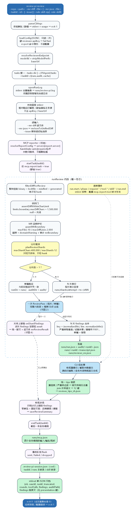
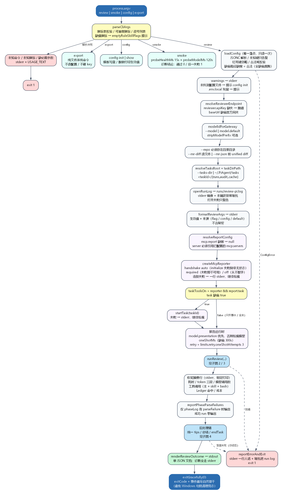
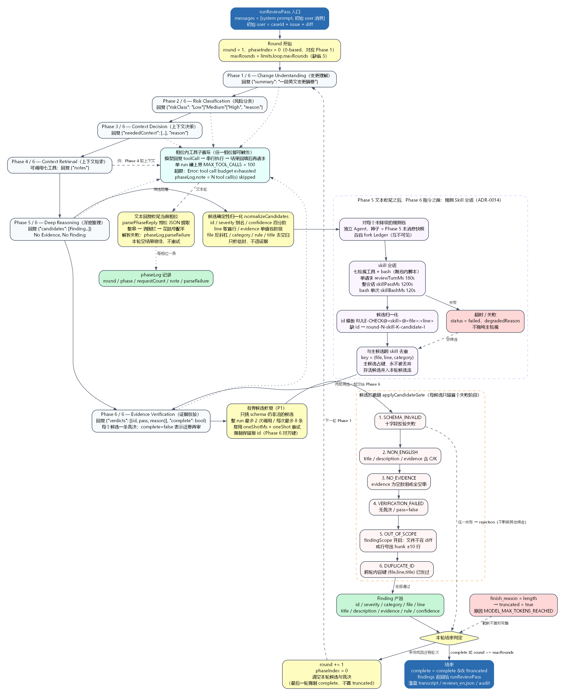
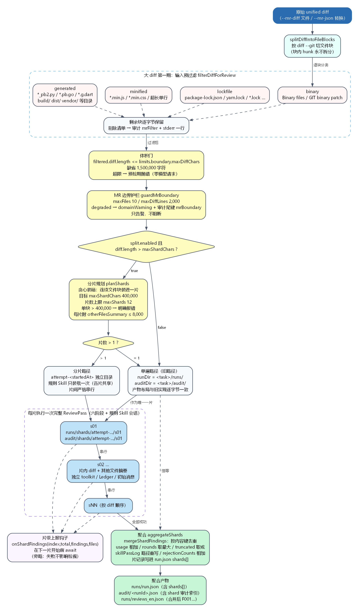
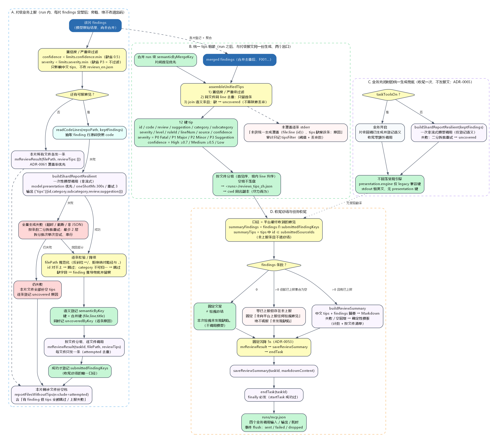

# review-pi 检视全链路流程图与说明

本文按**当前仓库最新代码**（`packages/review-pi/src`）绘制检视链路的 5 张流程图：1 张总览 + 4 张子图。图中所有节点都对应真实实现里的函数、数据结构或配置项；图下逐项解释其含义、默认值与产物路径。

> 代码事实源（阅读顺序建议）：
> `src/cli/main.ts` → `src/run/review-run.ts` → `src/run/review-pass.ts` → `src/loop/agent-review-loop.ts` → `src/loop/phases.ts` → `src/gate/candidate-gate.ts` → `src/cli/unified-tips.ts` / `src/cli/report-payload.ts` / `src/cli/review-summary.ts`。

## 阅读约定

| 图元 | 含义 |
| --- | --- |
| 深蓝实心圆角框 | 链路的起点 / 终点（进程入口、退出） |
| 浅蓝框 | 执行单元（函数、阶段、子流程） |
| 黄色框 / 菱形 | 关键参数、阈值、判定分支 |
| 绿色框 | 落盘产物（run.json / audit / tips / stdout 等） |
| 紫色框 / 紫色虚线集群 | 外部 MCP 上报与呈现在线调用（旁路，可降级） |
| 红色框 | 失败、拒绝、降级分支 |
| 青色框 | 输入处理 / 代码情报 / 工具辅助 |
| 实线箭头 | 主链路 |
| 虚线箭头 | 旁路、补充关系或“失败后仍继续” |
| 点线箭头 | 只投影、不改结果的观测关系 |

所有图都由同目录的 Graphviz 源文件生成，源文件与 PNG / SVG 放在 `docs/png/`：

| 图 | 源文件 | PNG |
| --- | --- | --- |
| 总览 | `docs/png/review-pipeline-overview.dot` | `docs/png/review-pipeline-overview.png` |
| CLI 入口 | `docs/png/review-cli-entry.dot` | `docs/png/review-cli-entry.png` |
| 六阶段循环 | `docs/png/review-six-phase.dot` | `docs/png/review-six-phase.png` |
| 大 diff 分片 | `docs/png/review-large-diff.dot` | `docs/png/review-large-diff.png` |
| 上报 / 统一 tips / 总结 | `docs/png/review-reporting.dot` | `docs/png/review-reporting.png` |

---

## 一、全景总图：一次 `review-pi review` 都经过什么



总图把一次检视分成 **9 段**。下面按段解释。

### 1. 进程入口与命令分发

- `review-pi review --repo <path> (--mr-diff <file> | --mr-json <file>) --taskId <id>` 是检视主命令。
- 另外三个命令走同一入口：`smoke`（网关 + 模型双探针）、`config <init|show>`（配置模板 / 脱敏查看）、`export`（只读文件系统，导出某次 run 的路径）。
- `parseCliArgs` 负责旗标表校验：未知命令、未知旗标、缺少必需参数都会在 stderr 打印一行原因 + `USAGE_TEXT`，然后 `exit 1`。
- 支持可重复旗标和逗号列表：`--rule-skill-zip a.zip,b.zip --rule-skill dir1,dir2`。缺值的规则包旗标不会静默吞掉，会先提示“缺少值，已忽略”。

### 2. 配置装载（唯一落点）

- `loadConfig` 在每次进程启动时**只读一次** JSONC 用户配置，形成不可变快照；请求期不重读、不回写 `process.env`。
- `reviewer.apiKey` 缺失、配置文件语法错误 → fail fast，`exit 1`。
- 未知键、钉死键、权限问题只产生 warning（stderr），不改退出码。
- 配置文件不存在本身是合法的：全缺省也能跑（`apiKey` 除外）。
- `export` 是例外：不加载配置、不碰 key、不做 `.env.local` 探测。

### 3. endpoint / model 解析

- `resolveReviewerEndpoint(config)` 取出 `apiKey` 与 `baseUrl`；`baseUrl` 缺省为官方网关。
- `modelIdForGateway`：`--model` 优先，否则 `model.default`；可选 `stripModelPrefix` 去掉模型 id 前缀后再发往网关。
- 检视模型缺省 `REVIEW_MODEL_ID = "deepseek-v4-flash"`，`--model` / `model.default` 可覆盖；推理档位锁定（`LOCKED_REASONING_EFFORT = "high"`，审计标签 `LOCKED_EFFORT_LABEL = "default"`），不随请求漂移。

### 4. tasks 根、运行日志与参数回显

- tasks 根 `--tasks-dir` 或 `~/.PiAgent/tasks`；`taskDirPath(tasksRoot, taskId)` 得到 `<tasks 根>/<taskId>/`，其下固定为 `runs/`、`audit/`、`.cache/`。
- `openRunLog` 把 stderr 全量镜像到 `runs/review-pi.log`，未捕获异常堆栈也写进去。日志打不开只警告，检视继续。
- `formatReviewArgs` 在 stderr 回显生效参数及来源（flag / config / default），**不含 apiKey / baseUrl**。

### 5. 读取输入

- `--mr-diff`：读入 unified diff 文本；`caseId` = 文件名去扩展名。
- `--mr-json`：读 GitCode / GitLab 的文件变更 JSON（数组或 `{diffs:[…]}`），由 `mrJsonToUnifiedDiff` 转成 unified diff。
- `--issue` 原样进入初始 user 消息；为空时显示 `(none)`。

### 6. MCP 上报器与 `startTask`

- `resolveReportConfig(config)`：`mcp.report` 缺席时返回 `null`（完全不上报）。
- `createMcpReporter` 建连；握手模式：
  - `auto`：`initialize` 失败自动降级为无状态直调；
  - `required`：初始化失败即视为不可用；
  - `off`：从不握手。
- 任何建连 / 握手失败都只打一行 stderr，**继续检视**。
- `taskToolsOn = reporter !== null && report.task`，`report.task` 缺省开启。
- `startTask(taskId)` 在 `runReview` 之前发送，让远端先知道任务存在；失败只警告。
- 片级上报运行时：`model.presentation` 优先，否则跟随检视模型；超时 `oneShotMs`（缺省 300 000 ms），重试 `limits.retry.oneShotAttempts`（缺省 3）。

### 7. `runReview` 内核

这是检视行为本体，全部在 `src/run/review-run.ts`：

1. `filterDiffForReview`：按文件块整块剔除 binary / lockfile / minified / generated，**绝不切 hunk**。
2. `assertDiffWithinCharLimit`：过滤后仍超过 `limits.boundary.maxDiffChars`（缺省 1 500 000 字符）→ 预检期抛人话错误，零模型请求。
3. `guardMrBoundary`：度量文件数与变更行数；超过 `maxFiles=10` 或 `maxDiffLines=2 000` 时 `degraded:true`，写 `domainWarning` 与审计尾键 `mrBoundary`，但**不阻断**。
4. `planReviewShards`：只有 `split.enabled && diff.length > maxShardChars` 才尝试分片；规划出 >1 片才走分片路径，否则仍走单遍。
5. 单遍路径：与分片前实现逐字节一致，`runDir = <task>/runs/`、`auditDir = <task>/audit/`。
6. 分片路径：`runs/shards/attempt-<startedAt>/sNN`，片间严格串行；规则 Skill 只装载一次，各片共享装载结果但各自 fork Ledger。
7. 每片 / 单遍执行一次 `ReviewPass`：完整六阶段 + 规则 Skill 会话 + 落盘（见第三节）。
8. 片级上报钩子 `onShardFindings`：该片 findings 定型后、下一片开始前 await；失败只影响上报诊断，不影响检视结果。
9. `aggregateShards`：按内容键合并 findings，usage 相加、rounds 取最大、truncated 取或、rejectionCounts 相加，skill 转录路径重写。
10. 落盘：`runs/run.json`、`audit/<runId>.json`、`runs/<runId>.transcript.json`、`runs/reviews_en.json`。

进度事件（`run.start` / `phase` / `request.*` / `tool.*` / `skill.*` / `run.end`）只做 stderr 投影；只有配置开启 `mcp.report.tool` 时才外发。

### 8. CLI 后处理

`runReview` 返回后，`main.ts` 按固定顺序做：

1. 收尾摘要行（stderr，恒定打印）：耗时、token 三段、模型调用数、工具调用（主会话 + skill + bash）、Ledger 命中、成本。
2. `reportPhaseParseFailures`：仅当 `phaseLog` 存在 `parseFailure` 时输出；成功 run 零输出。
3. 统一 tips 组装（`assembleUnifiedTips`）：把片级语义登记与合并后的 findings 拼成 12 键 tips。
4. 业务上报关闭时补一次片级语义生成（`buildShardReportResilient`，对过滤后的 `keptFindings`，只登记语义、不发报文；ADR-0065），随后写 `reviews_tips_zh.json`。控制台不翻译、stdout 恒英文。
5. 收尾总结 `buildReviewSummary` → `saveReviewSummary`。
6. `endTask`（finally 必发，前提是 `startTask` 成功过）。
7. 写 `runs/mcp.json`（仅 `taskToolsOn` 且确有业务调用记录时；四个业务调用的输入 / 输出 / 耗时）。
8. 事件队列 flush（sent / failed / dropped）。
9. 写 cwd 的 `.review-pi-session.json`。
10. `renderReviewOutcome` 输出 stdout 单 JSON 文档。
11. `exitGracefully(0/1)`。

### 9. 退出码与 stdout 纪律

- 成功 = `exit 0`；**诚实截断也是 0**（`truncated=true` 由 stdout JSON 携带，不靠退出码表达）。
- 任何中止 / 异常 / 配置错误 = `exit 1`。
- stdout 只有**单个 JSON 文档**；所有诊断、警告、进度都走 stderr。
- 退出一律走 `exitGracefully`：设置 `process.exitCode` 后等事件循环自然排干，避免 Windows 上 undici / AbortSignal 句柄清理竞态把退出码吞成 `0xC0000409`。

---

## 二、子图 1：CLI 入口与启动



### 节点逐项说明

| 节点 | 含义与实现 |
| --- | --- |
| `process.argv` | 进程参数入口，命令面为 `review / smoke / config / export` |
| `parseCliArgs` | 旗标表校验、可重复旗标、逗号列表解析；`--strict-rule-skill`、`--no-progress` 等布尔旗标 |
| 解析失败 → `USAGE_TEXT` → `exit 1` | 未知命令 / 未知旗标 / 缺必需参数 |
| `export` | 纯文件系统命令：不读配置、不碰 key；可按 `--taskId` / `--tasks-dir` / `--path` 导出路径 |
| `config init / show` | `init` 写缺省 JSONC 模板（已存在需 `--force`）；`show` 脱敏打印生效值，`--json` 输出机器可读形态 |
| `smoke` | 双探针：`probeHealthMs` 15 s 探网关健康，`probeModelMs` 120 s 探模型可达；通过 0 / 任一失败 1 |
| `loadConfig` | 唯一配置落点：JSONC 解析、未知键告警、钉死键忽略、合法域校验 |
| `warnings → stderr` | 未找到配置文件提示 `config init`；`.env.local` 残留提示（只 `stat` cwd，不读取内容） |
| `resolveReviewerEndpoint` | 取 `apiKey` / `baseUrl`；apiKey 缺失抛错 |
| `modelIdForGateway` | `--model` > `model.default`；可选 `stripModelPrefix` |
| `--repo` / `--mr-diff` / `--mr-json` | repo 必须存在且是目录；两种 MR 输入二选一 |
| `resolveTasksRoot + taskDirPath` | tasks 根与任务目录；其下 `runs/`、`audit/`、`.cache/` |
| `openRunLog` | stderr 全量镜像到 `runs/review-pi.log`；打开失败只警告 |
| `formatReviewArgs` | 参数回显（值 + 来源），不含秘密 |
| `resolveReportConfig` | `mcp.report` 缺席 → `null`；`server` 必须引用已配置的 `mcp.servers` |
| `createMcpReporter` | 建连与握手；失败降级，继续检视 |
| `taskToolsOn` | `reporter && report.task`；`report.task` 缺省 true |
| `startTask` | 业务调用之一；失败只警告 |
| 报告运行时 | `model.presentation` 优先，否则检视模型；`oneShotMs` 300 s；重试 3 |
| `runReview(...)` | 进入内核（见第三节、第四节） |
| 收尾摘要行 | 恒定打印到 stderr，便于事后对账 |
| `reportPhaseParseFailures` | 仅解析失败时输出，成功 run 零输出 |
| 后处理链 | 统一 tips / 收尾总结 / endTask（见第五节） |
| `renderReviewOutcome` | stdout 单 JSON 文档 |
| `exitGracefully(0)` | 设置退出码并等待自然排干 |
| `reportErrorAndExit` | stderr 一行人话，堆栈进 run log，`exit 1` |

### `review` 命令旗标速查

| 旗标 | 必需 | 说明 |
| --- | --- | --- |
| `--repo <path>` | 是 | 仓库根 / 工作区目录 |
| `--mr-diff <file>` | 与 `--mr-json` 二选一 | unified diff 文件；`caseId` = 文件名去扩展名 |
| `--mr-json <file>` | 与 `--mr-diff` 二选一 | 文件变更 JSON，内部转 unified diff |
| `--taskId <id>` | 是 | 任务 id，落到 `<tasks 根>/<id>/` |
| `--issue <text>` | 否 | MR 问题描述，原样进初始 user 消息 |
| `--tasks-dir <dir>` | 否 | tasks 根；缺省 `~/.PiAgent/tasks` |
| `--model <id>` | 否 | 覆盖 `model.default` |
| `--config <path>` | 否 | 配置文件显式路径 |
| `--rule-skill-zip <path[,path…]>` | 否 | 规则 Skill zip；可重复 / 逗号列表 |
| `--rule-skill <dir[,dir…]>` | 否 | 规则 Skill 已解压目录；可重复 / 逗号列表 |
| `--strict-rule-skill` | 否 | 规则包装载失败即判 run 失败（缺省只降级） |
| `--no-progress` | 否 | 关闭进度事件外发 |

---

## 三、子图 2：六阶段检视循环（核心）



一次 `ReviewPass` = **系统提示 + 初始 user 消息 + 六阶段循环 + 规则 Skill 会话 + 有界修复 + 候选拦截 + 落盘**。六阶段是固定骨架，每个单元恰好各执行一次；轮次由 `limits.loop.maxRounds` 控制（缺省 3）。

### 3.1 入口消息装配

- 消息数组初始为 `[system prompt, initial user message]`。
- `SYSTEM_PROMPT` 声明：资深评审员、固定六阶段、No Evidence No Finding、全部输出英文、需要 JSON 时只回一个 JSON 对象。
- 初始 user 消息由 `buildInitialUserMessage(caseId, issue, diff)` 生成：

  ~~~text
  Merge request under review.

  Case ID: <caseId>
  Issue description:
  <issue 或 (none)>

  Unified diff:
  ```diff
  <diff>
  ```
  ~~~

### 3.2 轮次与相位状态机

- `round` 从 1 开始；`phaseIndex` 是 **0-based**（0 = Phase 1，4 = Phase 5，5 = Phase 6）。
- 每个相位由一条完整的 user 消息驱动，形如 `Phase N of 6 - <Name>.`。
- 一个相位可能经历多次模型请求：只要模型回复里带 tool call，就进入工具子循环，工具结果回填后再次请求；**只有纯文本回复才收尾当前相位**。
- `phaseRequestCount`、`phaseSkippedToolCalls` 在相位结束时归零。
- 每相位收尾写一条 `PhaseRecord`：`round / phase / requestCount / note / parseFailure`。

### 3.3 六阶段回复契约

| # | 阶段（审计名） | 中文语义 | 要求回复的 JSON |
| --- | --- | --- | --- |
| 1 | `Change Understanding` | 变更理解：看懂改了什么、涉及哪些文件 / 符号、意图是什么 | `{"summary":"<一段英文摘要>"}` |
| 2 | `Risk Classification` | 风险分类：给变更定风险档 | `{"riskClass":"Low"\|"Medium"\|"High","reason":"<为什么>"}` |
| 3 | `Context Decision` | 上下文决策：为了正确评审还需要哪些额外上下文 | `{"neededContext":["<item>",…],"reason":"<为什么>"}` |
| 4 | `Context Retrieval` | 上下文检索：实际取回上下文；有工具就调工具 | `{"notes":"<已获得什么上下文，或为什么取不到>"}` |
| 5 | `Deep Reasoning` | 深度推理：产出候选 findings，必须带证据 | `{"candidates":[<Finding>…]}` |
| 6 | `Evidence Verification` | 证据核验：逐候选判断证据是否真的支撑结论 | `{"verdicts":[{"id":"…","pass":true\|false,"reason":"…"}],"complete":true\|false}` |

**Phase 5 的十字段候选合同**（缺一即 `SCHEMA_INVALID`）：

1. `id`：非空字符串，本轮内唯一（如 `F001`）；
2. `severity`：严格 `P0` / `P1` / `P2` / `P3`；
3. `category`：非空字符串（如 `CORRECTNESS`、`SECURITY`）；
4. `file`：仓库相对路径，正斜杠；
5. `line`：正整数（不是字符串、不是范围）；
6. `title`：非空单行英文摘要；
7. `description`：非空英文说明，含影响；
8. `evidence`：非空字符串数组（**不能**是单个字符串）；
9. `rule`：非空字符串；
10. `confidence`：0–1 的数字（不是百分数字符串）。

### 3.4 工具子循环

- 七工具固定顺序（`REVIEW_TOOL_ORDER`），审计里用点分名，wire 上用下划线名：

| 工具 | 作用 | 参数 |
| --- | --- | --- |
| `review.get_diff` | 分页返回本 MR 的 unified diff | `limit`、`offset`（1-based） |
| `review.get_symbol` | 按简单名查符号声明（签名级，无方法体；类型会带成员） | `symbol` |
| `review.get_file` | 读仓库快照文件，可带 1-based 闭区间 | `path`、`startLine`、`endLine` |
| `review.find_references` | 全词、大小写敏感的名字级引用查找（不做类型解析） | `symbol` |
| `review.get_call_chain` | 名字级调用链：hop-1 / hop-2 调用者 + 声明体内被调者 | `symbol` |
| `review.search_rule` | 项目规则库大小写不敏感子串搜索 | `query` |
| `review.search_history` | 历史评审 / 缺陷记录子串搜索 | `query` |

- 工具结果有单次字符预算（`DEFAULT_TOOL_RESULT_BUDGET_CHARS`，A 档死钉，不来自配置）。
- 工具调用硬上界：`MAX_TOOL_CALLS = 100`（按已执行的工具调用计数，失败也计入，跨轮不重置）。
- 超限后工具应答固定为 `Error: tool call budget exhausted`；相位记录 `note = N tool call(s) skipped`，**不翻转** `truncated`。
- 执行失败也计入调用数；未知工具名会返回可用工具清单。

### 3.5 回复解析与失败策略

- `parsePhaseReply` 走宽松 JSON 提取：整串直解 → 剥代码围栏 → 花括号配平扫描；多对象时优先取“含目标键的最后一个对象”。
- 解析失败**不抛异常、不重试**：写 `phaseLog.parseFailure`（分级原因），本轮以空结果继续。
- Phase 6 解析失败（或回复 `complete=false`）→ 本轮 `complete=false`，从而进入下一轮（若还有轮次）。

### 3.6 Phase 5 之后：规则 Skill 会话

位置：**Phase 5 文本收尾之后、Phase 6 指令之前**（`phaseIndex === CANDIDATES_PHASE_INDEX`）。

- 对每个未降级、且有名字的规则包，起一个独立 `Agent`：
  - 种子 = 主会话 Phase 5 末的 messages 快照；
  - 各自 fork 自己的 Ledger（互不可见）；
  - 工具面 = 七检视工具 + `bash`（跑包内脚本）。
- 超时：单请求 `reviewTurnMs` 180 s；整会话 `skillPassMs` 1 200 s；`bash` 单次 `skillBashMs` 120 s。
- 失败 → `status = failed` + `degradedReason`，**不拖垮主检视**；成功但零候选 → `status = empty`。
- Skill 候选先归一化（id 前缀 `round-N-skill-K-candidate-`），再与主候选按 `(file, line, category)` 跨 skill 去重；存活候选并入本轮候选流，Phase 6 一次裁定两批。

### 3.7 候选确定性归一化

`normalizeCandidates` 只修**信封 / 格式**字段，不造证据：

- `id` 缺失 → 位置兜底 `round-N-candidate-I`（跨轮去重不被模型重编号误伤）；
- `severity` 别名归一（`critical` / `blocker` → `P0`，`high` / `major` / `error` → `P1` 等）；
- `confidence` 百分数 → 小数；
- `line` 只解析模型已写出的数字（`L147` / `147-150` 取首行），不推断；
- `evidence` 单值包数组、字符串化；
- `file` 反斜杠 → 正斜杠；
- `category` / `rule` / `title` 去空白；
- 无法修复的定位字段原样保留，交给拦截链以 `SCHEMA_INVALID` 留痕；
- 每条修复产生一条 `CandidateNormalizationRecord`（只记字段名，不记值）。

### 3.8 有界候选修复（P1）

- 触发：Phase 6 收尾后，仍有 schema 非法的候选。
- 预算：整 run 最多 **2 次**修复调用；每次最多 **8 条**候选。
- 复用 `oneShotMs` 与 `oneShot` 重试策略。
- **强制保留原 id**：id 是 Phase 6 裁决的对齐键，改 id 会让裁决错配。

### 3.9 候选拦截链（Evidence Gate）

`applyCandidateGate` 顺序固定，每个候选只留**首个**失败阶段：

1. `SCHEMA_INVALID`：十字段校验失败；
2. `NON_ENGLISH`：`title` / `description` / `evidence` 含 CJK 字符；
3. `NO_EVIDENCE`：`evidence` 为空数组或全空串；
4. `VERIFICATION_FAILED`：无裁决，或 `pass=false`；
5. `DUPLICATE_ID`：跨轮内容键 `(normalize(file), line, normalize(title))` 已发过。

通过全部阶段的候选进入 `findings`，并按 `emittedIds` / `emittedContentKeys` 更新跨轮去重集合。

### 3.10 轮次结束判定

- `complete = roundComplete`（来自 Phase 6 回复的 `complete`）。
- `complete === true` → 结束本轮并返回。
- 否则若 `round >= maxRounds` → **强制 complete**：不再开新轮，本轮产出即最终结果。这是成本线，不是失败，**不置 `truncated`、不写 `MAX_ROUNDS_REACHED`**。
- 否则 `round += 1`、`phaseIndex = 0`、清空本轮候选 / 裁决 / skill 批次，发下一轮 Phase 1。

### 3.11 截断语义

- 模型输出撞上 `finish_reason = "length"` → `truncated = true`，原因 `MODEL_MAX_TOKENS_REACHED`。
- deepseek-v4 系 `max_tokens` 含思维链：预算不足时思维链先耗尽，可见回答可能为空 / 半句；截断必须留痕，不许静默成“审 0 条”。
- 截断不宣称完整：`complete = complete && !truncated`。

### 3.12 单遍产物

- 转录：`runs/<runId>.transcript.json`（规则 Skill 会话各自 `session-<runId>-skill-*.json`）；
- 英文意见：`runs/reviews_en.json`；
- 审计：`audit/<runId>.json`（含 `phaseLog`、`rejections`、`requests`、`toolCallLog`、`cacheBreaks`、`skillPassLog` 等）；
- 片级记录：`runs/run.json`（分片时含 `shards[]`）。

---

## 四、子图 3：大 diff 的预过滤、边界与分片



大 diff 处理分三层：**输入预过滤（第一期）** → **体积门 + 边界护栏** → **分片规划与串行执行（第二期）**。

### 4.1 输入形态与切块

- 原始输入来自 `--mr-diff` 文件或 `--mr-json` 转换后的 unified diff。
- `splitDiffIntoFileBlocks` 按 `diff --git` 切文件块；**块内 hunk 永不拆分**，保证行号与证据链完整。
- 分片是纯函数：同输入 + 同配置 → 同分片，可重放。

### 4.2 输入预过滤 `filterDiffForReview`

块级分类，第一个命中的原因生效：`binary > lockfile > minified > generated`。

| 原因 | 识别规则（摘要） |
| --- | --- |
| `binary` | `Binary files …` / `GIT binary patch` |
| `lockfile` | `package-lock.json`、`yarn.lock`、`pnpm-lock.yaml`、`*.lock` 等 |
| `minified` | `*.min.js` / `*.min.css` / 超长单行 |
| `generated` | `*_pb2.py`、`*.pb.go`、`*.g.dart`、`*.designer.cs`、`*.generated.ts`、`*.map` 等；`build/`、`dist/`、`vendor/` 等目录 |

- 命中的块**整块剔除**，剩余块逐字节保留。
- 剔除清单进审计 `mrFilter`，并在 stderr 打一行。
- 过滤只切文件块，绝不切 hunk。

### 4.3 体积门

- `assertDiffWithinCharLimit`：过滤后 `diff.length <= limits.boundary.maxDiffChars`。
- 缺省 1 500 000 字符；配 `null` 可关闭。
- 超限 → 预检期抛中文错误，提示拆 MR 或调大上限；**零模型请求**。

### 4.4 MR 边界护栏 `guardMrBoundary`

- 度量文件数与变更行数；不可度量（结构游走不完整）按保守口径转显式降级。
- 缺省 `maxFiles = 10`、`maxDiffLines = 2 000`；两个维度都设 `null` 时护栏整体停用。
- 界内：`degraded:false`，零附加键；超界：`degraded:true` + `domainWarning`（进 RunResult 顶层）+ `mrBoundary`（审计尾键）。
- 只告警，不阻断。

### 4.5 分片规划 `planShards`

- 触发条件：`split.enabled && diff.length > split.maxShardChars`，且规划结果 >1 片；否则返回 `null` 走单遍。
- 贪心装箱：连续文件块装进同一片，目标 `maxShardChars = 400 000` 字符。
- 片数上限 `maxShards = 12`（成本护栏）。
- 单个文件块 > 400 000 字符 → 明确报错（不能切 hunk，只能拆文件或等第三期按需读取）。
- 每片附 `otherFilesSummary`（≤ `contextSummaryChars = 8 000`）：只含其他片文件路径与增删行数，**不是证据源**，仅告诉模型“还存在哪些改动”。

### 4.6 分片执行

- 目录：`runs/shards/attempt-<startedAt>/sNN`，审计 `audit/shards/attempt-<startedAt>/sNN`；每次尝试独占一组片产物，不覆盖历史转录。
- 规则 Skill 只装载一次，各片共享装载结果；每片独立 `toolkit`、`Ledger`、初始消息。
- 片间严格串行，按 diff 顺序。
- 每片执行一次完整 `ReviewPass`（六阶段 + 规则 Skill 会话），随后触发 `onShardFindings`。

### 4.7 聚合 `aggregateShards`

- `mergeShardFindings`：按内容键 `(normalize(file), line, normalize(title))` 去重；严重度取最高、证据并集、重编号 `F001…`；排序为文件首见序 → 行号 → 严重度 → title。
- usage 相加；`rounds` 取最大；`truncated` 取逻辑或；`rejectionCounts` 相加。
- `skillPassLog` 文件名重写为 runs 目录相对路径；片记录写进 `run.json` 的 `shards[]`。
- 单遍路径的合并是恒等操作。

### 4.8 聚合产物

- `runs/run.json`：含 `shards[]`（分片时）。
- `audit/<runId>.json`：含 `shards` 审计索引。
- `runs/reviews_en.json`：合并后的英文 findings（`F001…`）。

---

## 五、子图 4：上报、统一 tips 与收尾总结



这张图有 3 个集群：**A 片级业务上报**、**B 统一 tips**、**C 收尾总结与任务收尾**。顺序契约是：`mrReviewResult`（片级，已发完）→ `saveReviewSummary` → `endTask`。控制台不做呈现翻译（ADR-0065），stdout 恒英文、没有 `presentation` 键。

### A. 片级业务上报（run 内，每片 findings 定型后）

1. **置信度 / 严重级过滤**：`confidence < limits.confidence.min`（缺省 0.5）或 `severity` 低于 `limits.severity.min`（缺省 P3 = 不过滤）的意见不进入中文 tips / 报文；**不改** `reviews_en.json`。
2. **测试文件跳过检视**：`limits.testFiles.skip`（缺省 true）在检视输入阶段整块剔除测试文件，因此测试文件既无 findings 也无 tips / 报文；留痕在 `mrFilter` 的 `test` 原因里。
3. **非 diff 区域过滤**：`limits.findingScope`（缺省开启，hunk ±10 行）在候选拦截链上丢弃文件不在本遍 diff、或行号落在变更 hunk 之外的意见（`OUT_OF_SCOPE`）；这类意见连 `reviews_en.json` 也不进，审计只留 `rejectionCounts`。
2. 若本片没有可报意见：
   - 本片所有文件各发一条空包 `mrReviewResult(filePath, reviewTips: [])`（ADR-0061：覆盖率优先）。
3. 否则：
   - `readCodeLines(repoPath, keptFindings)`：抽取每条 finding 对应行的源码快照 `code`；
   - `buildShardReportResilient`：一次非流式模型调用，输入是 findings，输出 `{"tips":[{id,category,subcategory,review,suggestion}]}`；
   - 失败（超时 / 截断 / 非 JSON）→ 按条数二分拆批重试，最多 2 层，拆分批单次尝试、串行；
   - 仍失败 → 本片文件全部补空 tips，并逐条登记 uncovered 原因。
4. **逐条校验 / 降级**：
   - `filePath` 规范化（反斜杠 → `/`，拒绝绝对路径、`..`、空段）；
   - `id` 对不上 → 跳过；`category` 不可归一 → 跳过；
   - 缺字段 → 用 finding 自身推导兜底并留痕（`degradedTips`）。
5. **语义登记** `semanticByKey`：键 = 合并键 `(file, line, title)`；同时记 `uncoveredByKey`（逐条原因）。
6. **按文件分组，逐文件调用** `mrReviewResult(taskId, filePath, reviewTips)`；每个文件只发一条（`attempted` 去重）。
7. **成功才登记** `submittedFindingKeys`：只有 `mrReviewResult` 成功、且该条 tip 真的进入报文才登记。这是收尾总结的唯一口径。
8. 本片剩余文件补空包：`reportFilesWithoutTips(exclude=attempted)`，覆盖“有 finding 但 tips 全被跳过 / 上报失败”的文件。

上报是旁路：任何失败只落 stderr 与诊断，不改变退出码，也不进审计。

### B. 统一 tips 组装

- 输入：合并去重后的 `mergedFindings` + 各片语义登记并集（片间首见优先）。
- 步骤：
  1. 置信度过滤（同 0.5 阈值）；
  2. 同文件同 `line` 去重，只留首条（merged findings 已排序，首见即确定）；
  3. join 语义条目；join 不上 → `uncovered`（不算故意丢弃）。
- 输出 **12 键 tip**：

| 键 | 说明 |
| --- | --- |
| `id` | finding id（`F001…`） |
| `code` | 问题行源码；允许空串 |
| `review` | 评审意见（Markdown） |
| `suggestion` | 改进建议（Markdown） |
| `category` | 服务端类别枚举：可维护 / 安全 / 可靠性 / 可测试性 / 性能 / 可移植 / 可读性 |
| `subcategory` | 更细分类，必填非空 |
| `severity` | `Fatal` / `Major` / `Minor` / `Suggestion` |
| `level` | 与 `severity` 同值（P0 Fatal、P1 Major、P2 Minor、P3 Suggestion） |
| `ruleId` | 规则 id；未匹配 = null |
| `lineNum` | 行号；tips 文档里是数字，平台报文里转字符串 |
| `source` | 片级登记来源 |
| `confidence` | `High ≥ 0.7` / `Medium ≥ 0.5` / 其余 `Low` |

- 按文件分组（首见序，组内 `lineNum` 升序），空组不落盘。
- 落盘：`<runs>/reviews_tips_zh.json`；cwd 同名副本尽力而为。
- 未覆盖逐条 stderr：`未获统一生成覆盖（file:line (id)），tips 缺席该条：<原因>`；审计只记 `tipsFilter`（阈值 + 丢弃数）。

**业务上报关闭时的兜底生成（ADR-0065）**：`taskToolsOn` 为假时各片没有跑过 `mrReviewResult` 回调，语义登记为空，因此 CLI 在收尾补一次 `buildShardReportResilient`——输入是**经置信度 / 严重级过滤后的 `keptFindings`**，只把语义登记进 `semanticByKey`、不发任何 MCP 报文；失败仍按二分拆批重试，最终失败逐条登记 uncovered。之后走与业务开启完全相同的 `assembleUnifiedTips` 与落盘路径；零意见 / 全部被过滤 → 产 `[]`；有 finding 但零覆盖 → 不产文件并清陈旧。**不再回落呈现引擎**：`presentation.engine` 保留为兼容配置键，CLI 不加载它；stdout 恒英文，没有 `presentation` 键。

### C. 收尾总结与任务收尾

- 前提：`taskToolsOn` 为真（MCP reporter 可用且 `report.task` 开启）。关掉业务 tool 时，总结与 `endTask` 都不发，但本地 tips / stdout 照常。
- **口径 = 平台最终收到的意见**：
  - `summaryFindings = findings ∩ submittedFindingKeys`；
  - `summaryTips = tips 中 id ∈ submittedSourceIds`；
  - 未上报条目不进总结。
- `findings` 条数为 0 时：
  - 确实没有意见 → 固定文案 `# 检视总结\n\n本次检视未发现缺陷。`（不调用模型）；
  - 本地有意见但一条都没上报 → 固定文案 `# 检视总结\n\n本次检视未向平台上报任何检视意见。`（绝不谎报“未发现缺陷”）。
- 有已上报意见 → `buildReviewSummary`：中文 tips + findings 摘要 → Markdown；模型失败 / 空回复 → 确定性模板（计数 + 按文件清单），并记 `degradedReason`。
- 沉降与顺序：
  - 最后一条 `mrReviewResult` 发完后，固定等 5 s（`TASK_TOOL_SETTLE_MS`）再发总结；
  - `saveReviewSummary` 发完后再等 5 s 再发 `endTask`；
  - `endTask` 在 `finally` 必发（前提 `startTask` 成功过）。
- 最后写 `runs/mcp.json`（四个业务调用的输入 / 输出 / 耗时），并 flush 事件队列（sent / failed / dropped）。

### 业务 tool 清单

| tool | 方向 | 说明 |
| --- | --- | --- |
| `startTask` | CLI → 服务端 | 任务开始；在 `runReview` 之前 |
| `mrReviewResult` | CLI → 服务端 | 按文件平铺的检视意见；每文件一条 |
| `saveReviewSummary` | CLI → 服务端 | Markdown 总结正文 |
| `endTask` | CLI → 服务端 | 任务结束；finally 必发 |

`mrReviewResult` 的单条意见字段：`code` / `review` / `suggestion` / `category` / `subcategory` / `level` / `ruleId` / `lineNum`；`filePath` 由发送层规范化。

---

## 六、默认值速查

| 配置键 | 缺省值 | 作用 |
| --- | --- | --- |
| `limits.loop.maxRounds` | 3 | 最多检视轮次（1–20） |
| `limits.timeouts.reviewTurnMs` | 180 000 ms | 单次检视回合 / skill 会话单请求 |
| `limits.timeouts.oneShotMs` | 300 000 ms | 片级生成 / 收尾总结单次调用 |
| `limits.timeouts.skillPassMs` | 1 200 000 ms | 规则 Skill 整会话 |
| `limits.timeouts.skillBashMs` | 120 000 ms | skill `bash` 单次 |
| `limits.timeouts.ruleSkillExtractMs` | 30 000 ms | 规则包解压 |
| `limits.timeouts.ripgrepMs` | 30 000 ms | ripgrep 单次 |
| `limits.timeouts.probeHealthMs` | 15 000 ms | smoke 网关探针 |
| `limits.timeouts.probeModelMs` | 120 000 ms | smoke 模型探针 |
| `limits.timeouts.presentationRequestMs` | 90 000 ms | legacy 呈现引擎单字段（CLI 不再调用） |
| `limits.timeouts.presentationBufferMs` | 30 000 ms | legacy 呈现引擎缓冲（CLI 不再调用） |
| `limits.retry.maxAttempts` | 3 | 通用重试次数 |
| `limits.retry.reviewTurnAttempts` | 3 | 检视回合重试 |
| `limits.retry.oneShotAttempts` | 3 | 单次调用重试 |
| `limits.retry.presentationAttempts` | 3 | legacy 呈现引擎重试（CLI 不再调用） |
| `limits.retry.smokeAttempts` | 1 | smoke 重试 |
| `limits.concurrency.suggestion` | 4 | legacy 呈现引擎并发（CLI 不再调用） |
| `limits.confidence.min` | 0.5 | 中文 tips 置信度门槛 |
| `limits.severity.min` | P3 | 中文 tips / MCP 上报严重级门槛（P3 = 不过滤） |
| `limits.testFiles.skip` | true | 检视输入阶段是否剔除测试文件（留痕 `mrFilter.test`） |
| `limits.findingScope.enabled` | true | 候选拦截链是否丢弃非 diff 区域意见（`OUT_OF_SCOPE`） |
| `limits.findingScope.contextLines` | 10 | hunk 前后放宽行数（0–2000，0 = 只保 hunk 内） |
| `limits.boundary.maxFiles` | 10 | 边界护栏文件数 |
| `limits.boundary.maxDiffLines` | 2 000 | 边界护栏变更行数 |
| `limits.boundary.maxDiffChars` | 1 500 000 | 体积门字符上限；`null` 关闭 |
| `limits.split.enabled` | true | 是否允许分片 |
| `limits.split.maxShardChars` | 400 000 | 单片字符目标 |
| `limits.split.maxShards` | 12 | 片数上限 |
| `limits.split.contextSummaryChars` | 8 000 | 其他文件摘要上限 |
| `limits.archive.maxArchiveBytes` | 8 MiB | 规则包 zip 体积 |
| `limits.archive.maxEntries` | 2 000 | 规则包条目数 |
| `limits.archive.maxTotalUncompressed` | 64 MiB | 解压总量 |
| `limits.archive.maxCompressionRatio` | 100 | 压缩比 |
| `limits.micro.skillBashOutputChars` | 256 000 | skill bash 输出上限 |
| `limits.micro.packageHeadBytes` | 8 192 | 规则包头部读取 |
| `limits.micro.queryEchoChars` | 120 | 查询回显截断 |
| `limits.micro.callChainHops` | 2 | 调用链 hop 数 |
| `limits.micro.toolNameChars` | 60 | 工具名截断 |
| `limits.micro.argumentsSummaryChars` | 80 | 参数摘要截断 |
| `limits.micro.progressDetailChars` | 120 | 进度详情截断 |

循环常量（不来自配置）：

| 常量 | 值 | 说明 |
| --- | --- | --- |
| `MAX_TOOL_CALLS` | 100 | 单 run 工具调用硬上界 |
| `MAX_REPAIR_CALLS_PER_RUN` | 2 | 候选修复最多调用次数 |
| `MAX_REPAIR_CANDIDATES_PER_CALL` | 8 | 每次修复最多候选数 |
| `TASK_TOOL_SETTLE_MS` | 5 000 ms | 业务 tool 间的固定沉降 |
| `DEFAULT_SPLIT_MAX_DEPTH` | 2 | 片级生成二分拆批深度 |

---

## 七、产物路径一览

以 `<task> = <tasks 根>/<taskId>` 为例：

| 路径 | 内容 |
| --- | --- |
| `<task>/runs/review-pi.log` | 运行日志（stderr 镜像 + 未捕获异常堆栈） |
| `<task>/runs/run.json` | 运行记录（分片时含 `shards[]`） |
| `<task>/runs/<runId>.transcript.json` | 主会话转录（单遍 = 1 条） |
| `<task>/runs/session-<runId>-skill-*.json` | 规则 Skill 会话转录 |
| `<task>/runs/reviews_en.json` | 英文 findings 导出 |
| `<task>/runs/reviews_tips_zh.json` | 中文按行分组建议（12 键） |
| `<task>/runs/mcp.json` | 四个业务调用的输入 / 输出 / 耗时 |
| `<task>/runs/shards/attempt-<ts>/sNN/` | 分片转录与片级产物 |
| `<task>/audit/<runId>.json` | 审计文件（phaseLog / rejections / requests / toolCallLog / skillPassLog / mrFilter / mrBoundary 等） |
| `<task>/audit/shards/attempt-<ts>/sNN/` | 片级审计 |
| `<cwd>/.review-pi-session.json` | session 索引（taskId、runs、主转录、skill 转录） |
| `<cwd>/reviews_tips_zh.json` | 中文建议副本（尽力而为） |

stdout 单 JSON 文档的主要字段：`ok`、`caseId`、`runId`、`truncated`、`rounds`、`toolCalls`、`findings`、`auditPath`。`findings` 恒为英文源，**没有** `presentation` 键（ADR-0065）。

---

## 八、降级与失败语义

| 场景 | 行为 | 是否影响退出码 |
| --- | --- | --- |
| 配置坏 / 缺 `apiKey` | fail fast，stderr 人话 + `exit 1` | 是 |
| 未知旗标 / 缺必需参数 | `USAGE_TEXT` + `exit 1` | 是 |
| MCP 建连 / 握手失败 | 一行 stderr，检视照跑 | 否 |
| `startTask` 失败 | 一行 stderr，检视照跑 | 否 |
| 规则 Skill 装载失败 | 记 `ruleSkill[]` 降级；`--strict-rule-skill` 时才判失败 | 默认否 |
| Skill 会话超时 / 失败 | `status=failed` + `degradedReason`，候选为空 | 否 |
| 阶段回复解析失败 | `phaseLog.parseFailure`，本轮空结果继续 | 否 |
| 工具预算耗尽 | 固定应答 + `note`，不翻转 `truncated` | 否 |
| 模型输出截断 | `truncated=true` + `MODEL_MAX_TOKENS_REACHED` | 否（成功仍 0） |
| 片级生成失败 | 二分拆批重试；仍失败补空 tips + uncovered | 否 |
| `mrReviewResult` 上报失败 | 记 uncovered，总结只统计已上报 | 否 |
| 中文 tips 落盘失败 | stderr；仍上报总结与 endTask，随后以失败退出 | 是 |
| 收尾总结模型失败 | 确定性模板降级 + `degradedReason` | 否 |
| 中文 tips 语义生成失败 / 零覆盖 | 有 finding 但不产 tips 并清陈旧，stderr 逐条留痕；不回落引擎 | 否 |
| session 索引写失败 | 只警告 | 否 |
| `mcp.json` 写失败 | 只警告 | 否 |

---

## 九、如何重新生成图片

本机使用 Graphviz `dot`（`C:\Program Files\Graphviz\bin\dot.exe`）：

```powershell
# 1) 去掉 UTF-8 BOM（写文件工具会加 BOM，Graphviz 会报 syntax error near 'digraph'）
node -e "const fs=require('fs');const p='docs/png/review-six-phase.dot';const s=fs.readFileSync(p,'utf8').replace(/^\uFEFF/,'');fs.writeFileSync(p,s,'utf8')"

# 2) 渲染 PNG 与 SVG
dot -Tpng docs/png/review-six-phase.dot -o docs/png/review-six-phase.png
dot -Tsvg docs/png/review-six-phase.dot -o docs/png/review-six-phase.svg
```

其余 4 张图同理（替换文件名）。图中中文字体使用 `Microsoft YaHei`，`dpi` 为 140–150。

---

## 十、一页速记

```text
review
  → parseCliArgs / loadConfig（fail fast）
  → endpoint + model
  → tasks 根 + run log + 参数回显
  → 读 diff
  → MCP reporter + startTask（旁路）
  → runReview
      → 预过滤（binary/lockfile/minified/generated）
      → 体积门（1.5M）
      → 边界护栏（10 文件 / 2K 行，只告警）
      → 分片规划（400K / 12 片 / 8K 摘要）
      → 单遍或 N 片串行
          → 每片：六阶段 + 工具子循环（≤100）+ 规则 Skill 会话
                  + 有界修复（≤2 次 / ≤8 条）+ 拦截链（5 阶段）
          → 片级上报（置信度 0.5 → 生成 → 校验 → 逐文件 mrReviewResult）
      → 合并（内容键去重）+ 落盘（run.json / audit / reviews_en）
  → 收尾摘要行 / 解析失败提示
  → 统一 tips（12 键）→ reviews_tips_zh.json（业务关闭时收尾补一次同源生成）
  → 收尾总结（只算已上报）→ saveReviewSummary → endTask
  → mcp.json / 事件 flush / session 索引
  → stdout 单 JSON → exit 0（截断也 0）/ 1
```
