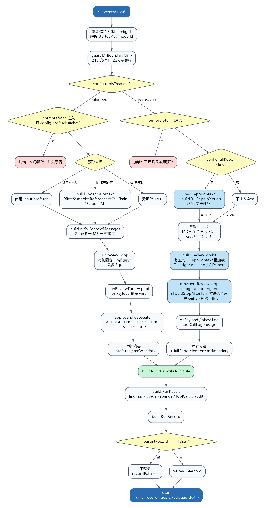
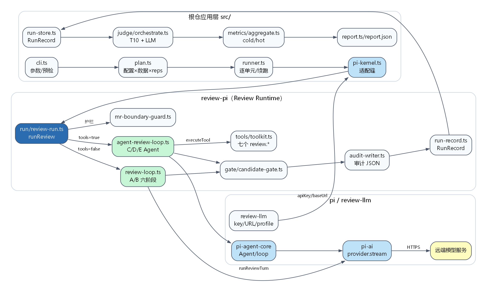
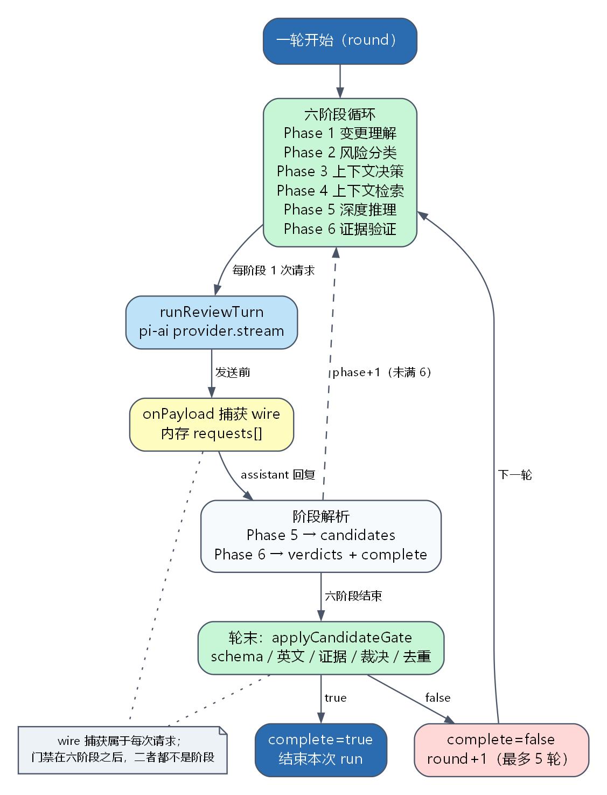

# 项目问答整理

本文汇总本仓（pi 内核线）在实际使用与阅读中提出的问题，按主题整理。每个问题对应的文件路径与调用流程见 **附录 A**，流程图见 **附录 B**。更细的配置说明见 `docs/配置矩阵A-E说明.md`，上手指南见 `docs/UA_ONBOARDING.md`。

---

## 一、仓库与内核

### Q1. 哪些目录/文件是 pi 的？pi 有哪些包？
`packages/` 下四个 vendor 包，版本均为 `0.85.1`：

| 目录 | 发布包名（ADR-0028） |
|---|---|
| `packages/ai` | `@review-agent-pi/pi-ai` |
| `packages/agent` | `@review-agent-pi/pi-agent-core` |
| `packages/chord` | `@review-agent-pi/chord` |
| `packages/telemetry` | `@review-agent-pi/pi-telemetry` |

上游原名为 `@earendil-works/*`，履约与出处对照见 `THIRD-PARTY-NOTICES.md`。

配套：根 `package.json` 的 `build:pi`、`pnpm-workspace.yaml`、`tsconfig.base.json`、`THIRD-PARTY-NOTICES.md`。上游的 coding-agent / tui / protocol / client / server / evals 等未 vendor。

### Q2. pi agent 怎么使用？有没有修改？
- 通过 `import { Agent } from "@review-agent-pi/pi-agent-core"` 使用，集中在 `packages/review-pi`。
- 用到 `Agent`、`AgentTool`、`streamFn`、`shouldStopAfterTurn`、`onPayload`、`agent.prompt/followUp/state.messages`。
- **pi-agent-core 源码本体零修改**：整树快照提交 `d5b5534`，锚定上游 `6671c604`（v0.85.1 后 11 天 main 修复）。
- fork 分歧只在接线层：`package.json`（workspace/exports/tsc）、两个 vitest 配置、`chord` 一行 `path.sep` 修复、三方声明文件。

### Q3. `review-pi` 和 `review-llm` 是什么？
- `packages/review-pi`：pi 内核线的 **Review Runtime**，入口 `runReview`，负责单案检视全链路（护栏、六阶段、工具、门禁、审计）。
- `packages/review-llm`：**LLM 接入共享缝**，只提供 key/URL 解析、DeepSeek 常量、模型画像；不发请求、不含检视逻辑。

### Q4. `src/` 下都是干什么的？
评测应用层，10 个子目录：
`dataset`（数据集适配）、`sampling`（抽样）、`experiment`（编排/runner/report）、`instrument`（契约/观测）、`judge`（判定链）、`metrics`（指标）、`gate`（门禁）、`calibration`（校准）、`presentation`（中文呈现）、`reference`（Claude Code 参照）。

---

## 二、运行与环境

### Q5. 项目怎么运行？需要补充什么？
1. Node ≥22 + pnpm（本机可用 `corepack pnpm`）。
2. `pnpm install`。
3. 仓库根 `.env.local`：
   ```
   REVIEWER_API_KEY=...
   REVIEWER_URL=https://ark.cn-beijing.volces.com/api/coding/v3
   JUDGE_API_KEY=...      # 仅 --judge 需要
   JUDGE_URL=...
   ```
4. 数据：`data/vul4j/materialized-cases.json`；仓库快照用 `pnpm materialize:vul4j -- --vul-ids "VUL4J-38,VUL4J-52,VUL4J-79"` 生成到 `.cache/datasets/vul4j-repos/`。
5. 运行：`pnpm experiment -- --id smoke --cases-file data/vul4j/materialized-cases.json --configs "A" --reps 1 --model deepseek-v4.1-flash`。

注意：PowerShell 下逗号列表必须加引号，否则 `A,C` 会被拆成 `A C`。

### Q6. 参数分别是什么？
`--id` 实验名/产物目录；`--cases-file` 物化 MRCase JSON；`--configs` A–E 子集；`--reps` 重复次数（rep1 冷、rep2+ 热）；`--model` 被测模型；`--judge` 启用判定链；`--judge-model` 异构 judge 模型；`--report-only` 只重建报告。

### Q7. `.ua/` 需要提交吗？
不需要。它是 `/understand` 生成物（图谱/指纹/临时文件），应加入 `.gitignore`。团队共享优先提交 `docs/UA_ONBOARDING.md`；图谱可作为 CI/Release 产物。

### Q8. `.env.local` 要提交吗？
不要。已被 `.gitignore` 忽略；只在本机填写 key/url。

---

## 三、检视流程

### Q9. 项目是不是写了一个 review 流程，用 agent 调 pi？
是。**Review 流程自研，pi 提供通用 Agent 循环与模型 I/O。**

- A/B：`runReviewLoop` 固定六阶段，不创建 Agent，直接调 pi-ai。
- C/D/E：`runAgentReviewLoop` 创建 pi-agent-core `Agent`，通过 `shouldStopAfterTurn` 推进阶段、`tools` 执行自研工具、`streamFn` 调 pi-ai。

### Q10. 检视代码的完整流程？
实验侧：CLI → plan → runner → `pi-kernel` 适配 → `runReview`。
单案侧：`guardMrBoundary` → 按配置分派 → 六阶段（变更理解 → 风险分类 → 上下文决策 → 上下文检索 → 深度推理 → 证据验证）→ 候选门禁 → 审计/RunRecord → judge → metrics → report。

### Q11. A/B 零工具怎么检视？检视什么？
固定六阶段管线，每轮 6 次请求（每阶段一次），最多 5 轮：
1. 变更理解（summary）
2. 风险分类（riskClass）
3. 上下文决策（neededContext）
4. 上下文检索（无工具则说明无法获取）
5. 深度推理（候选 findings）
6. 证据验证（逐条 verdict + complete）

候选需通过 `SCHEMA_INVALID → NON_ENGLISH → NO_EVIDENCE → VERIFICATION_FAILED → DUPLICATE_ID`。

### Q12. A/B 调度是固定流程还是 Agent？
**固定流程。** `runReviewLoop` 是确定性 `for` 循环；模型只能通过 `complete` 决定是否再来一轮，不能决定阶段或工具。

### Q13. `input.prefetch` 是什么？那段检查有什么用？
`ReviewRunInput.prefetch?: PrefetchContext`，允许传入已算好的 B 预取（zoneBMessage、三层消息、records），用于跨 rep/字节门复用。
检查 `input.prefetch !== undefined && !config.prefetch` 是防止“A 被预取污染”：A 定义为纯 diff 基线，注入预取会破坏实验对照，故 fail fast。

---

## 四、上下文与工具

### Q14. A 和 B 分别获取什么上下文？
- **A**：Zone A system prompt + 一条 MR 消息（caseId、issueDescription、unified diff）。
- **B**：A 的全部 + Zone B（Repo Map/包结构/变更包符号索引）+ Symbol 签名层 + Reference 引用层 + Call Chain 层。

顺序：`system → Zone B → MR → Symbol → Reference → Call Chain`。

### Q15. Zone B / Symbol / Reference / Call chain 怎么获取？
均在 `packages/review-pi/src/zoneb/`，全程零 LLM/零工具：
- `repo-context.ts`：ripgrep 列 Java 文件、词法提包名、按需 memoize。
- `symbols.ts`：tree-sitter-java 签名级符号。
- `zone-b-builder.ts`：Repo Identity/Map/包/符号索引/项目规则。
- `changed-symbols.ts`：hunk 区间 ∩ 符号区间。
- `reference-sites.ts`：ripgrep 全词匹配 + 符号链定位。
- `call-chain.ts`：名字级 2 跳调用链。
- `prefetch.ts`：固定顺序编排。
- `budget.ts`：字符预算与截断留痕。

### Q16. A/B 能拿到变更文件全文吗？
不能。A 只有 diff；B 只有签名、引用行、调用链等摘要，**都不含完整源码**。完整源码只在 C 的全仓注入（80k 字符预算）或 C/D/E 的 `get_file` 工具中。

### Q17. `review.*` 工具定义在哪个文件？
- 名字/顺序/Schema：`tools/registry.ts`
- 装配/分发：`tools/toolkit.ts`
- 实现：`get-diff.ts`、`get-symbol.ts`、`get-file.ts`、`search-tools.ts`
- 辅助：`args.ts`、`result-budget.ts`、`ledger.ts`

### Q18. zonea 和 zoneb 目录分别做什么？
- **Zone A**：跨 MR 字节稳定的 system prompt（六阶段、证据政策、schema、严重度、风险分类），只有 `system-prompt.ts`。
- **Zone B**：仓库静态上下文工厂（地图、符号、引用、调用链、全仓注入），供 B/C/D/E 复用。

---

## 五、配置与判定

### Q19. 有哪些配置（A–E）？在哪里定义？
定义：`packages/review-pi/src/contracts/config.ts`、`src/instrument/contracts/config.ts`。

| 配置 | 工具 | 预取 | 全仓注入 | 稳定前缀 | Ledger |
|---|---|---|---|---|---|
| A | 否 | 否 | 否 | 否 | 否 |
| B | 否 | 是 | 否 | 否 | 否 |
| C | 是 | 否 | 是 | 否 | 否 |
| D | 是 | 否 | 否 | 是（声明位） | 否 |
| E | 是 | 否 | 否 | 是（声明位） | 是 |

注：`stablePrefix` 当前未被运行时读取；实际稳定前缀由 Zone A 常量 + append-only 保证。C 是判定锚，E 是生产默认。

### Q20. 不跑全配置可以吗？
可以。要 S/A/B 判定必须有 **C 作为锚**，最少 `C + 目标配置`（如 `"A,C"` 或 `"C,E"`）；只验证链路可单跑任意配置。

### Q21. “S/A/B 主判定依赖 hot 指标”是什么意思？
每条 case × 配置重复 N 次：rep1 = cold（缓存/前缀未热），rep2+ = hot（稳态）。判定只取 hot 均值，锚点 C：
- S：Recall ≥ C×90% ∧ Precision ≥ C×100% ∧ Token ≤ C×30% ∧ Cache ≥85%
- A：Recall ≥ C×80% ∧ Token ≤ C×30% ∧ Cache ≥80%
- B：Recall ≥ C×70% ∧ Token ≤ C×50%

少于 2 reps 无 hot → `NOT_EVALUABLE`；C 自比时 Token 判据必然失败，显示 `BELOW_B` 属预期。

### Q22. 上面跑完有 judge 吗？怎么看哪个方案好？
`cmp-ac` **没有** judge（`plan.judge=false`）。对比看 `dashboard.md` 的 hot 指标与 token：
- A：Recall 16.7%、Precision 13.9%、24,777 tokens、0 工具；
- C：Recall 19.4%、Precision 15.3%、231,725 tokens、6 工具。
C 质量略高但成本约 9.3 倍，且样本仅 3 case、方差大。要正式结论需加 `--judge`、更多 case、`--reps 3`，并看质量-成本帕累托。

---

## 六、补充问答（Zone A 与执行细节）

### Q23. Zone A“跨 MR 字节稳定”是什么意思？
指不论评审哪个 MR、哪个配置、第几次 rep，序列化后的 **system prompt 字节完全相同**：相同的 UTF-8 字节、空格、换行、标点与顺序。其中不能包含 caseId、路径、时间戳、模型名等动态内容。

目的：
- 最大化网关/模型的 prompt cache 前缀命中；
- 供 bytegate 与 DSH 线审计真源逐字节比较；
- 保证实验可复现。

保障：`zonea/system-prompt.ts` 常量 + `system-prompt.test.ts` 对 `testdata/golden/system-prompt.txt` 逐字节断言。

### Q24. 不同 MR 下 A 的提示词一致吗？和 B–E 一致吗？
一致。Zone A 系统提示来自同一常量，对所有 MR、所有配置 A–E、所有 reps 都相同。

但**完整请求不同**：
- A：system + MR 消息；
- B：system + Zone B + MR + Symbol/Reference/CallChain；
- C：system + MR + 全仓注入 + 七工具 schema；
- D/E：system + MR + 七工具 schema；E 额外启用 Ledger。

A/B 用 `runReviewLoop`，C/D/E 用 pi-agent-core `Agent`。

### Q25. Zone A 是基础，其他方案在此基础上扩展？
是，但扩展发生在 system prompt 之外：
- B 加确定性静态上下文；
- C 加全仓源码注入 + 工具；
- D 加工具；
- E 在 D 上加 Ledger。

Zone A 提示词、六阶段、证据政策、finding schema、候选门禁、审计与判定链保持不变，因此 A–E 可比。

### Q26. `runReviewLoop` 实现什么？算 Agent 吗？
实现 A/B 的**固定六阶段编排器**：每轮固定 6 次请求，最多 5 轮；模型只能通过第 6 阶段 `complete` 决定是否再来一轮。没有 `Agent`、没有工具子循环、没有 `shouldStopAfterTurn`。

因此不算 pi-agent-core 意义上的 Agent，更准确叫 **deterministic multi-turn pipeline / orchestrator**。C/D/E 的 `runAgentReviewLoop` 才是 Agent 模式。

### Q27. `review-run.ts` 的执行流程？
主入口 `runReview`（`packages/review-pi/src/run/review-run.ts:80`）：

1. 读取 `CONFIGS[configId]`、时间与模型；
2. `guardMrBoundary`：≤10 文件且 ≤2K 变更行，超界只降级不拒检；
3. 按 `toolsEnabled` 分派：
   - A/B：处理预取 → 构建初始上下文 → `runReviewLoop` → 候选门禁；
   - C/D/E：拒绝预取 → C 全仓注入 → 七工具 toolkit → `runAgentReviewLoop`；
4. 两路汇合：写审计 → 构建 `RunResult` → `RunRecord` → 按 `persistRecord` 决定是否落盘。

完整流程图：



矢量版：`docs/png/review-run-flow.svg`；Graphviz 源文件：`docs/png/review-run-flow.dot`。
重新生成：`python docs/render_review_flow.py`（需要 Graphviz `dot`）。

### Q28. B 方案的 `input.prefetch` 是什么？
`ReviewRunInput.prefetch?: PrefetchContext`，是 B 的“预取结果注入缝”：

```ts
{
  zoneBMessage: LlmMessage,
  layerMessages: LlmMessage[],   // Symbol → Reference → Call Chain
  records: PrefetchLayerRecord[] // 预算/截断/记账
}
```

- 传了：直接用，跳过 `buildPrefetchContext`；
- 没传：B 现场计算（零 LLM、确定性）；
- A 传了会抛错；C/D/E 走工具路径也会拒绝预取。

用途：复用昂贵预取（大仓库可达数分钟）、保证字节门重放一致。普通 `pnpm experiment` 通常不传，B 按单元现场计算；`bytegate/gate-runner.ts` 会按 case 缓存并注入。

## 七、补充问答（请求、循环与 wire）

### Q29. A/B 的“固定六阶段请求”是什么？在哪些文件？
指一轮评审按固定顺序**串行发出 6 次 LLM 请求**，每次带一条阶段指令；不是并行，也不能跳阶段。

| 内容 | 文件 |
|---|---|
| 六阶段指令、阶段数、顺序 | `packages/review-pi/src/loop/phases.ts` |
| 循环执行 | `packages/review-pi/src/loop/review-loop.ts:55`（`for round` :68，`for phaseIndex` :74，`runTurn` :80） |
| 单次请求 → pi-ai | `provider/pi-client.ts:65`（`runReviewTurn`） |
| 轮次上限 5 | `loop/constants.ts:4` |

每次请求 = system prompt + 已累积消息 + 当前阶段指令；回复 append 到历史。

### Q30. 是每个阶段循环 6 次，还是一轮 6 次、最多 5 轮？
后者。内层固定 6 个阶段、每阶段 1 次请求；外层最多 5 轮完整流程。

```
for round in 1..5:
  for phase in 1..6:
    send_one_request(phase)
  if complete: break
```

一轮完成 = 6 次请求；最坏 5×6 = 30 次。

### Q31. 六阶段分别在干什么？为什么循环 5 次？
六阶段：变更理解（summary）→ 风险分类（riskClass）→ 上下文决策（neededContext）→ 上下文检索（notes）→ 深度推理（candidates）→ 证据验证（verdicts + complete）。

循环 5 次的原因：
1. Phase 6 返回 `complete=false` 时，给模型一次修正候选/补充推理的机会；
2. 成本与延迟上界（A/B 最多 30 次请求，C/D/E 另受工具预算 6 限制）；
3. `MAX_ROUNDS=5` 是与 DSH 线共享的测量常量，保证同预算比较。

触发 5 轮上限：`truncated=true`，`truncationReasons=["MAX_ROUNDS_REACHED"]`，已有 findings 保留。

### Q32. 项目怎么判断“跑成功”、不再跑 2–5 轮？
只看 Phase 6 的 `complete === true`，不是 findings 数量或门禁通过率。

- A/B：`parseVerificationReply` 解析出 `complete`，为 true 就 `break`；false 继续下一轮。
- C/D/E：第 6 阶段结束后 `complete=roundComplete`；true 则 `shouldStopAfterTurn` 返回停止；false 且未到 5 轮则注入下一轮 Phase 1。
- 回复不是合法 JSON / 缺 `complete` → 按 false 处理，会多跑一轮。
- 门禁只决定候选是否成为 Finding，不会强制再来一轮。

因此“成功”= 模型声明验证完成，不代表结果质量一定正确；即使 0 findings 也可能 `complete=true`。

### Q33. 正常情况下可能只跑一次吗？
可能，但要区分“一次”：
- **一轮**：A/B 固定 6 次请求；`complete=true` 时 `rounds=1`，不再跑第 2 轮。
- **一次请求**：不是。正常完成也至少走完 6 个阶段。

### Q34. 为什么说 A/B 单次是“调用 pi”？`pi-ai` 和 `review-llm` 有什么区别？
A/B 不创建 Agent，但每个阶段通过 `runReviewTurn` 调 `pi-ai` 的 `deepseekProvider().stream()`，即调用一次模型客户端。

| | `pi-ai` | `review-llm` |
|---|---|---|
| 本质 | 模型客户端/SDK 抽象 | 配置与解析工具包 |
| 是否发 HTTP | 是 | 否 |
| 内容 | provider 适配、序列化、流式、usage | key/URL 解析、超时/重试、模型画像 |
| 依赖 | 外部模型服务 | 无 |

链路：`.env.local → review-llm → review-pi（reviewer-endpoint/pi-client）→ pi-ai → 远端模型服务`。
**`pi-ai` 不依赖 `review-llm`**；是 `review-pi` 把 review-llm 解析出的 `apiKey/baseUrl/model` 传给 pi-ai。

### Q35. `runReviewTurn → onPayload` 捕获 wire 是在干什么？存内存还是文件？
`onPayload` 是 pi-ai 在**序列化完成、HTTP 发送前**触发的钩子，参数是即将发出的请求体。`captureWire` 校验形状（model/messages），提取 tools，并保存 `wireBody = JSON.stringify(payload)`。

用途：审计 `requests[].wireBody`、bytegate 与 DSH 逐字节比较/用 fakeFetch 重放、分析 cache break、问题复现。不包含 API key/header。

存储分两阶段：
- 运行中：`wire` 在内存，累积到 `requests[]`；
- 跑完后：`buildAuditFileContent` → `writeAuditFile`，写入 `runs/<id>/audit/.../<runId>.json`；
- `RunRecord` 会去掉 `requests`，wire 主要在审计文件；bytegate 通过 `readAuditWireBodies(auditPath)` 读取。

若 `onPayload` 没有触发（wire 未捕获），`runReviewTurn` 直接抛错，不允许静默成功。

## 八、补充问答（门禁、审计与记录）

### Q36. `applyCandidateGate` 是干什么的？输入输出是什么？
文件：`packages/review-pi/src/gate/candidate-gate.ts:25`。

输入：`candidates`（Phase 5）、`verdicts`（Phase 6）、`emittedIds`（跨轮去重）、`round`。
输出：`findings`（通过者）、`rejections`（被拒 + 首个失败原因）、更新后的 `emittedIds`。

拦截顺序：`SCHEMA_INVALID → NON_ENGLISH → NO_EVIDENCE → VERIFICATION_FAILED → DUPLICATE_ID`。A/B 每轮六阶段结束后调用一次；C/D/E 在验证阶段收尾调用同一函数。

### Q37. 门禁用规则还是 LLM 判断？
纯规则，无 LLM、无网络。schema 校验、CJK 正则、evidence 非空、查 verdict、查重复 id 都是确定性代码。

语义判断在 Phase 6 由 LLM 完成（给 `pass/reason`）；门禁只读取并使用该裁决。

### Q38. 门禁依赖 Phase 5 产出规范和完整的数据吗？
是，fail-closed：
- Phase 5 的 `candidates` 必须可解析；失败则本轮无候选；
- 候选必须符合 finding schema，否则 `SCHEMA_INVALID`；
- 缺 `id` 会兜底生成，但 Phase 6 裁决按 id 对齐，错位会 `VERIFICATION_FAILED`；
- `evidence` 必须是非空字符串数组，否则 `NO_EVIDENCE`；
- Phase 6 必须覆盖每个 id，否则 `VERIFICATION_FAILED`。

### Q39. 为什么流程图里门禁在六阶段和 wire 捕获之后？
因为数据依赖：门禁需要 Phase 5 的 candidates 和 Phase 6 的 verdicts。wire 捕获发生在每次请求发送前，是请求执行的一部分；门禁则在一轮六个阶段全部结束后才执行。流程图把每阶段一次请求压缩成一条链路，所以看起来像“turn 后立刻 gate”。

### Q40. wire 捕获和 gate 不属于六阶段吧？
对。六阶段只是 Phase 1–6 的指令与解析。wire 捕获属于传输/观测层（每次请求触发），gate 属于轮末汇聚层，二者都不是阶段。

### Q41. 审计里的 `prefetch` / `mrBoundary` 在做什么？
- `prefetch`（仅 B）：四层预取记账 `{layer, budgetChars, contentChars, truncated, totalEntries, shownEntries}`，证明注入了什么、截断多少。
- `mrBoundary`（仅降级时）：`{files, changedLines, degraded:true, reason}`，标记超界/不可度量但仍在检视。
两者都是审计可选尾键，不发给模型；界内/非 B 时省略（缺席省键）。

### Q42. 这些数据会保存吗？后续用到没？
会保存：
- 审计 JSON（完整 `prefetch`/`mrBoundary`）；
- `RunRecord.baseline.audit.prefetch` 与 `baseline.domainWarning`（轻量投影）。

当前用途：审计/排查、复现、`--report-only` 重建、bytegate（wire 部分）；**不参与 S/A/B、PRF、token 计算**，也不会回喂模型。`mrBoundary` 目前主要是可解释性标记。

### Q43. 这些主要是为了后面查看详情用吗？
是，主要是可观测性：解释“这次注入了什么、有没有截断、是否超界降级”。同时承担审计契约、字节对齐与记录重建职责，但不是评分输入。

### Q44. `buildRunId` / `writeAuditFile` 阶段在干什么？上下游是什么？
实现：`packages/review-pi/src/audit/audit-writer.ts`。

- `buildRunId`：`时间戳-configId-安全caseId`，生成安全文件名。
- `buildAuditFileContent`：合并 metadata + usage + findings + RunAudit（requests/phaseLog/rejections/cacheBreaks/truncated）+ 可选 `prefetch/fullRepo/ledger/mrBoundary`。
- `writeAuditFile`：`mkdir -p` 后写 `<auditDir>/<runId>.json`，返回路径。

上游：loop outcome、boundary、B/C/E 的上下文记账。下游：`RunResult.auditPath` → `buildRunRecord` → `persistRunRecord` → bytegate / 报告重建。

### Q45. “build RunResult” 阶段在干什么？
不是独立函数，而是在 `review-run.ts` 末尾组装对象：

```ts
{ caseId, configId, model, findings, usage, rounds, toolCalls, audit, auditPath, domainWarning? }
```

`audit` 是完整 `RunAudit`（含 requests）。它作为运行时结果契约，随后用于 `buildRunRecord`；根仓 `pi-kernel.ts` 再把 `record.baseline` 映射成根仓 `RunResult`（requests 置空，wire 以审计文件为准）。

### Q46. `buildRunRecord` 在干什么？
文件：`packages/review-pi/src/experiment/run-record.ts:110`。

把 `RunResult` 投影为与 DSH 同构的 `RunRecord`：
- `baseline`：findings/usage/rounds/toolCalls + `AuditLight`（去掉 requests，保留 prefetch/fullRepo/ledger）+ `auditPath` + `domainWarning?`；
- `effective: null`、`verifierPass: null`（verifier 关闭）。
只构造对象，不写盘；`writeRunRecord`（:148）负责写 `runs/.../rep-N.json`。

### Q47. `persistRecord` 判断是什么作用？
它是 RunRecord 落盘的所有权开关：
- 缺省/`true`：review-pi 自己写 RunRecord；
- `false`：不写 RunRecord（`recordPath=""`），由根仓 runner 统一写，避免双写。

根仓 `pi-kernel.ts` 固定传 `persistRecord:false`。注意审计文件仍会写，只有 RunRecord 跳过。

## 九、C/D/E 与 Ledger（Q48–Q56）

### Q48. C/D/E 分别如何检视？
三者共用：`runToolDrivenReview` → 七工具 toolkit → `Agent` → 六阶段 → 候选门禁。差异：

- **C**：初始上下文 = MR + 全仓 Java 源码（80k 字符预算）；工具仍可用；审计多 `fullRepo`。
- **D**：初始仅 MR；无全仓；RepoContext 首次工具调用时懒加载；Ledger inert。
- **E**：同 D；Ledger enabled，重复读取返回 `Already loaded: ctx#NNN`；生产默认。

### Q49. D 能通过工具看到任何文件吗？
能看**仓库快照内**的文本文件，但不是任意：
- `get_file` 接受仓库相对 POSIX 路径，拒绝绝对路径与 `..`；
- 不限于 `.java`，但受字符预算、行区间、单 run 6 次工具调用限制；
- 不能访问仓库外、不能执行、不能写；
- `get_symbol`/`find_references`/`get_call_chain` 只覆盖 Java 词法分析。

### Q50. `stablePrefix` 是什么？
设计目标是让请求前缀（Zone A system prompt 等）跨 run/rep 保持一致，提升 prompt cache 命中。但当前实现中该字段**未被运行时读取**；实际稳定前缀由“Zone A 常量 + 不设 `transformContext`、消息 append-only”保证，C/D/E 都成立。因此 D 的 `stablePrefix=true` 目前不改变行为。

### Q51. E 的 Ledger 是什么？
单 run 内的上下文去重账本（`tools/ledger.ts`）：
- 读取成功后登记 `ctx#001` 等；
- 同一 `kind + description` 再次请求返回 `Already loaded: ctx#NNN (...)`；
- 读取失败不登记；
- 审计包含 ledger 快照；
- 只有 E 启用，C/D 为 inert。

### Q52. `tools/ledger.ts` 与 `contracts/ledger.ts` 各做什么？是 TS 常用写法吗？
- `contracts/ledger.ts`：类型/接口契约，无运行时代码；
- `tools/ledger.ts`：功能态/惰性态实现 + `readThroughLedger`。

这是常见的 **interface + implementation + DI**（ports & adapters / 策略模式）；TS 用 `interface`、工厂函数、结构化类型，`import type` 在编译后擦除。

### Q53. 类似 Java 的接口和实现吗？
是。区别：
- TS 结构化类型，不强制 `implements`；
- 接口运行时被擦除，不能 `instanceof`；
- 这里用工厂函数返回对象，而非 class 构造器；
- 依赖注入通过 `ToolRunContext.ledger` 完成。

### Q54. 去重怎么实现？
`byKey: Map<string, LedgerEntry>`，键为 `${kind} ${description}`：
1. `referenceIfLoaded` 命中 → 返回短引用，跳过数据源；
2. 未命中 → 执行读取；
3. 成功后登记并生成 `ctx#NNN`；
4. 失败不登记。

只对“同一工具 + 完全相同的规范化参数”去重；整读后读子区间不命中。

### Q55. 会对哪些类型去重？
| kind | 场景 |
|---|---|
| `file` | `get_file` 整文件 |
| `range` | `get_file` 指定行区间 |
| `symbol` | `get_symbol`、`find_references`、`get_call_chain` |
| `evidence` | `get_diff`、`search_rule`、`search_history` |

### Q56. 去重目的是什么？降低 token？
主要是降低重复上下文与 token，同时跳过重复 I/O/解析、控制上下文窗口。它不是跨 run 缓存，也不是语义去重；C/D 使用 inert 版本，用于隔离该变量的实验影响。

## 十、执行结果、指标与工具（Q57–Q65）

### Q57. 当前有执行结果吗？哪种方案最优？
有两次：
- `runs/smoke`：1 case × A × 1 rep，judge 开启，`NOT_EVALUABLE`（缺 hot）。
- `runs/cmp-ac`：3 cases × A/C × 3 reps，无 judge；A 判 `B`，C 锚 `BELOW_B`。

`cmp-ac` hot 指标：A Recall 16.7% / Precision 13.9% / 24,777 tokens；C 19.4% / 15.3% / 231,725 tokens。C 质量略高但成本约 9.3 倍。样本仅 3 个 case、方差大，且 D/E 未测，**无法严谨判定最优**。当前数据下 A 性价比最好，C 是质量上限。

### Q58. Recall / Precision 是什么含义？
- Recall = TP / (TP + FN)：真值位置被覆盖的比例（查全）。
- Precision = TP / (TP + FP)：报出的 finding 中为真的比例（查准）。
- F1 = 2PR/(P+R)。

匹配规则（`src/metrics/screening.ts`）：文件路径归一相等 + 行号落在真值区间（默认容差 0）+ 缺陷性质一致；file-level 忽略行号。一个真值最多被一个 finding 占用。

### Q59. A–E 都跑六阶段，A/B 只调 LLM，C–E 用 Agent + 工具？
基本正确。补充：
- C/D/E 提供的是**全部七个**工具，不是一部分；
- A/B 一轮固定 6 次请求，最多 5 轮；
- C/D/E 的阶段由 `shouldStopAfterTurn` 推进，阶段内可能有多次请求（工具子循环）。

### Q60. 七个工具分别是什么？怎么被拉起？
`get_diff`、`get_symbol`、`get_file`、`find_references`、`get_call_chain`、`search_rule`、`search_history`。

调用链：模型 tool_call → pi-agent-core `agent-loop` → `AgentTool.execute` → `toolkit.executeTool` → 执行器（`args` 校验、Ledger、预算）→ 字符串结果回填。Schema/顺序在 `tools/registry.ts`，装配在 `tools/toolkit.ts`。

### Q61. `tools/get-diff.ts` 的完整路径？
`D:\Project\ReviewAgent-pi\packages\review-pi\src\tools\get-diff.ts`

### Q62. tool 是怎么变成 pi 能调用的工具的？
1. `registry.ts` 定义 wire 名与 JSON Schema；
2. `agent-review-loop.ts` 把它们包成 `AgentTool`：`name`=wire 下划线名、`parameters`=schema、`prepareArguments` 剥未知键、`execute` 调 toolkit；
3. 放进 `Agent` 的 `initialState.tools`；
4. pi-ai 序列化为 `tools[].function`；模型发起 tool_call 后由 agent-loop 执行。

### Q63. 项目在哪初始化 pi Agent？流程是什么？
`packages/review-pi/src/loop/agent-review-loop.ts:160` 的 `new Agent(...)`，每个 C/D/E run 新建一次。

流程：`runReview → runToolDrivenReview → buildReviewToolkit → runAgentReviewLoop → new Agent({initialState:{systemPrompt, model, messages, tools}, streamFn, shouldStopAfterTurn, onPayload}) → agent.prompt(Phase 1)`。

### Q64. packages 下的 ai / chord / telemetry 用了吗？作用是什么？
- `ai`：直接使用（provider、序列化、流式、usage、类型）。
- `agent`：直接使用（Agent 循环、工具执行）。
- `chord`：无直接 import；仅 agent harness 的 3 个文件引用（Context 原语）。
- `telemetry`：无直接 import；agent harness 使用，`ai` 仅 `import type`。

review-pi 的 `package.json` 只声明 `pi-agent-core` 与 `pi-ai`；chord/telemetry 是传递依赖，Review 路径不调用其能力。

### Q65. 除了 7 个工具，有 skill、MCP 吗？
没有。没有 MCP client/registry，也没有 skill 加载或动态工具发现。`search_rule`/`search_history` 只是读取注入的 `KnowledgeCorpus`（默认空）。仓库里的 `.agents/skills` 是给 coding agent 用的，与 Review Runtime 无关。

## 十一、工具与 Agent 能力边界（Q66–Q74）

### Q66. pi agent 自己有哪些工具、skill、MCP 或扩展？
- Agent 核心：**无内置工具**，工具由调用方注入。
- vendored harness 自带：`bash`、`read`、`write`、`edit`（`harness/tools/`），以及图片读取、文件写队列、路径工具。
- Skills：`harness/skills.ts` 可加载 `SKILL.md`（frontmatter、ignore 规则、`formatSkillInvocation`）。
- 其他：prompt templates、system prompt、compaction、branch summary、session、runtime lanes、telemetry。
- MCP：**没有**。

review-pi 只用了 Agent 核心，没有启用 harness 的 bash/read/write/edit、skills 或 session。

### Q67. 检视时是不是连 bash 都无法执行？
是。模型没有 bash 工具，不能执行命令、写文件、改仓库。运行时内部会 `spawn` ripgrep 做文件列举/搜索，但参数固定、模型不可控，不是模型执行 bash。

### Q68. 再详细说说七个工具能做什么？
| 工具 | 能做什么 | 主要限制 |
|---|---|---|
| `get_diff` | 取当前 MR unified diff | 仅变更内容 |
| `get_file` | 读仓库快照文件/行区间，带行号 | 仓库内、文本、预算 |
| `get_symbol` | 按名字查 Java 签名，类型含成员 | 无方法体、无类型解析 |
| `find_references` | 全仓 Java 名字级引用点 | 词法匹配，不区分重载 |
| `get_call_chain` | 变更方法 1–2 跳 caller/callee | 名字级、最多 2 跳 |
| `search_rule` | 查静态规则语料 | 默认空、非代码搜索 |
| `search_history` | 查静态历史语料 | 默认空 |

共同：只读、确定性、字符预算、单 run 最多 6 次、E 下 Ledger 去重。

### Q69. `find_references` 用 ripgrep，是工具内部固定调用吗？
是。工具 handler → `rgSearchWord` → `spawn(rgPath, 固定参数)`；模型只提供 `symbol`，不能选二进制/参数/路径。固定参数包括 `--case-sensitive --fixed-strings --word-regexp -g *.java --`，`--` 防止参数注入；结果排序后返回。

### Q70. 检视时是不是无法知道仓库有哪些文件？
分配置：
- A：不知道，只有 diff 路径；
- B：知道 Java 文件树（Repo Map，受预算可能截断）；
- C：预算内全仓 Java 源码，知道可见文件；
- D/E：没有目录列举工具，只能从 diff/符号检索结果推断，或用 `get_file` 猜路径。

### Q71. 有必要加 bash 工具吗？
不建议。bash 带来 RCE、数据泄露、不可复现、破坏只读与实验可比性等风险。缺的其实不是命令执行，而是：
- 只读 `list_files`；
- 非 Java 文本 `search_text`；
- 需要跑测试时用沙箱化 `run_tests`（命令白名单、禁网、只读挂载、超时、输出预算）。

### Q72. pi agent 的能力是不是只用了 loop 和 7 个工具？记忆方面呢？
主要是：`agent-loop`、消息状态、工具调度、`shouldStopAfterTurn`、`followUp`、`onPayload`、`streamFn`。

记忆：
- 只有单 run 的 `messages` 工作记忆；
- 无长期记忆、无跨 run 记忆；
- 未用 harness session/compaction；
- Context Ledger 是请求去重，不是语义记忆；
- 审计/RunRecord 只是落盘证据，不回流模型。

### Q73. 六阶段是六个 agent 吗？
不是。一个 Agent、一条对话、一个模型；六阶段是同一 Agent 的六个状态，通过阶段指令与 `shouldStopAfterTurn` 推进。

### Q74. 有没有子 agent？
没有。一次 run 只有一个 Agent；没有 spawn agent、父子通信、独立上下文或角色隔离。七个工具是普通工具，不是子 agent。

## 十二、调用链、影响面与检视方向（Q75–Q87）

### Q75. 有获取调用链进行详细检视吗？
有工具 `review.get_call_chain`，但只给**名字级 1–2 跳位置**，不含方法体：
- Callers hop 1/2、Callees hop 1，格式为 `enclosing - file:line`；
- 无类型解析、重载不区分、只覆盖仓库内 Java；
- 输出受 8K 字符预算；单 run 最多 6 次工具调用；
- B 在检视前预取；C/D/E 由模型按需调用。

### Q76. 调用链主要是用来定位、获取必要上下文吗？
是。七个工具都是“按需取最小上下文”，调用链负责结构定位：
- `get_call_chain` 找入口/影响面；
- `get_file` 读调用方/被调方代码；
- 真正形成 finding 的证据来自读到的代码，而不是调用链本身。

### Q77. A 调用 B、B 调用 C、C 调用 D，能跟踪到 D 吗？
能，但要多次调用，不是一次拿全链：
- 向下（callee）单次只展开 1 跳：A→B→C→D 需 3 次 `get_call_chain`；
- 向上（caller）单次展开 2 跳：跨 3 层约需 2 次；
- 受 6 次工具预算限制；E 下 Ledger 对重复符号返回 `ctx#NNN`；
- 名字级匹配，同名方法会混边。

### Q78. 当前给模型检视方向了吗，还是完全自己找问题？
给的是**流程方向**，不是**缺陷领域方向**：
- Zone A：六阶段方法论、No Evidence No Finding、finding schema、severity 定义、risk classes；
- Phase 指令：Change Understanding → … → Evidence Verification；
- 未给缺陷 checklist；`search_rule`/`search_history` 语料运行时为空；
- “查什么缺陷”主要靠模型自身能力。

### Q79. diff 只改 A、C 未改但调用 A，会检视 C 是否受影响吗？
会“看到”，不保证“详细检视”：
- A：完全看不到 C；
- B：预取列出 C 的调用点/单行文本，但无工具读 C 正文；
- C：全仓注入，预算内可读 C；
- D/E：模型需主动 `get_call_chain` + `get_file`，受 6 次预算限制；
- Gate 不限制 finding 必须落在 diff 行，未修改文件也可报，但证据不足会被拒。

### Q80. 检查 C 有随机性，想让它检查有什么简单方案？
按成本从低到高：
1. **覆盖率度量**：确定性算 caller/callee 集合，与 findings 证据交叉，`impactCoverage` 入 RunRecord；
2. **新配置 F + 影响面注入**：初始上下文追加确定性清单与 MUST 指令；
3. **prefetch Impact 层**：B 风格第 5 层，展示确定；
4. **运行时代调工具**：Phase 4→5 间由 runtime 执行 `get_call_chain`/`get_file`，不占模型预算。

### Q81. 方案 3（prefetch Impact 层）怎么实现？
硬约束：B 的字节门与 DSH t-series 真源逐字节对齐，不能原地改 B。落法：
- 新增 config F，`includeImpactLayer` 默认 false，A–E 字节零变化；
- `contracts/prefetch.ts` 加 `"impact"` 层名与 `impactLayerBudgetChars`（默认 12K）；
- 新建 `zoneb/impact-layer.ts`：复用 `buildCallChainBlocks`，跨方法按 `file:line` 合并去重，按文件分组，层头带 MUST 指令；
- `prefetch.ts` 条件追加消息与 record；`review-run.ts` 按 F 开关传入；
- F 需自己的 golden/字节门；B 门禁保持绿色作为回归安全网。

### Q82. 可以在六阶段中要求检视有调用关系的地方吗？
可以，但不能原地改 `phases.ts`（字节冻结 + DSH parity）。做法：
- 新增 `PHASE_INSTRUCTIONS_IMPACT` 变体；
- 在 Phase 3 要求 `neededContext` 包含调用点；
- Phase 5 要求逐条评估并以调用点作为证据；
- Phase 6 要求验证每个影响点已评估或明确排除；
- 两个循环加可选 `phaseInstructions` 参数，缺省用冻结常量；F 传变体。
- 指令是“要求”，最好与 Impact 层“清单”一起上，否则 A/B 找不到、D/E 受预算限制。

### Q83. Impact 层是什么？
提议新增的第 5 个确定性预取层（当前不存在）：
- 内容：把所有变更方法的 caller/callee 调用点合并成一张“受影响检查清单”；
- 组织：按受影响文件分组，条目含 `file:line`、usage/declaration、关联变更符号、enclosing 签名；
- 与 Call Chain 层区别：后者按变更方法展示链路，前者是扁平清单 + MUST 评估指令；
- 作用：把“模型可能找到 C”变成“必然面对 C 并被要求评估”；
- 仍只给位置/签名，不含 C 方法体；挂在 F 上。

### Q84. 有必要让模型从安全、性能等所有场景检查吗？
默认不列举更好：
- 全场景清单会诱导凑 finding、拉低 Precision、稀释注意力；
- 当前评测集偏安全，加“重点查安全”属于对基准调优；
- 会破坏 Zone A 字节冻结与 A–E 对照；
- 现有 risk classes 已是条件化提示（High 才提示并发/安全/资源等）。
更有效的方向：按风险类定向、注入项目规则语料、给 Impact 层、按 diff 锚定。若要做，用 F 配置做消融并测 Recall/Precision/token。

### Q85. 检视前有分析变更文件的调用链关系吗？
只有 B 有：
- B：六阶段前 `buildPrefetchContext` 确定性生成 Call Chain 层；
- A：无；
- C：无专门分析，靠全仓源码；
- D/E：检视过程中由模型按需调用，通常在 Phase 4。
分析对象是 diff 命中的变更方法/构造器；只改注释/import/字段可能没有方法命中，则不生成链。

### Q86. B 用什么方案实现调用链分析？
tree-sitter + ripgrep + 符号索引 + 确定性装配：
1. `analyzeDiff` 得到变更文件与 hunk；
2. `resolveChangedFileSymbols` 找变更方法；
3. `rgSearchWord` 全仓搜名字（固定 `--word-regexp --fixed-strings -g *.java`）；
4. `symbolPathAt` 判断所在方法与声明行；
5. `buildCallChainBlocks` 组装 callers hop1/2、callees hop1；
6. 去重排序、预算截断。
零构建、零 LLM、无类型解析，换来确定性与速度。

### Q87. 是针对整个代码仓进行分析的吗？
全仓检索、局部解析、局部展开：
- 全仓：文件列举、名字引用搜索（含 hop2）、Zone B Repo Map；
- 局部：调用链起点只来自 diff 变更方法；tree-sitter 只解析命中文件与作用域包；callees 只看变更方法行区间；链最多 2 跳；
- 输出受预算截断。
所以跨文件调用能被发现，但不会把整个仓库建成完整调用图。

## 十三、配置 E 的检索与 RepoContext（Q88–Q92）

### Q88. 配置 E 是怎么获取仓库上下文的？会预先分析整个仓库吗？
**不会预分析**，是**工具驱动的懒加载**：
- 初始上下文只有 system prompt + 一条 MR 消息（diff），**不含任何仓库内容**；
- `RepoContext` 由首次工具调用触发（`tools/toolkit.ts` 的 `memoizedRepo`），run 内 memoize，只加载一次；
- 首次加载做一次全仓轻扫描：`rg --files -g *.java` 列文件 + 每文件读头 8KB 抽 `package` 名；
- 文件正文（`readSource`）与 tree-sitter 符号索引（`symbolIndex`）再往后**按需**读、run 内 memoize。

所以成本是**阶梯式**的：不调工具 → 零读仓；第一次工具 → 一次全仓列文件 + 抽包；真正读某文件 → 才解析该文件。

### Q89. E 这种"工具驱动懒加载"和"预建代码图 + 增量更新"比，哪个好？
在本仓的精度口径下（ADR-0003 零构建静态解析、只做词法级）**两者精度等价**——代码图能回答的，`rg` + tree-sitter 也能回答，反之亦然。

差别在工程属性：
- 代码图需要**跨 run 的持久状态**（构建、存储、失效），破坏"同仓状态 → 字节级相同输出"的确定性纪律；
- 缓存陈旧会引入**不可复现**的差异；
- 懒加载零状态、零构建、天然确定性。

代价：懒加载每次 run 重新扫（POC 规模可接受）；深度语义（类型解析、跨文件数据流）两者都给不了。

### Q90. 只解析 Java 吗？想支持别的语言怎么办？
**只 Java**：`tree-sitter-java@0.23.5` + `web-tree-sitter@0.27.0`；文件发现固定 `rg --files -g *.java`。
多语言的改动面：加对应 tree-sitter 语法包、把 `*.java` glob 参数化（`rg` 目前单 glob）、符号/引用层按语言分派。当前是 POC1 单语言锁定，未做。

### Q91. E 第一次触发读仓要多久？
一次 `rg --files`（全仓文件数）+ 每文件 8KB 头读（抽包名）。成本 = O(文件数)，与 MR 大小无关。之后每个 `get_file`/符号查询只付对应文件的解析成本。

### Q92. E 的检索精度由什么决定？
由**词法分析 + ripgrep 固定参数**决定：
- tree-sitter 给签名级（无方法体、无类型解析）；
- `rg` 固定 `--case-sensitive --fixed-strings --word-regexp -g *.java --`（名字级精确匹配、不区分重载）；
- 因此"同名不同重载"会混，"动态调用 / 反射"看不到。

## 十四、Context Ledger 内部实现（Q93–Q100）

### Q93. `createContextLedger` 与 `createInertContextLedger` 的区别？
| | 功能态（E） | 惰性态（C/D + 缺省） |
|---|---|---|
| `referenceIfLoaded` | 查 `byKey`，命中返回引用串 | 恒 `undefined` |
| `register` | 写 `entries` + `byKey` | 空操作 |
| `snapshot` | 返回 entries 浅拷贝 | 恒 `[]` |

惰性态让"没启用 Ledger 的配置"与"启用但恰好没命中"在**行为上不可区分**，用于隔离该变量的实验影响。

### Q94. 账本的内部数据结构与编号规则？
```ts
entries: LedgerEntry[]        // { id, kind, description }
byKey:  Map<string, LedgerEntry>
```
- 键 = `` `${kind} ${description}` ``（**空格**连接）；
- 号 = `` `ctx#${String(entries.length + 1).padStart(3, "0")}` `` → `ctx#001`、`ctx#002`…；
- `kind ∈ {file, range, symbol, evidence}`，分别对应整文件 / 行区间 / 符号类 / 证据类（diff、rule、history）。

### Q95. 引用串长什么样？为什么有 120 字符？
```
Already loaded: ctx#001 (review.get_file src/main/java/Foo.java:100-180)
```
`description` **不截断**（它是键，必须完整）；只有**回显**部分经 `boundedEcho(description, 120)` 截断——`LEDGER_REFERENCE_ECHO_MAX_CHARS = 120`。即"键完整、回显有界"。

### Q96. 去重命中时，模型怎么知道原内容是什么？
引用串**本身就是这次工具调用的返回内容**（`agent-loop.ts:236-239` 把它 push 进 `messages`）。而那份**原内容仍在同一条 append-only 历史的前面**——上下文快照 = `state.messages.slice()`（`agent.ts:436-442`），从不删改。所以模型看到 `Already loaded: ctx#001` 时，往上翻就能找到当初 `ctx#001` 对应的正文。**引用不重新注入内容，它只是指路。**

### Q97. 查账、记账与"调用工具"的前后关系？
不是"调用前查、调用后记"，而是**同一次调用内部围绕真读的一前一后**：
```
入参校验 → ① 查账 → (命中则返回) → ② 真读 → ③ 记账 → 返回内容
```
`readThroughLedger` 的语句顺序就是语义：`referenceIfLoaded` → `await read()` → `register`。账本对 wire 的唯一影响，是让某次工具结果从"内容"变成"一行引用"。

### Q98. 三条不变量各由什么保证？
| 不变量 | 由什么保证 |
|---|---|
| 失败不登记 | `register` 在 `await read()` **之后**，抛错自然跳过（无需 try/catch 撤销） |
| 命中不重复登记 | 同一函数内"先查后写" → 同键不可能两次进 `entries` |
| 编号 = 读取顺序 | `register` 按真读成功的时间顺序执行，`ctx#NNN` 严格对应 push 顺序 |

账本内部**没有"失败"概念**——"失败不登记"是**调用位置**的性质。

### Q99. 一条 assistant 消息里同时有多个 toolCall 会怎样？
`toolExecution: "sequential"`：同一轮内多个 toolCall **按序执行且共享同一账本**。
```
assistant: [get_file A] [get_file A]
  #1 → 未命中 → 真读 → 记 ctx#001 → 返回正文
  #2 → 命中 ctx#001 → 直接返回引用      ← 同一 turn 内即生效
```
所以去重不只跨请求，**同一轮内**立刻生效。

### Q100. 实测去重命中过吗？
没有。9 个真实 E run × 3 rep = 27 份审计：**0 次命中**；`ledger` 长度恒为 6（= `MAX_TOOL_CALLS`）；`ledger = toolCalls − errored` 在 9/9 中成立。也就是说在这批评测数据上，Ledger 是一个"几乎全部时间无效、但被正确接线"的变量。

## 十五、调试与构建（Q101–Q106）

### Q101. VS Code 里怎么给 `src/*.ts` 下断点？
`.vscode/launch.json` 两个配置都能断到 `src`：
- **`review-pi E (real gateway)`**：`program = packages/review-pi/dist/cli/main.js`，`sourceMaps: true` → 经 sourcemap 映射回 `src/*.ts`；
- **`offline A-E (vitest)`**：`program = node_modules/vitest/vitest.mjs`，走 pi 包 exports 的 `"source"` 条件 → **直接加载 `src/*.ts`**（无需 map），零网络零 token。

断点直接打在 `src/**/*.ts` 即可。改源码后要重建（`pnpm build:pi`）——否则 dist 陈旧、断点错位。

### Q102. 为什么不要用 `bin/review-pi.js` 当 `program`？
`bin/review-pi.js` 是**壳**：先做新鲜度检查，再 `spawnSync(process.execPath, [CLI_COMPILED_ENTRY, ...args])` 起**子进程**跑真正的 CLI。把它当 `program`，断点只命中外壳脚本，真正的检视逻辑在子进程里。
两个解法：① `program` 直接指向 `dist/cli/main.js`（launch.json 已如此）；② 保留 bin 但开 `autoAttachChildProcesses: true`（vitest 配置就开了）。

### Q103. pi-ai 里在哪里断点看"单次调用模型的所有参数"？
首选**一行**：
```ts
// packages/review-pi/src/loop/agent-review-loop.ts:170-172
onPayload: (payload) => { requests.push(auditWireCapture(payload)); ... }
```
`payload` = pi-ai 构建完的 `params`（model / messages / tools / 全部采样与思考参数），一次逻辑调用命中一次，不经过 SDK 与流式解析。

按需更深入：

| 位置 | 看什么 |
|---|---|
| `agent-review-loop.ts:146-152`（`streamFn`） | model / context / options 三元组（合并前；apiKey、reasoningEffort 在此注入） |
| `packages/ai/src/api/openai-completions.ts:311`（`stream` 入口） | pi-ai 原语级入参（systemPrompt / messages / tools） |
| 同上 `:356`（`buildParams` 之后） | SDK 级最终 `params`（含本仓不设的 max_tokens 等） |
| 同上 `:366` | 真正发 HTTP 的 `client.chat.completions.create(...)` |

### Q104. 想看"真正上线的字节"怎么办？
**别断 SDK**（内部有重试 + 流式，断点会炸），用**注入 fetch**：
- `streamFn` 已透传 `options.fetch`（`agent-review-loop.ts:146-152`）→ 一路到 `createClient` 的 `new OpenAI({ fetch })`；
- 本仓已有先例 `provider/recording-fetch.ts`（按请求捕获 usage、回显 model）；
- 事后复盘也行：`requests[]` 逐请求落审计 JSON（`audit/*.json` 的 `requests[N]`）。

### Q105. `tsconfig.json` 和 `tsconfig.build.json` 的区别？
| | `tsconfig.json`（检查/IDE） | `tsconfig.build.json`（emit） |
|---|---|---|
| 用途 | 类型检查、vitest、编辑器 | 产出 `dist/` |
| `noEmit` | `true` | `false` |
| `allowImportingTsExtensions` | `true`（仅 `noEmit` 下合法） | `false` |
| `noUncheckedIndexedAccess` | `false`（对 vendored pi 源码让步） | `true`（本包代码按最严） |
| `exactOptionalPropertyTypes` | `false` | `true` |
| pi-ai 解析 | 经 `exports.types` → **TS 源码** | 经 `paths` → **dist 的 .d.ts** |

原因写在两个文件头：dev 检查时 pi 源码会进入本程序（`exports.types` 指向 `.ts`），其严格度扛不住根级加严 flags；emit 时又不能包含 pi 源码（`rootDir` 外 → TS6059），故 `paths` 映射到 dist d.ts。**dev 回退的两个 flag，build 里全部收紧。**

### Q106. `args.js` / `args.d.ts` 是什么？`bin`、`dist`、`src` 什么关系？
- `src/cli/args.ts` → tsc 产出 `dist/cli/args.js` + `dist/cli/args.d.ts`（`dist/` 是 `tsconfig.build.json` 的 emit 物，gitignore）；
- `bin/` 是**手写 JS**（`bin/review-pi.js`、`bin/lib/cli-runtime.js`），**不是**从 `src` 编译来的；
- 链路：`bin`（壳）→ 检查 dist 新鲜度 → spawn `dist/cli/main.js` → 运行时逻辑。所以 `bin` 与 `dist` 不同源，改 `src` 只影响 `dist`。

## 十六、长上下文、距离与默认值（Q107–Q112）

### Q107. 上下文变长会不会让 Ledger 引用"失效"？
会退化，但**退化的点不是"看不懂"，而是"不去看"**：
- 距离本身会稀释注意力（lost in the middle）——引用串离末尾越远，模型越可能忽略它；
- **更尖的风险**：命中时内容**不会重新注入**，一旦模型没回头翻原文，它**不会自我纠正**（非自愈）——这是 Ledger 相比"重复注入"的固有代价；
- 本仓目前安全：工具结果总量上界 `6 × 8k = 48k` 字符，E 实测峰值约 12k tokens，最长距离约 11.8k tokens，且**去重从未命中**。

### Q108. 怎么测量"某条消息距末尾有多远"？
两种口径，按需选：
- **运行时（精确、免费）**：provider 返回的 `prompt_tokens` 做**游标差分**——相邻两次请求的 `prompt_tokens` 差值 ≈ 新增消息的 token 数，累加即得每条消息距末尾的 token 距离；
- **离线（近似）**：字符偏移 × 实测比例（本仓 **2.71 chars/token**）。

### Q109. 本仓实测的 token 规模是多少？
- chars/token = **2.71**（全 E 审计累计 1,567,552 字符 / 579,072 prompt tokens）；
- E 最坏情形：**27 条消息 / 44,417 字符 ≈ 12k tokens**；
- 首次工具调用出现在消息下标 4–10；最老的工具结果距末尾约 **11.8k tokens**；
- 之所以上不去：`MAX_TOOL_CALLS = 6` × 单结果 `8k` 字符给了硬上界。

### Q110. 不传 `--model` 时用哪个模型？
`REVIEW_MODEL_ID = "deepseek-v4-flash"`（`provider/pi-client.ts`）。三处叠加：
- `cli/args.ts:170`：`parseModelFlag` 里 `values.get("--model") ?? REVIEW_MODEL_ID`；
- `run/review-run.ts:85`：`input.modelId ?? REVIEW_MODEL_ID`；
- 空串 / 纯空白 → 用法错误（不接受空 model）。

自由 id 透传（与 ADR-0008「被测模型可换」一致）。

### Q111. `runReviewCommand(args)` 的流程？
1. **fail-fast**：校验凭证（`REVIEWER_*`）与输入（repo、diff）；
2. `runReview(input)` → 得 `RunResult`；
3. 呈现投影（可选翻译，`presentation-projection`，单字段 90s 超时）；
4. 向 stdout 输出**单个 JSON**；
5. `return 0`。

**截断也是 0**——`cli/main.ts:120-121`「截断 = 完成的一种」，截断由 JSON 的 `truncated: true` 携带。退出统一走 `exitGracefully`（置 exitCode + 等事件循环排干，8s 兜底），避免 Windows 上 `process.exit` 与 undici 句柄清理竞态。

### Q112. 管 ADR 的 skill 是哪个？`docs/` 下哪些是它的产物？
**`domain-modeling`**（仓内 `.agents/skills/domain-modeling/`）。它唯一的 `docs/` 产物是 **`docs/adr/`**（11 篇 ADR，0001–0011）；`CONTEXT.md` 在仓库根。`docs/agents/*.md`（issue-tracker / triage-labels / domain）是 **harness 文档**，不是该 skill 的产物。

## 十七、全项目限制清单（Q113）

### Q113. 循环 / 工具调用 / 读取 / 上下文长度 / 变更文件数 / 修改行数的限制是什么？超限发生什么？
统一纪律：**零静默 + 不中止**——每类超限都是「截断/降级 + 显式留痕」，从不拒绝、从不静默丢弃。留痕只有三个落点：**请求字节 / 审计 JSON / RunResult 顶层**。**截断不算失败**，退出码仍是 `0`。

| # | 类别 | 限制值 | 常量位置 | 超限行为 |
|---|---|---|---|---|
| 1 | 循环轮次 | `MAX_ROUNDS = 5`（run 级） | `loop/constants.ts` | `truncated=true`、`truncationReasons += "MAX_ROUNDS_REACHED"`、findings 照常返回 |
| 1b | 每轮阶段 | `PHASE_COUNT = 6`（固定） | `loop/phases.ts` | — |
| 2 | 工具调用 | `MAX_TOOL_CALLS = 6`（**run 级，不重置**） | `loop/constants.ts` | 该次**不执行**：返回 `"Error: tool call budget exhausted"`、`toolCallLog` 照记、`truncated=true`、`truncationReasons += "TOOL_BUDGET_EXHAUSTED"`、**不发号、预算不退还** |
| 3 | 单次工具结果 | `8_000` 字符 | `tools/result-budget.ts` | **行边界**截断（不切断行内）+ 末尾确定性提示行 |
| 3b | Ledger 引用回显 | `120` 字符 | `tools/ledger.ts` | `boundedEcho` 截断（只截回显，不截键） |
| 3c | search query 回显 | `120` 字符 | `tools/search-tools.ts` | 同上 |
| 4 | 全仓注入（C） | `80_000` 字符 | `zoneb/full-repo-injection.ts` | 整文件优先装满 → 末文件行级截断 + 尾部总通知（最多列 20 个未注入路径） |
| 4b | 预取 zoneB（B） | `16_000` | `contracts/prefetch.ts` | 层内块级截断 + 通知 |
| 4c | 预取 symbol/reference/callChain | `8_000` / `6_000` / `6_000` | 同上 | 同上 |
| 5 | MR 边界：文件数 | `maxFiles = 10` | `run/mr-boundary-guard.ts` | **不拒检**：`degraded=true`、`reason="too-many-files"`、`domainWarning` + 审计 `mrBoundary` |
| 5b | MR 边界：变更行 | `maxDiffLines = 2_000` | 同上 | 同上，`reason="diff-too-large"` |
| 6 | 单文件 package 抽头 | `8_192` 字节 | `zoneb/repo-context.ts` | 只读头 8KB |
| 7 | **MR diff 初始注入** | **无限制** ⚠️ | `loop/messages.ts` | 原样注入（`get_diff` **工具**结果才受 8k 预算） |

**关键补充**：
- **每条超限都留痕**（`truncationReasons` / 审计尾键 / `RunResult.domainWarning`），**没有一处"超限即失败"**；
- MR 边界**只标注不拦截**（生产化 v1 定位：护栏 + 显式标注，v2 切分另立项）：界内时全部"缺席省键"，与无护栏**逐字节一致**；超界 / 不可度量只加尾键，**照常检视**；
- **唯一无上限的是 MR diff 本身**——护栏不触碰请求字节面，靠 `MAX_ROUNDS` / `MAX_TOOL_CALLS` 限制**模型**而非限制**输入**；
- 外围超时：CLI 优雅退出 `8_000ms`、翻译单字段 `90_000ms`、ripgrep `30_000ms`、网关探针 15s / 模型探针 120s；
- 退出码：`0` = 完成（含截断）；`1` = 中止 / provider 错误 / 用法错误。

## 十八、结论速记

- **运行**：装依赖 → `.env.local` → 物化 Vul4J → `pnpm experiment`。
- **A/B**：固定六阶段、零工具；A 只有 diff，B 加静态上下文摘要。
- **C/D/E**：pi-agent-core Agent + 七工具；C 全仓注入，E 加 Ledger。
- **判定**：hot 指标 + 锚 C；至少 2 reps。
- **pi**：源码 vendor、未改逻辑；Review 语义全在 `review-pi`。

## 十九、阶段六验证、complete 与 JSON 格式纪律（Q114–Q120）

### Q114. 逐候选验证证据并给 complete 信号，怎么验证的？规则是什么？代码在哪？
**"验证"全部是模型自证**——代码不做任何"证据是否真支持 finding"的语义校验，只做**解析 + 结构化拦截 + 用 complete 决定轮次**三件事。

| 层 | 规则 | 代码位置 |
|---|---|---|
| 提示词（给模型的全部规则） | Phase 6 指令：逐候选回 `{"verdicts":[{"id","pass","reason"}],"complete":bool}`；`pass=true` = 所引证据支持该 finding | `loop/phases.ts:30-33` |
| 解析 | `verdicts` 必须是数组；每条 `id` 必须是非空字符串（否则丢弃 + note）；`pass`/`complete` **只认严格 `=== true`**；`reason` 非字符串则 `""`；整段非法 JSON → 空 Map + `complete=false`（**不抛**） | `loop/parse.ts:58-97` |
| 候选拦截链 | 每候选按固定顺序只记**第一个**失败：`SCHEMA_INVALID → NON_ENGLISH → NO_EVIDENCE → VERIFICATION_FAILED → DUPLICATE_ID` | `gate/candidate-gate.ts:54-90` |
| 轮次 | `complete=true` 停；否则 `round<MAX_ROUNDS(5)` 回 Phase 1；到顶 `truncated=true` + `MAX_ROUNDS_REACHED` | `agent-review-loop.ts:237-263`（C/D/E）、`review-loop.ts:105-118`（B） |

`VERIFICATION_FAILED` 只有两条规则：① 该候选**没有裁决**（`no verification verdict for candidate`）；② 模型给 `pass=false`（`evidence verification rejected the candidate: <reason>`）。**`pass=true` 直接放行为 Finding，代码不再核实证据**——前两阶段（形状 / 语言）与 `NO_EVIDENCE`（`evidence` 数组至少一个非空字符串，`candidate-gate.ts:101-106`）都是**结构性把关**，不是语义验证。

⚠️ 与两件"别的东西"区分：`src/judge/` 是**离线** LLM-as-judge（判定链第二级，跑在 metrics 阶段）；二遍 Verifier 恒 **off**——`effective`/`verifierPass` 恒 `null`（`experiment/run-record.ts:70-77,125-129`），未实现，所以 Phase 6 是唯一的 evidence verification。

### Q115. 是不是就是把阶段 5 的结果解析一下，看是不是 JSON、字段是否符合、值是否合规，全符合就 complete？
**不是**，三处错位：

- **解析的不是阶段 5 的结果，是阶段 6 自己的回复**。`parseCandidatesReply`（`loop/parse.ts:45-55`）对阶段 5 只查 `candidates` 是不是数组，**完全不校验字段**；`parseVerificationReply`（`loop/parse.ts:58-80`）读的是阶段 6 那条 `{verdicts, complete}`。
- **"字段/值合规"另有其事，且不产出 complete**。那是阶段 6 之后对**阶段 5 候选**跑的 `applyCandidateGate`（`gate/candidate-gate.ts:54-90`，产出 findings/rejections），与 complete 无因果。
- **`complete` 是模型自报的布尔值**，代码只做 `record.complete === true`（`loop/parse.ts:78`），**没有任何"全合规 → true"的推导**。

于是四种组合都可能：全 pass + `complete=false` → **续轮**（模型想再审一轮）；有候选被拦 + `complete=true` → **照样停**（被拦进 `rejections[]`、通过进 `findings[]`）。

### Q116. 从 `tmp/session1.jsonl` 看阶段五输出与阶段六输入/处理/输出
⚠️ 该文件**不是 JSONL**：是 `{ role: "user", content: \`...\` }` 的 **JS 字面量 dump**（44 条消息，无 `${` 插值），按行 `JSON.parse` 会挂；顶层是数组，**无 system、无初始 MR**（≈ 运行期派生消息）。定位（0-based）：

| 下标 | 内容 | 归属 |
|---|---|---|
| #22 | Phase 5 指令 | 阶段五输入 |
| #23–#40 | 工具子循环（11 次调用：`find_references`/`get_symbol`/`get_file`） | 阶段五处理 |
| #41 | thinking(15992) + **text(6178)** | **阶段五输出** |
| #42 | Phase 6 指令 | **阶段六输入**（新增一条；真实输入还要加 system + MR + #0…#41） |
| #43 | thinking(1373) + **text(1910)** | **阶段六处理 + 输出** |

- **阶段五输出**：`{"candidates":[F001 P1 CORRECTNESS \`AbstractUrlBasedTicketValidator.java:147\` .7, F002 P2 MAINTAINABILITY \`Cas20ServiceTicketValidator.java:73\` .6, F003 P3 \`Cas10TicketValidatorTests.java:90\` .7, F004 P3 \`Cas10TicketValidatorTests.java:21\` .9]}`，均有 `evidence[]`。
- **阶段六处理**（#43 thinking）：逐条对照 diff / 行位 / 测试给 `Pass: true`，末句 "All pass. complete: true."——**纯模型自述**。
- **阶段六输出**：`{"verdicts":[4×{id,pass:true,reason}],"complete":true}`。
- 套回代码：解析 4 条裁决 + `complete=true` → `applyCandidateGate` 五级全过 → F001–F004 全转 Finding、`rejections=[]`、`rounds=1`、`truncated=false`。模型 = `deepseek-v4-flash`；#41 usage `input 2836 / cacheRead 26624 / output 5166 / reasoning 3748`，两者 `stopReason: stop`。

### Q117. 阶段五的结果通过阶段六（提示词调用模型）直接判断是否 pass、最后给 complete——对吗？
**对，补三点**：

- 阶段六**不只读阶段五的文本**，而是对照**完整上下文**核验（system + MR + 阶段五检索回来的工具结果 `#24–#40`），且阶段六**还能再调工具**（本 session 未调，直接 thinking → text）。
- 逐候选 `pass` 与全局 `complete` 是**两个粒度**：`pass` 决定**每条候选**进不进 findings（gate 的 `VERIFICATION_FAILED`）；`complete` 决定**整轮**停不停。**二者独立**（`complete` 不是"全 pass"推出来的）。
- 代码**不再复核**：`pass=true` 直接放行；缺裁决 → `VERIFICATION_FAILED`；且这是**同源同模型自证**（本 session 同为 `deepseek-v4-flash`），非异构 judge、非二遍 Verifier。

### Q118. `complete` 的判断依据是什么？
**只有两层，都没有具体判据**：

- **代码侧**：`const complete = record.complete === true`（`loop/parse.ts:78`）——严格布尔、**零推导**。不看候选数 / pass 率 / findings 数 / 有没有未验证项。
- **提示词侧**：仅 Phase 6 一行开放定义——`"complete" means the review is finished and no further round is needed; false means another review round is required.`（`loop/phases.ts:33`）；**System Prompt 完全没提 complete**。

所以依据 = **模型自己对"本轮是否已足够完整、是否需要再审一轮"的判断**（本 session 的判据是 thinking 末句"4 条全 pass、无遗留"）。它与 `verdicts` **正交**（有测试钉死：零裁决也可 `complete=true`，`review-loop.test.ts:162`；`pass=false` 也可 `complete=true` 并终止，`:184-194`）。因判据开放，必须有上界兜底：`MAX_ROUNDS=5`，到顶 `truncated=true` + `[MAX_ROUNDS_REACHED]`（`agent-review-loop.ts:251-254`、`review-loop.ts:115-117`）。

### Q119. 阶段五会不会因为模型的格式差异导致输出 JSON 略有不同，从而被判定非 pass？
**会有影响，但不会直接变成"非 pass"**——`pass` 只来自阶段 6 的 `verdicts`。按差异类型分五种后果：

| 类型 | 例 | 路径 | 后果 | 审计落点 |
|---|---|---|---|---|
| A 整段非 JSON | 尾随逗号 / 单引号 / **JSON 前后夹说明文字** | `parseJsonReply`（直接 parse → 剥 ``` 围栏重试 → 仍失败） | **候选整段静默丢失** | `phaseLog[].note="…is not valid JSON"` |
| B 无 `candidates` 数组 | 写成 `{"findings":[…]}`、`candidates` 是对象 | `parseCandidatesReply` | 候选全丢 | `note="…has no candidates array"` |
| C 单条字段不合规 | `severity:"High"`、`line:"147"`、`confidence:1.5` | `validateFinding` → gate | 该候选被拦 | `rejections[].stage=SCHEMA_INVALID` |
| D 候选 id 缺失 / 对不上 | 无 `id`，或 Phase 6 用了别的 id | `readCandidateId`（`gate/candidate-gate.ts:44`）兜底 → `verdicts.get(id)===undefined` | 该候选被拦 | `stage=VERIFICATION_FAILED`（reason=`no verification verdict for candidate`） |
| E Phase 6 回复坏 | 非 JSON / 无 `verdicts` 数组 | `parseVerificationReply` | 所有候选 `VERIFICATION_FAILED` + `complete=false` 续轮 | 同上 + note |

容忍：前后空白、markdown 围栏。**不容忍**：未加引号 key、尾随逗号、单引号、注释、**JSON 前后夹任何文字**（不做首 `{`–尾 `}` 提取）、多 JSON 拼接。schema 严格：`severity` 精确枚举 P0–P3、`line` 整数 ≥1、`confidence`∈[0,1]、`evidence` 字符串数组、其余非空字符串（`finding/finding-schema.ts`）。

实证：扫 `runs/` **191 JSON / 464 findings / 20 rejections**，**stage 全部 = VERIFICATION_FAILED；SCHEMA_INVALID / NON_ENGLISH / NO_EVIDENCE / DUPLICATE_ID 均为 0**——格式类问题未发生（单测把五种 stage 都钉死：`gate/candidate-gate.test.ts:43-102`）。

### Q120. 有必要优化让模型输出标准 JSON 吗（如 pydantic / `response_format`）？
**没必要，收益≈0、代价很高**：

- **收益侧**：要消除的"格式失败"实测为 **0**；而 20 条 rejection **全是 `VERIFICATION_FAILED`**（模型语义判定），schema 管不着。且 `response_format` / json_schema **只保证格式合法、不提升 pass 判定质量**——它治的病这批数据里没有，真正的病症它不治。
- **代价侧**：违反 ADR-0009 的**测量常量面**纪律（`docs/adr/0009-pi-kernel-from-scratch-rewrites-review-runtime.md:9,18,23`）——A/B 请求字节对照 DSH 审计真源**逐字节一致**；黄金 wire 真源顶层仅 `[model, messages, thinking, reasoning_effort, stream]`（`testdata/golden/wire-req0-vul4j-1.json`），加 `response_format` **立刻破坏 A/B 字节门与跨内核可比性**（属"改仪器"，不是"改被测"）。
- **等价物**：本仓是 TypeScript，**无 pydantic**（等价 zod/ajv）；pi 内核的结构化约束**只有工具级**（`Tool.constrainedSampling:{type:"json_schema",strict}`，`packages/ai/src/types.ts:508-521`；落地 `api/openai-completions.ts:1493-1501`），**没有顶层文本 response_format 通道**；deepseek provider 走 `openai-completions`（`provider/pi-client.ts:53`）。

**建议排序**：① 现在不做（格式失败率 0 + 全为语义问题 + 动它就动仪器）；② 真怕"静默丢候选"，只做**读侧容错**（`loop/parse.ts` 加首 `{`–尾 `}` 提取 + 一次修复重试 + note 留痕），**零 wire 代价**、对正常输入行为不变；③ `response_format` / 工具化 schema 只该在**换评测集重锚的新线**上启用（那时才从"改仪器"变成"定义新仪器"）。

## 二十、问答归档机制（Q121）

### Q121. 能不能在我问问题一段时间后自动把问题总结进 `docs/项目问答整理.md`？
**能，但选了"命令 + skill"的半自动路线（B 档）**：不做后台自动触发、不挂插件 hook。OpenCode V2 的插件 hook 里有 `event`（可订阅 `session.idle`）等挂载点，技术上完全能做成"空闲即自动总结"；但"自动总结"**每次空闲都要花一次模型调用**，且会**在后台改正式文档**（格式纪律一偏就污染）。所以把"采集"与"总结"拆开、由人显式触发更稳。

| 档 | 形态 | 触发 | LLM 成本 | 风险 |
|---|---|---|---|---|
| A | 插件订阅 `session.idle` 直接总结入档 | 空闲自动 | 每次空闲一发 | 高（非问答会话也触发、重复总结、误改文档） |
| A′ | 插件只做自动采集（追加原始提问到暂存文件） | 空闲自动 | 零 | 低 |
| **B** | **自定义命令 `/qa-save` + 格式 skill** | **人手敲** | **一次** | **低（时机可控）** |
| D | 只在 `AGENTS.md` 加"每 N 问并入"规则 | 会话内自觉 | 随会话 | 最弱 |

**落地（本次已建，UTF-8 / LF / 无 BOM）**：

| 文件 | 作用 |
|---|---|
| `.opencode/commands/qa-save.md` | 命令 **`/qa-save`**（V2 规范目录 `.opencode/commands/`；body 即提示词模板，支持 `$ARGUMENTS`） |
| `.agents/skills/qa-journal/SKILL.md` | skill **`qa-journal`**（项目兼容目录 `.agents/skills/`，与仓内 `domain-modeling` 等一致） |

skill 固化了格式纪律：Q 全局连续编号、章节约中文数字、附录 A 每条 `An.` 覆盖 Q 区间、新章节插在 `## 附录 A` 前、新附录插在 `## 附录 B` 前；答案"结论先行 + 表格 + `文件:行`"；裸 `ADR-NNNN` 指本仓、DSH 兄弟仓写「DSH 线 ADR-XXXX」；只动 `docs/项目问答整理.md`。**无任何后台行为**——插件依赖虽已装（`.opencode/package.json:3` 的 `@opencode-ai/plugin@1.19.3`），但不挂 hook。

## 二十一、阶段五与阶段六的关系、规则检索（Q122–Q123）

### Q122. 是否可以理解成"阶段五先输出检视意见，阶段六再调用模型检查一下给个结论"？
**主干对，三点需精修**：

- **阶段五产出的是"候选"不是"最终意见"**：输出 `{"candidates":[...]}`，`parseCandidatesReply` 只查 `candidates` 是不是数组（`loop/parse.ts:45-55`）；过 `applyCandidateGate`（`gate/candidate-gate.ts:25-42`）才成 Finding。
- **阶段六不是"再读一遍阶段五的文本"，而是带全上下文复核**：面对 system + MR + **阶段五检索回来的工具结果**，且**自己还能再调工具**；reason 是行位级对账，不是只信候选自报。
- **"结论"是两层粒度、都由模型自报**：

| 输出 | 粒度 | 代码拿它干嘛 |
|---|---|---|
| `verdicts[].pass` | 每条候选 | gate 的 `VERIFICATION_FAILED`（`pass=false` 或缺裁决 → 拦这条） |
| `complete` | 整个 run | 是否再跑一轮（`===true` 停） |

二者**正交**（零裁决也能 `complete=true`）；且 `pass=true` 时**代码不再复核证据**（`gate/candidate-gate.ts:70-81`）——是**同源同模型自证**，非同源之外的异构 judge，也非二遍 Verifier（恒 off）。**A/B 每阶段恰好 1 请求、六阶段串行；C/D/E 阶段五可先有工具子循环，只有文本回合才推进阶段。**

### Q123. 阶段五能不能加一个步骤，让检索代码仓对应的一些特定规则，对这些规则进行检视？
**接口早预留了，但你要加的不是"一个阶段"，而是"造规则源 + 让阶段五看见它"；且"检索仓库里的规则文件"目前根本没实现（现有工具搜的是静态空语料）。**

| 部件 | 位置 | 现状 |
|---|---|---|
| 工具 `review.search_rule` | `tools/registry.ts:139-155` | 描述是搜 "project rule base … statically configured per run" |
| 语料契约 | `contracts/knowledge.ts:13-29` | `KnowledgeEntry{id,title,text}`、`KnowledgeCorpus{rules?,history?}`、`EMPTY_KNOWLEDGE_CORPUS={}` |
| 装配 | `tools/toolkit.ts:91-92` | `rules: options.knowledge?.rules ?? []`——**无任何调用方传 `knowledge`**，故搜到恒空 |
| Zone B 提示位 | `zoneb/zone-b-builder.ts:230-236` | 注入 "## Project rules / … out of scope for this phase"（已进 golden `zone-b-vul4j-1.txt:341`） |
| `Finding.rule` | `zonea/system-prompt.ts:36` | 自由文本、模型自编，背后无规则集 |
| 阶段五指令 | `loop/phases.ts:26-29` | "Deep Reasoning"——**一个字没提规则** |

四种形态（代价递增）：① **只填语料**（改装配、不动提示词，C/D/E 专属，语义门放行）；② **改 Phase 5 文本引导模型先取规则**（**动测量常量** → 破 `phase-*.txt` / `system-prompt.txt` 字节门与 DSH 对照可比性）；③ 新增"扫仓库规则文件"的数据源/工具（新增实现，不改提示词则模型是否自发用不确定）；④ 新增"规则检视阶段" → 七阶段（连 A/B 的六阶段骨架一起破）。

**硬约束**：A/B `toolsEnabled:false`（`contracts/config.ts`）→ 规则检索天然 **C/D/E 专属**；阶段提示词是**测量常量**（`loop/phases.ts:1-4` 明写字节断言）；`zone-b-builder.ts:234` 已显式记录 "project rule sources are out of scope"；Vul4J 第三方仓未必有规则文件 → 需 fallback 通用规则集；规则合规类发现可能偏离真值 → **Precision ↓**。**建议**：先做①填语料、观测模型是否自发调 `review.search_rule`；要改提示词则作为**新配置/变体重锚**，不回灌冻结的 A–E。

## 二十二、阶段五候选门与跨轮状态（Q124–Q125）

### Q124. 阶段五的 gate 有哪些，怎么工作，筛选什么？
**"阶段五的 gate" = 候选拦截链 `applyCandidateGate`（`gate/candidate-gate.ts:25-42`），在阶段六收尾时才跑**（拿阶段五候选 × 阶段六裁决）——**不是阶段五内部的步骤**。

五级固定顺序，每候选只记**第一个**失败（`firstFailingStage`，`:54-90`）：

| # | Stage | 筛选什么 | 代码 |
|---|---|---|---|
| 1 | `SCHEMA_INVALID` | 10 字段形状：`id/category/file/title/description/rule` 非空串、`severity∈{P0..P3}`、`line` 整数≥1、`evidence` 全字符串数组、`confidence∈[0,1]` | `:60-63` → `finding/finding-schema.ts:9-27` |
| 2 | `NON_ENGLISH` | `title` / `description` / `evidence[]` 含 CJK（正则 `:93`） | `:64-66` → `:95-99` |
| 3 | `NO_EVIDENCE` | `evidence` 无一个非空字符串 | `:67-69` → `:101-106` |
| 4 | `VERIFICATION_FAILED` | 该候选**无裁决**（id 对不上）**或** `pass=false` | `:70-81` |
| 5 | `DUPLICATE_ID` | 该 `id` 在**先前轮次已产出过 Finding** | `:82-88` |

工作方式：逐候选 → `readCandidateId` 取 id（缺失则合成 `round-<round>-candidate-<index>`，`:44-52`）→ 短路判级 → 要么 `rejections.push`，要么 `toFinding`（`:108-134`）并写 `emittedIds`；输出 `{findings[], rejections[], emittedIds}`（`:19-23`）。**与 `complete` 完全解耦**。注意"整段非 JSON / 无 `candidates` 数组"在 `parseCandidatesReply`（`parse.ts:45-55`）就静默丢候选，**进不到 gate**。实证：扫 `runs/` **191 JSON / 464 findings / 20 rejections，20 条全 = `VERIFICATION_FAILED`**，前四级结构性 stage 均为 0。

### Q125. 跨轮的检视意见会叠加吗？所以要避免 id 重复吗？下一轮是重新开始上下文还是继承？
**叠加（run 级 push，不覆盖）；要避免 id 重复（`emittedIds` 跨轮保留）；下一轮继承同一段对话、append-only，不重建上下文。**

| 变量 | 作用域 | 轮间行为 | 位置 |
|---|---|---|---|
| `findings[]` / `rejections[]` | run 级 | **叠加** | `agent-review-loop.ts:90-91/244-245`；B `review-loop.ts:58/106-107` |
| `emittedIds` | run 级 | **保留**（跨轮去重基准） | `agent-review-loop.ts:102/246` |
| `roundCandidates` / `roundVerdicts` / `roundComplete` | 轮级 | **每轮清空** | `:99-101/259-261` |
| `phaseIndex` / `phaseRequestCount` / `phaseSkippedToolCalls` | 阶段级 | **每轮重置** | `:96-98/257-258` |

- **ID 去重只拦"已产出过 Finding 的 id"**：写入点在 gate 成功分支（`candidate-gate.ts:38`），**被拒的 id 可重提**；同轮内也去重（边遍历边 `add`，`:28,38`）；按 id 字符串判重、不看内容；排在**最后**（重复 id 若同时缺裁决 → 报 `VERIFICATION_FAILED`）。
- **上下文继承（append-only）**：B 线 `messages` 在轮循环外声明一次、每阶段只追加（`review-loop.ts:61/79/81`）；C/D/E 线消息存 `agent.state.messages`、靠 `agent.followUp` 追加（`agent-review-loop.ts:42-43/183-185/262`）。**"阶段重新开始（每轮回 Phase 1），但上下文不重开"**——轮 2 的模型看得见轮 1 的候选与裁决，故机械重提原 id 只会得一条 `DUPLICATE_ID`。

## 二十三、检视转录与检视意见导出（Q126–Q135）

### Q126. 为什么要新增「检视转录」和「检视意见导出」这两样产物？
**两个缺口，一个犯罪现场**：① 一次 run 的交互全貌**从未落盘**——磁盘上最近的等价物是审计的 `requests[].wireBody`（每请求重复的**发送面**、丢 Agent 侧语义）与 `toolCallLog`（只有 name/参数/摘要、**无时间戳**），出问题只能翻判级报告；② Finding 只散落在 `rep-N.json` 的 `baseline.findings`、审计 `findings` 与 CLI stdout 三处，没有一份**明确给下游读**、也没有中文版。

于是 run 收尾**新增三个文件**（全部落在既有 run 输出树内、`runs/**` 已 gitignore）：检视转录 `session-*.json`、`reviews_en.json`、`reviews_zh.json`。它是 debug/取证用的**现场**，**不是指标源**（指标仍取自运行记录与审计）。决策见 `docs/adr/0013-review-transcript-and-findings-export-as-run-artifacts.md:13`。

### Q127. 转录里到底留了什么？系统提示词从哪来？
`{ info, messages, view }` 三键（`packages/review-pi/src/export/transcript.ts:403`）：

- **`messages`** = `agent.state.messages` **原样**（不截断、不改名）+ **合成的 `messages[0]`** `{ role:"system", content:<Zone A 系统提示词> }`。系统提示词不在 `state.messages` 里，而是 `AgentState.systemPrompt` **独立字段**（由 loop 带出，`loop/agent-review-loop.ts:257-261`），故合成一份、不会重复。
- **`info`** = 精确键表（见 Q130）。
- **`view`** = OpenCode 风格定形投影（见 Q131）。

纪律对比：`messages`/`info` 走**省键**（缺键即"源里没有"）；`view` 相反走**定形**（形状固定、不得省键：**有源就填、无源才 `null` 占位**，ADR-0015）。**不截断、不脱敏**——这是有意的"完整现场"（含系统提示词、宿主绝对路径、被检仓库文件正文）。

### Q128. 转录文件怎么命名、落在哪？为什么每次 run 独立留档？
- **落点**：`<runsRoot>/<experimentId>/runs/<source>/<safeCaseId>/<configId>/session-<…>.json`，与 `rep-N.json` **平铺**同层（`run/review-run.ts:417-448`）。
- **命名**：`session-` + `buildRunId(firstRequestAt, configId, caseId)`（`export/transcript.ts:399`；时间戳写法单源复用 `audit/audit-writer.ts:68`），**保留毫秒点**，如 `session-20261026T093241.017-D-VUL4J-1.json`。
- **时间**取**首次模型请求时刻**（loop 首个请求处捕获 `firstRequestAt`，`loop/agent-review-loop.ts:209-211`），**不是** run 入口 `startedAt`——名字回答"Agent 什么时候真正开始"。
- 文件名含该时刻 ⇒ **每 run 独立留档、不覆盖**（同 case/config 跑两次得两份互不覆盖的文件）。`info.id` = 文件名 stem；`info.runId` = 审计 runId（**配对键**，与命名时间不同源）——用来 join 转录 ↔ `reviews_*` ↔ 审计 ↔ `rep-N.json`。

### Q129. 为什么 A/B 不产转录，只产 reviews_en.json？
A/B 是**非 Agent 路径**（`toolsEnabled:false`，`contracts/config.ts:27-28`），走 `loop/review-loop.ts` 的固定六阶段、**不实例化 pi Agent**，其等价"现场"已由审计的 `requests[].messages` 承载，不另造转录。`reviews_*` 则**全配置**都写（`run/review-run.ts:179`），A/B 也有 `reviews_en.json`，只是没有 `session-*.json`（后者只在 C/D/E/F 的 Agent 路径产，`:363`）。

### Q130. 转录里的 tokens/cost 为什么和审计 / rep-N.json 对不上？
**有意不等**：转录 `info.tokens`/`info.cost`（及 `messages[].usage`）走 **pi-ai `Usage` 全量口径**（含 `cost`/`reasoning`/缓存读写），逐条 assistant 求和（`export/transcript.ts:460`）；审计与 `rep-N.json` 用的却是内核 `LlmUsage`（层级与口径都不同）。这是 ADR-0013 后果清单里"**刻意偏离、别去修**"的一条。

`info` 精确键表（**无** `kind`/`version`/`projectID`/`durationMs`/`systemPrompt`）：

| 键 | 值 |
|---|---|
| `id` / `runId` | 文件名 stem / 审计 runId（配对键） |
| `agent` / `configId` / `title` | `"review"` / `C..F` / `caseId` |
| `model` | `{id, baseUrl}`（Agent 实例身份，非逐请求解析值） |
| `tokens` | `{input, output, reasoning, cache{read,write}}`（逐条 assistant 求和） |
| `cost` | `{input, output, cacheRead, cacheWrite, total}`（逐条 `usage.cost` 求和） |
| `outcome` | 三值（见 Q134） |
| `time` | `{created: firstRequestAt, updated: finishedAt}`（**epoch 毫秒**；ADR-0015 前是 ISO `{created, completed}`） |
| `location.directory` | `repoPath`（绝对路径） |

`time.created` 是**首次模型请求**时刻（与文件名同源），`updated` 是 run 收尾时刻。注意顺序倒挂：**主会话**开跑前已入列的 user 消息（初始上下文 + Phase 0 指令）的时刻**早于** `time.created`——OpenCode 反过来（会话诞生先于首条消息），这是命名时间选 `firstRequestAt` 的必然代价（ADR-0015 决策 8）；首个 assistant 也可能略早（pi 在 `onPayload` 前就给 partial 消息打点），其后一律不早于 `time.created`。**skill 会话转录**（config F）例外：它以 Phase 5 结束时的 messages 快照为种子，种子里的 user/assistant 全部早于该会话的 `time.created`。

`perMessageTimestamps` 键**已删除**（ADR-0015）：逐消息时间戳已可用，不再需要"不可用"声明。

### Q131. `view` 是什么？定形纪律和工具调用合并规则是什么？
`view` = 与 OpenCode 会话导出**并排可读**的定形投影（纯函数 `buildView`，`export/transcript.ts:215`），让这份转录能像 OpenCode 会话那样"打开就复现现场"。与 `messages`/`info` 相反，`view` **形状固定**：**有源就填、无源才 `null` 占位**、不得省键（ADR-0015 取代 ADR-0013 的"一律 null"；填充值全部取自 native 字段，故 `view` 仍是 `messages` 的纯函数投影）。

| pi 源 | `view` |
|---|---|
| 合成 system | `{type:"system", text}`（OpenCode 参考导出**无**此值，属本仓扩展；无 `id`/`time`） |
| user | `{type:"user", id:"msg_<4位序号>", time:{created: <UserMessage.timestamp>}, text, files:[], agents:[]}` |
| assistant | `{type:"assistant", id: responseId ?? "msg_<4位序号>", time:{created:<AssistantMessage.timestamp>, streamed:null, completed:null}, agent:"review", model{id,providerID,variant:null}, content[], snapshot:null, finish:stopReason, rawFinish:rawStopReason??null, tokens, cost}` |
| `thinking` 块 | `reasoning` part（`text`，`time{created,completed}` 两 null——无源） |
| `text` 块 | `text` part |
| `toolCall` + 紧随 `toolResult` | **合并**成一个 `tool` part（`toolCall.id ↔ toolResult.toolCallId`）；同批多 call ⇒ **拆多 part**，各带 `id` |

合成 id 的序号 = 该消息在 **user/assistant 子序列**中的 1-based 位置（合成 system 不占号）。分配是**两遍**：先给全部 user/assistant 预分配 `msg_<4位序号>` 并登记占用；assistant 仅当 `responseId` **非空、未被占用、且不与合成 id 的形状（`msg_` + ≥4 位数字）同形**时才改用它。`responseId` 缺失、重复（如 fake 适配器恒回一个值）、撞上已分配序号或形如 `msg_0100` ⇒ 保留合成序号——合成序号预分配后不再让出，因此 id 只有 `responseId` 与 `msg_<4位>` 两种形态，且在单份转录内唯一。

`tool` part 的 `state.status`：有结果 = `completed`；`toolResult.isError===true` ⇒ `error` + `state.error.message`（= 结果文本）；**无匹配结果**（截断/中止）⇒ `pending` + `content:null`。`state.input` = `toolCall.arguments`，`state.content` = `toolResult.content`，`state.metadata` 恒 `null`；`tool.time = {created:null, ran:null, completed:<toolResult.timestamp|null>}`——`completed` 有源就填，`created`/`ran` 无源（pi 不记工具的发起/启动时刻，ADR-0015）。`toolResult` **不另立 view 消息**——并入对应 assistant 的 `tool` part；本仓工具结果 `details` 恒 `{}`，不投到 `state`。

### Q132. reviews_en.json / reviews_zh.json 的信封是什么？zh 为什么放在核外（CLI）？
**信封**（`export/reviews.ts:20`）：`{generatedAt, runId, source, caseId, configId, rep, model, findings}`，`findings` = 完整 `Finding` 对象、**保序**（与 `record.baseline.findings` 同序深相等）、恒英文。落点 `.../<configId>/rep-<N>/reviews_en.json`，**按 rep 覆盖重写**（`run/review-run.ts:452`）。

`reviews_zh.json` = en 信封 + **投影留痕三键**（`language`/`terminologyVersion`/`findingLinks`，`cli/reviews-zh.ts:29`；`degraded` 永不落盘）。它由**核外**（CLI 呈现缝）产：ADR-0010 的边界纪律是"英文产出 + 核外翻译投影"，翻译算法/术语表/密钥全在核外；CLI 在投影成功后**复用同一次投影结果**写 zh（`cli/main.ts:116-141`），**不为写文件再调一次网关**。根侧 runner **无投影缝 ⇒ 永不产 zh**。

### Q133. reviews_zh.json 的缺席/陈旧/降级/写失败分别怎么处理？
| 情形 | 结果 |
|---|---|
| 引擎未配置（`REVIEW_PI_PRESENTATION_ENGINE` 缺席） | zh **缺席**、run exit 0（`identity` 态） |
| 投影降级（引擎抛错/形状不符） | zh **缺席**、run exit 0、stderr 一行原因（沿用 ADR-0010 降级纪律） |
| 投影成功但 zh **写盘失败** | **抛错** → exit 1（与 en/session 写失败同档） |
| 本次**不产** zh，但同目录已有**陈旧** `reviews_zh.json` | **主动删除** + stderr 一行，使磁盘与本次 run 一致 |

关键约束：陈旧清理**只动本次 run 的 `rep-<N>/`**（落点由 `dirname(reviewsPath)` 推导，`cli/main.ts:117`；`removeStaleReviewsZh` 只 `rm` 该目录下的 zh，ENOENT ⇒ 无操作），**绝不跨 rep 越权删除**。

### Q134. 转录的 outcome 三值怎么映射？"failed" 会出现吗？
映射（`export/transcript.ts:447`）：`truncated===true` ⇒ `"truncated"`；否则 `complete===false` ⇒ `"failed"`；否则 `"succeeded"`。

**`"failed"` 在当前接线不可达**：loop 的 `complete === !truncated` 在全部可达停止点恒成立（`advancePhase` 只有"`complete` 为真"与"`round >= MAX_ROUNDS`"两个停止点，provider 错误在返回前抛错、不产转录文件）；唯一能设 `complete===false` 的路径是被 abort 的回合，而当前**无任何调用方传 `AbortSignal`**。三值映射保留为**防御式**投影。

### Q135. 这次为什么拆成 Step A / Step B 两步？
两步各自独立可验证（`docs/adr/0013-review-transcript-and-findings-export-as-run-artifacts.md`）：

- **Step A**：内核原生转录 + `firstRequestAt` 捕获 + `session-*.json`（只 `info`+`messages`）+ `reviews_en.json` + S1 测试。零网络、零密钥、不引新依赖。（已知过渡态：Step B 前 session 文件无 `view` 键。）
- **Step B**：`view` 定形投影进 session + CLI 缝产 `reviews_zh.json` + 完整 zh 生命周期矩阵（present / absent / stale-deleted / degraded / write-failure）。

唯一新增的内核仪器是 loop 首个请求处的**一个时间戳** `firstRequestAt`；**请求字节、审计、`RunRecord` 形状零漂移**（不进字节门/语义等价门/上线门）。

## 二十四、规则 Skill 改为「Phase 5 之后追加检视会话」（Q136–Q159）

### Q136. 为什么要推翻 ADR-0012 的「候选阶段注入规则简报」？
因为需求从「把项目规则喂给检视」变成「**在阶段五检视结束后调用 skill 再做一趟检视，并复用阶段五及之前的上下文**」。旧路有三处结构性摩擦：

| 摩擦 | 具体后果 |
|---|---|
| F 的字节差落在 **Phase 5 消息体内** | 而 Phase 5 指令属测量常量面（`loop/phases.ts`），逐字节对照只能说清「尾部多了一段文本」，说不清「多做了一趟检视」 |
| skill 被当成**规则来源**而非**检视者** | 简报只提供规则文本，SKILL.md 的检视指引与 `scripts/filter_rules.py` 都不参与执行 |
| **单 skill** | `--rule-skill-zip` 只收一个包，无法按 CLI 顺序叠加多个规则域 |

新口径见 `docs/adr/0014-rule-skill-review-pass-after-candidates-phase.md`；旧 ADR-0012 的决策 3、决策 2 的「单一 zip」限定被取代，设计文档 §6 验收 2（审计单对象）与 §4 第 7 条硬纪律（不执行脚本）同样被取代，其余保留。

### Q137. skill 回合插在哪一步？为什么不在六阶段之后？
插在 **Phase 5 之后、Phase 6 之前**。

- **Phase 6 统一裁定**：skill 候选与主候选在同一张 `verdicts` Map 里被一次裁定，`applyCandidateGate` 仍**只调用一次**（`gate/candidate-gate.ts:25-42`）。
- 若放在**全部六阶段之后**，skill 的 findings 就跳过了 verification，必须再补**第二套 verification + 第二套 gate**，复杂度陡增。
- 「复用阶段五以及之前的上下文」正好把窗口钉死在这两个相位之间。

### Q138. 「参考 pi agent SDK 调用 skill」到底怎么写？
**在裸 `Agent` 上追加一条 `formatSkillInvocation(skill)` user 消息**，然后驱动一回合；**不迁移 `AgentHarness`**。

依据：harness 的 `kind:"skill"` 处理器**唯一行为**就是把 `formatSkillInvocation` 拼成一条 user 消息交给普通 run（`packages/agent/src/harness/runtime/lane.ts:529-542`）。所以手工追加与 SDK 调用**字节与语义等价**，却不必重写整个驱动面（相位驱动 / 钩子 / 缓存纪律）。迁 harness 是另一个立项。

### Q139. 直接连发两条 follow-up（Phase 6 + skill）行不行？
**不行，会被吞。**

`followUpMode` 缺省 `one-at-a-time`（`packages/agent/src/agent.ts:141-154`、`:231-232`）：连发两条只排掉**最旧**一条，另一条滞留。若 Phase 6 回 `complete: true`，`advancePhase` 返回 `true`，循环在 `agent-loop.ts:252-255` 直接结束，**滞留消息永不注入**；若回 `complete: false`，滞留的 skill 消息会在下一轮 Phase 1 之前被排出来，跑在 `phaseIndex === 0` 的位置。

⇒ 顺序性必须由状态机显式驱动，不能靠队列。

### Q140. Phase 5 之后要原地等 N 个异步会话，内核支持吗？
**支持，无需改内核。** `shouldStopAfterTurn` 的签名是 `boolean | Promise<boolean>`（`packages/agent/src/types.ts:223`），调用处是 `await config.shouldStopAfterTurn?.(...)`（`packages/agent/src/agent-loop.ts:252`）。因此在 Phase 5 回合内可以 `await` 完 N 个 skill 会话，再 `followUp(Phase 6)` 并返回 `false`，整个 run 仍是同一个 `Agent`。

### Q141. 为什么必须给 loop 加「skill pass 子状态」？
因为 loop 的记账是**无条件**的：任何「无 toolCall 的文本回合」都会进 `advancePhase`（`loop/agent-review-loop.ts:246-267`），按当前 `phaseIndex` 记一条 `PhaseRecord` 并使相位 +1。凭空多插一条 user 消息的后果是：

| 插在第 4 脚（Phase 5） | 插在第 5 脚（Phase 6） |
|---|---|
| 覆盖 `roundCandidates`（`:299-303`），主候选丢失 | 直接触发候选门（`:269-278`），skill 候选还未产出 |

⇒ 必须在 `advancePhase` 里新增「Phase 5 回复后进入 skill pass」的子状态：逐 skill 追加消息、把产出**追加**进 `roundCandidates`，全部跑完才 enqueue Phase 6。这是自 ADR-0012 以来对该 loop 的第一次结构性改动。

### Q142. N 个 skill 是同一会话顺序跑，还是各自独立会话？
**各自独立会话**（每个 skill 一个 `Agent`），种子 = 主 Agent 在 Phase 5 结束时的 `messages` 快照；**skill 之间互不可见**，合并全在核内。

代价与收益：

- 放弃「skill-2 能看到 skill-1 的 findings」——那会诱发跟风（重复或微调），且 append-only 语义下无法低成本屏蔽。
- 换来：每个 skill 的产出可独立归因；检视 run 的工具面**仍是七工具**（bash 只活在 skill 会话）。

### Q143. skill 会话能用哪些工具？
**七检视工具 + `bash`（八只）**。只给 bash 会把 skill 退化成 grep 脚本，取不到符号/引用图；而 skill 会话不是被测量面，八工具不进 F↔E 字节对照，多出的代价只是 token。

检视 run 本身**仍是七工具**——ADR-0012 的「工具面零改动」在被测量侧继续成立。

### Q144. skill 的候选由谁验证？
**主 Phase 6 统一验证**。skill 候选清单由 loop 在拼装 Phase 6 指令消息时追加（`buildSkillCandidatesBrief`——数据在 loop 侧），Phase 6 在同一次裁定里覆盖两批候选；`roundVerdicts` 仍是一张 Map。

不选「每个 skill 会话自证」：虽然自证质量更高（见过自己的工具调用），但每个 skill 多一个回合，N 个 skill 成本直接翻倍。

### Q145. Phase 6 的候选清单为什么只能并进相位消息？
两条硬约束：

1. **独立消息会变成两个 run**：`one-at-a-time` 下 Phase 6 与候选清单是两条队列项，只排最旧一条（见 Q139）。
2. **写进系统提示词会破 Zone A**：`SYSTEM_PROMPT` 是 A–E 冻结的测量常量面，且动态内容进 Zone A 会破坏稳定前缀缓存。

所以只能并进 Phase 6 那条指令消息；ADR-0012 的 `phaseBrief` 注入缝随之**整体删除**（它唯一的使用者——候选阶段简报 `phaseBrief(4)`——已退役，留着就是签名还在、没人传的假缝）。无 skill 候选时 Phase 6 逐字节等于 E。

### Q146. 同一缺陷被两个 skill 命中怎么办？
**跨 skill 去重，在候选门之前做**：按 `(file, line, category)` 合并，保留 CLI 顺序**最先命中**者，被合并者只计入 `mergedCount`。三条护栏：

- **schema 非法的候选不参与去重**——直接交给 `SCHEMA_INVALID`，否则去重会把非法候选藏起来（与「零静默」纪律冲突）。
- **不能在候选门之后去重**——那时被合并者已先产生 `rejection`，留下噪声。
- **不做 `(file,line,category,title)` 四元组**——`title` 是自由文本，措辞不同就漏合并；同位置同类别基本就是同一缺陷。

去重键可行的硬依据：`Finding` 确有 `category / file / line / evidence`（`contracts/finding.ts:3-12`）；`DUPLICATE_ID` 只按 id 字符串比对（`gate/candidate-gate.ts:82-88`），而 id 里编了 skill 名，同一缺陷**必然逃逸** id 去重。

**语义冲突**（不同类别、同位置）两条都留——合并不判定谁对。

### Q147. skill 会话的 system prompt 用哪个？
**复用检视的 `SYSTEM_PROMPT`**。这是性能关键：skill 会话的首请求 = 系统提示 + Phase 1–5 消息 + skill 消息，与主会话 Phase 6 的请求共享极长前缀，skill 会话之间也共享 ⇒ 跨会话缓存全部命中。用专用提示词会在第一个字节就分叉，N 个 skill 就是 N 次全量重算。

### Q148. ledger 是共享还是独立？「共享」具体指哪一种？
**主 ledger 在 Phase 5 结束时的快照分叉**——每个 skill 会话继承主会话当时的 ledger，之后各自独立。

| 读法 | 后果 |
|---|---|
| **b1 快照分叉**（采用） | 继承的每一条都确实在 skill 的种子历史里，引用可解析 |
| b2 单实例共享（否决） | skill-2 会拿到 skill-1 加载的**引用**，而 skill-1 的工具调用不在 skill-2 的历史里 ⇒ 模型拿到无法解析的空指针 |

硬依据：`referenceIfLoaded` 返回的是**引用字符串**而非内容（`tools/ledger.ts:23-45`）；`buildReviewToolkit` 是**内部创建** ledger 的（`tools/toolkit.ts:86`），没有注入缝 ⇒ 需新增 `ledger?` 选项或 `ledger.fork()`。

### Q149. bash 白名单放在哪？
**核内常量表**（如 `SKILL_BASH_ALLOW = ["python", "python3"]`），扩展时改表。预留以后接环境变量/CLI 旗标的接入点，但**现在不给**。

红线：**白名单绝不能由 pack 声明**——那等于「执行被检视项目自带的任意脚本」，正是要否掉的那条硬纪律。要扩面就改常量表并过 ADR 审查，而不是给包一个开关。

### Q150. skill 怎么找到 `filter_rules.py`？`location` 是净化后的伪路径。
**默认 `cwd` = pack 根，SKILL.md 里写相对路径** `python scripts/filter_rules.py`。`filter_rules.py` 的规则目录按 `__file__` 解析（`default_rules_dir()`），所以只要 cwd 在 pack 根就成立。

只有在 skill 需要跨目录时才**兜底透传真实绝对路径**——且只在 skill 会话内（它不参与 F↔E 字节对照）。核内展开占位符（`$SKILL_DIR`）更纯净，但多一层约定，留作 v2。

### Q151. 「执行失败」与「合法空产出」怎么分？资源上限多少？
| 情形 | 判定 |
|---|---|
| 模型调用错误 / 会话超时 / 产出无法解析成候选结构 | `failed`（带 `failureStage`：装载 / bash / 解析） |
| 会话跑通、脚本跑通，但 **0 条候选** | `empty`（合法，非降级） |
| bash 被**白名单拒绝** | **不算** `failed`——工具错误回给模型，它可自行改命令重试 |
| 单条命令超时 / 输出超长 | 工具错误回给模型；只有整个会话仍失败才 `failed` |

资源上限：单条命令显式 **120s**（不依赖工具默认值；2026-10-28 由 60s 上调）、单 skill 会话 **10 min**（同日由 5 min 上调）、输出走既有结果预算层（`tools/result-budget.ts` 的 `applyLineBudget`，`DEFAULT_TOOL_RESULT_BUDGET_CHARS = 8000`）。三个数与白名单同处一张核内常量表。

### Q152. 审计里 skill 记在哪？
**两个并列数组**，不嵌套、不合并：

- `ruleSkill[]` = **装载**事实，每 run 一条（`{name, digest, source, degradedReason?, diagnostics?}`）；
- `skillPassLog[]` = **执行**事实，粒度是 **round × skill**，元素 `{round, skill, status, requestCount, toolCallCount, candidateCount, mergedCount, ruleIds?, transcriptFile?, degradedReason?, failureStage?}`。

粒度不同是决定性理由：装载每 run 一次，执行多轮时同一 skill 会有多条 pass，嵌套会把一维数组塞成 `pass: [{...},{...}]`，形状不稳定。

**不扩展 `PhaseRecord`**：那会改类型并波及 `agent-gate-runner` / 语义等价门的逐条对照；`phaseLog` 保持「与六相位一一对应」，skill 回合不进 `phaseLog`。

`mergedCount` 是账目关键——没有它，`candidateCount` 与「实际并入数」的差无法解释。

### Q153. skill 会话进不进转录？
**进，每个 skill 会话独立落盘一份**，主转录/审计引用它。

硬依据：`CONTEXT.md` 把「检视转录」定义为进入 Review Runtime 的**全部交互**的完整留档；skill 会话确实在检视流程内，不落盘就会导致取证链断裂（无法复算某条 finding 来自哪次 bash/工具调用），与 ADR-0013 的立案理由冲突。现有转录**完全不按相位/来源分键**（`export/transcript.ts:215-240` 只是遍历原始消息数组），所以必须靠独立文件区分，而不是靠转录内部标记。

### Q154. 多轮时 skill pass 跑几次？重复怎么兜？
**每轮都跑**（每轮 Phase 5 之后）。`complete: false` 的定义就是「还要再检视一轮」，跳过 skill 等于少检视一遍，语义不自洽。

重复由既有 `DUPLICATE_ID` 兜住——前提是 skill 候选 id **不含 round**（`RULE-CHECK@<skill>@<file>:<line>` 正是不含 round），所以跨轮同位置会正确判重。跨 skill 的重复则由 Q146 的去重负责。

最坏情况成本：`MAX_ROUNDS = 5`（`loop/constants.ts:3-4`）× N 个 skill = 5N 次额外会话。

### Q155. 没传 skill（N=0）时 F 还是 F 吗？
**F 退化为 E**：无 skill 会话，**全部请求与 E 逐字节相同**；审计里 `ruleSkill: []`、`skillPassLog: []`；`--strict-rule-skill` 才抛错。

这给出一个可判定的验收断言（「F 无 skill = E 逐字节」），也与「缺省 per-skill 跳过、strict 才抛」的既有降级纪律一致。不采用「N=0 记 `degradedReason`」——那会在审计里出现一个没有对应 pass 的降级原因，语义含混。

### Q156. ADR-0012 哪些被取代、哪些保留？
**被取代**：

1. 注入点「Phase 5 消息尾部」→ Phase 5 之后追加独立 skill 会话，Phase 5 消息不再修改；
2. 「简报 = skill 块注入主会话」→ skill 块注入 skill 会话；
3. 「单 skill」→ 多 zip、可重复、CLI 顺序；
4. 「工具面零改动」的驱动面含义 → 检视 run 仍七工具，但 loop 驱动面新增 skill pass 状态；
5. 设计文档 §6 验收 2 的审计单对象 → `ruleSkill[]` + `skillPassLog[]`；
6. 设计文档 §4 第 7 条「绝不执行 zip 内任何脚本」→ **superseded**：允许在白名单 + env 白名单 + pack cwd 下执行。

**保留**：路径净化（仅主会话）· 模块内自带相位下标 · 降级不阻断 run、`strict` 才抛 · digest 幂等缓存 · 「规则不进 `search_rule` 语料」· 伪配置位不进 A–E 主矩阵。

### Q157. 这次的可验收断言是哪 9 条？
1. `pnpm --filter review-pi test` 全绿；`loop/phases.ts` / `zonea/system-prompt.ts` / `tools/registry.ts` **零改动**。
2. **N=0 ⇒ F 与 E 全部请求逐字节相同**。
3. N≥1 ⇒ **Phase 1–5 请求与 E 逐字节相同**；Phase 6 消息含 skill 候选清单（动态区）。
4. 审计出现 `ruleSkill[]` + `skillPassLog[]`，`status` 三态正确，`mergedCount` 对得上账。
5. 每个 skill 会话独立转录落盘，主转录/审计引用它。
6. **主会话**请求无绝对路径；skill 会话可含真实 pack 路径。
7. 全部会话请求序列 **append-only，零 cache break**（追加一条 skill 消息构成的请求是前一请求的超集，`loop/cache-break.ts:15-16`、`cache-break.test.ts:33-37`）。
8. 恶意包（Zip Slip / 解压炸弹 / 越白名单命令）→ 拒绝且 run 照常；`strict` 抛。
9. 同 zip 两次跑 → digest 相同、第二次不解压。

### Q158. 已知代价是什么？（不粉饰）
1. **Token**：N × 轮数 次 skill 会话；输入侧按 N 份计，靠跨会话缓存缓解而非消除。
2. **F 不再整链字节可复现**：Phase 6 之后的选择性字节取决于 skill 产出；可断言的只有「Phase 1–5 与 E 逐字节相同」与「N=0 ⇒ 全链相同」。
3. **最大的治理变更**：推翻「绝不执行 zip 内任何脚本」。缓解 = 核内常量白名单 + env 白名单 + 只读 pack + 绝不写回被检视仓库。
4. **产出改形**：见 Q159。
5. **待建缝**：`buildReviewToolkit` 的 `ledger?` 注入、`advancePhase` 的 skill pass 子状态、每个 skill 会话独立 `onPayload` 捕获与转录落盘。

### Q159. 规则包本身要改什么形？
| 资产 | 变化 |
|---|---|
| `SKILL.md` | 撤销内联 12 条规则索引，回归「怎么跑脚本 + 怎么检视」的**指引**形态 |
| `rules/01..12-*.md` | 从陪衬升为**主路径**（由脚本按 diff 筛出） |
| `scripts/filter_rules.py` | 升为主路径，被 skill 会话用 `python scripts/filter_rules.py` 调用 |
| `scripts/build_skill_md.py` | **退役**（不再生成内联索引） |

改动后需重打 zip：`cd packages/review-pi/testdata/rule-skills; tar -a -c -f general-code-review.zip general-code-review`。

## 附录 A：问题 ↔ 文件路径 ↔ 调用流程

### A1. 仓库与运行（Q1–Q8）

| 问题 | 关键文件 | 调用流程 |
|---|---|---|
| Q1 | `packages/{ai,agent,chord,telemetry}/package.json`、根 `package.json` | `build:pi` 按 telemetry→chord→ai→agent 构建；review-pi 依赖其中两包 |
| Q2 | `review-pi/loop/agent-review-loop.ts`、`run/review-run.ts:217` | `runReview → runToolDrivenReview → runAgentReviewLoop → Agent → pi-ai` |
| Q3 | `review-pi/src/index.ts`、`review-llm/src/{resolver,reviewer,profile}.ts` | 根 `pi-kernel → runReview`；review-llm 只提供 key/URL/profile |
| Q4 | `src/{dataset,sampling,experiment,instrument,judge,metrics,gate,calibration,presentation,reference}` | 数据→采样→编排→判定→指标→报告 |
| Q5 | `package.json` scripts、`.env.local`、`scripts/materialize-vul4j.ts` | `pnpm install → materialize:vul4j → pnpm experiment` |
| Q6 | `src/experiment/cli.ts` | 解析参数 → `plan.ts` 展开 → `runner.ts` 执行 |
| Q7 | `.gitignore`、`.ua/` | `/understand` 本地生成，不入库 |
| Q8 | `.gitignore`、`.env.local` | 启动时由 `src/experiment/env.ts` 自动装载 |

### A2. 检视流程与上下文（Q9–Q18）

| 问题 | 关键文件 | 调用流程 |
|---|---|---|
| Q9 | `run/review-run.ts`、`loop/{review-loop,agent-review-loop}.ts` | 护栏 → 分派 → 六阶段 → 门禁 → 审计 |
| Q10 | `src/experiment/*`、`review-pi/run/review-run.ts` | CLI→plan→runner→pi-kernel→runReview→loop→audit→judge→metrics→report |
| Q11 | `loop/phases.ts`、`loop/review-loop.ts` | 6 阶段串行请求 → `applyCandidateGate` |
| Q12 | `review-loop.ts` vs `agent-review-loop.ts` | A/B 固定 `for` 循环；C/D/E `Agent` + 钩子 |
| Q13 | `contracts/prefetch.ts`、`run/review-run.ts:93` | 有注入用注入；B 现场算；A 注入即报错 |
| Q14 | `loop/messages.ts`、`zoneb/prefetch.ts` | A = MR；B = ZoneB + MR + Symbol/Reference/CallChain |
| Q15 | `zoneb/{repo-context,symbols,zone-b-builder,changed-symbols,reference-sites,call-chain,prefetch}.ts` | 读仓→diff→ZoneB→符号→引用→调用链 |
| Q16 | `zoneb/full-repo-injection.ts`、`tools/get-file.ts` | A/B 无全文；C 全仓注入；C/D/E 工具按需读 |
| Q17 | `tools/{registry,toolkit,get-diff,get-file,get-symbol,search-tools}.ts` | registry schema → toolkit 装配 → `executeTool` |
| Q18 | `zonea/system-prompt.ts`、`zoneb/*` | Zone A 固定系统提示；Zone B 静态上下文工厂 |

### A3. 配置与判定（Q19–Q28）

| 问题 | 关键文件 | 调用流程 |
|---|---|---|
| Q19 | `packages/review-pi/src/contracts/config.ts`、`src/instrument/contracts/config.ts` | `--configs` → `plan.ts` → `runReview` 按 `toolsEnabled` 分派 |
| Q20 | `src/experiment/cli.ts`、`src/metrics/verdict.ts` | 目标配置 + 锚 C；`reps≥2` 才有 hot |
| Q21 | `src/metrics/aggregate.ts`、`src/metrics/verdict.ts` | rep1=cold / rep2+=hot → 判定只用 hot |
| Q22 | `src/judge/orchestrate.ts`、`src/experiment/report.ts` | `--judge` → 规则+LLM 双口径 → report/dashboard |
| Q23 | `zonea/system-prompt.ts` + `system-prompt.test.ts` + golden | 固定常量逐字节断言，无动态内容 |
| Q24 | `zonea/system-prompt.ts`、`run/review-run.ts` | system 完全相同；请求体按配置不同 |
| Q25 | `contracts/config.ts`、`run/review-run.ts` | A 为基线，B/C/D/E 在提示词之外加装上下文/工具/Ledger |
| Q26 | `loop/review-loop.ts:55` | `for round 1..5 → for phase 1..6 → gate` |
| Q27 | `run/review-run.ts` | 见 `docs/png/review-run-flow.png` |
| Q28 | `contracts/prefetch.ts`、`bytegate/gate-runner.ts:171` | B 用注入或现场算；bytegate 按 case 缓存注入 |

### A4. 请求、循环与 wire（Q29–Q35）

| 问题 | 关键文件 | 调用流程 |
|---|---|---|
| Q29 | `loop/phases.ts`、`loop/review-loop.ts:74/80` | 6 次串行请求，每次一个 Phase |
| Q30 | `review-loop.ts:68/74`、`loop/constants.ts:4` | 内层固定 6 次，外层最多 5 轮 |
| Q31 | `loop/phases.ts`、`loop/constants.ts` | 六阶段职责；complete/成本上界/统一测量常量 |
| Q32 | `loop/parse.ts`、`review-loop.ts`、`agent-review-loop.ts:275` | `complete===true` 停；否则下一轮 |
| Q33 | `loop/review-loop.ts` | 1 轮 = 6 请求；`rounds=1` |
| Q34 | `provider/pi-client.ts`、`provider/reviewer-endpoint.ts`、`review-llm/*` | env→review-llm→review-pi→pi-ai→远端 |
| Q35 | `pi-client.ts:65`、`captureWire`、`audit/audit-writer.ts` | 请求前捕获→内存 requests[]→审计 JSON |

### A5. 门禁、审计与记录（Q36–Q47）

| 问题 | 关键文件 | 调用流程 |
|---|---|---|
| Q36 | `gate/candidate-gate.ts:25` | Phase5 candidates + Phase6 verdicts → gate → findings/rejections |
| Q37 | `gate/candidate-gate.ts`、`loop/parse.ts` | 规则过滤；语义 verdict 来自 LLM |
| Q38 | `gate/candidate-gate.ts`、`finding/finding-schema.ts` | 不规范→拒；缺裁决→`VERIFICATION_FAILED` |
| Q39 | `loop/review-loop.ts:74–105` | 六阶段结束后 gate；wire 属于每次请求 |
| Q40 | `loop/phases.ts` vs `provider/pi-client.ts`、`gate/*` | 二者都不是阶段 |
| Q41 | `contracts/prefetch.ts`、`contracts/run.ts`、`audit/audit-writer.ts` | B/C 可选尾部审计键 |
| Q42 | 审计 JSON、`experiment/run-record.ts`、`src/experiment/run-store.ts` | 保存并透传；不参与指标 |
| Q43 | `audit/audit-writer.ts`、`run-record.ts` | 可观测/复现/对齐 |
| Q44 | `audit/audit-writer.ts`、`review-run.ts` `buildAuditDir` | outcome → buildRunId → buildContent → writeAuditFile → auditPath |
| Q45 | `run/review-run.ts` | 组装 RunResult → buildRunRecord → 根仓映射 |
| Q46 | `experiment/run-record.ts:110/148` | RunResult → AuditLight → writeRunRecord |
| Q47 | `run/review-run.ts` `persistRunRecord`、`src/experiment/pi-kernel.ts` | true=内核写；false=runner 写 |

### A6. C/D/E、工具与 Agent 能力（Q48–Q74）

| 问题 | 关键文件 | 调用流程 |
|---|---|---|
| Q48 | `run/review-run.ts`、`contracts/config.ts` | `runToolDrivenReview` → toolkit → Agent；C 加全仓，E 加 Ledger |
| Q49 | `tools/get-file.ts`、`tools/args.ts` | tool_call → `get_file` → 路径 jail → 读取 |
| Q50 | `contracts/config.ts`、`loop/agent-review-loop.ts` | 声明位未读；实际靠 Zone A + append-only |
| Q51 | `tools/ledger.ts`、`contracts/ledger.ts` | `readThroughLedger` → 命中 `ctx#NNN` |
| Q52 | `contracts/ledger.ts`、`tools/ledger.ts` | interface + 工厂实现 + 注入 |
| Q53 | 同上 | TS 结构化类型；接口运行时擦除 |
| Q54 | `tools/ledger.ts` | Map 键 `kind+description`；未命中读取后登记 |
| Q55 | `tools/{get-file,get-symbol,get-diff,search-tools}.ts` | file/range/symbol/evidence |
| Q56 | `tools/ledger.ts`、`tools/toolkit.ts` | 省 token/上下文；非跨 run |
| Q57 | `runs/smoke`、`runs/cmp-ac` | A vs C 结果；A 判 `B`、C 为锚；D/E 未测 |
| Q58 | `src/metrics/screening.ts`、`quality.ts` | 文件+行+性质匹配 → TP/FP/FN |
| Q59 | `loop/review-loop.ts`、`loop/agent-review-loop.ts` | A/B 固定 6 请求；C/D/E Agent+7 工具 |
| Q60 | `tools/registry.ts`、`tools/toolkit.ts` | tool_call → agent-loop → executeTool |
| Q61 | `packages/review-pi/src/tools/get-diff.ts` | — |
| Q62 | `registry.ts`、`agent-review-loop.ts` | schema → AgentTool → `initialState.tools` |
| Q63 | `agent-review-loop.ts:160` | runReview→runToolDriven→new Agent→prompt |
| Q64 | 各包 `package.json`、`agent/harness/*` | ai/agent 直接；chord/telemetry 传递 |
| Q65 | `tools/registry.ts`、`agent/src` | 无 skill/MCP；KnowledgeCorpus 可选 |
| Q66 | `agent/harness/tools/*`、`skills.ts` | bash/read/write/edit + skills；无 MCP |
| Q67 | `tools/registry.ts`、`codeintel/rg.ts` | 无 bash 工具；内部 spawn rg |
| Q68 | `tools/*.ts` | 七个只读工具 |
| Q69 | `codeintel/rg.ts` | handler→findReferenceSites→rgSearchWord→spawn |
| Q70 | `zone-b-builder.ts`、`full-repo-injection.ts`、`tools/*` | A 无；B 地图；C 全仓；D/E 推断 |
| Q71 | 设计取舍 | 不建议 bash；用 list_files/search_text/run_tests |
| Q72 | `agent-review-loop.ts`、`harness/session/*` | 单 run messages；无长期记忆 |
| Q73 | `loop/phases.ts`、两个 loop | 单 Agent 六状态 |
| Q74 | `agent/src` | 无子 agent |

### A7. 调用链、影响面与检视方向（Q75–Q87）

| 问题 | 关键文件 | 调用流程 |
|---|---|---|
| Q75 | `tools/search-tools.ts`、`zoneb/call-chain.ts` | tool_call → `buildCallChainBlocks` → 位置列表 |
| Q76 | `tools/registry.ts`、`tools/toolkit.ts` | 七工具取上下文；证据靠 `get_file` |
| Q77 | `zoneb/call-chain.ts`、`loop/agent-review-loop.ts` | 单次 1–2 跳；多次迭代；6 次预算 |
| Q78 | `zonea/system-prompt.ts`、`loop/phases.ts` | 六阶段流程；无缺陷 checklist |
| Q79 | `zoneb/prefetch.ts`、`gate/candidate-gate.ts` | B 列调用点；未改文件可报 finding |
| Q80 | `zoneb/prefetch.ts`、`experiment/run-record.ts` | 覆盖率 / F 注入 / Impact 层 / runtime 代调 |
| Q81 | `contracts/{config,prefetch}.ts`、`zoneb/impact-layer.ts` | F + `includeImpactLayer` 默认 false |
| Q82 | `loop/phases.ts`、两个 loop | 变体指令；参数缺省冻结常量 |
| Q83 | `zoneb/impact-layer.ts`（新建） | 合并 caller/callee；按文件分组；MUST 头 |
| Q84 | `zonea/system-prompt.ts`、F 消融 | 默认不枚举场景；条件化/规则语料 |
| Q85 | `run/review-run.ts`、`zoneb/prefetch.ts` | B 检视前预取；A/C/D/E 无预分析 |
| Q86 | `zoneb/{prefetch,call-chain,reference-sites,symbols}.ts` | tree-sitter + ripgrep + 符号索引 |
| Q87 | `zoneb/repo-context.ts`、`reference-sites.ts` | 全仓搜索；局部解析；1–2 跳 |

### A8. 配置 E 检索与 RepoContext（Q88–Q92）

| 问题 | 关键文件 | 调用流程 |
|---|---|---|
| Q88 | `tools/toolkit.ts`（`memoizedRepo`）、`zoneb/repo-context.ts` | 首次工具调用 → `loadRepoContext` → rg 列文件 + 8KB 抽包 → 按需 `readSource`/`symbolIndex` |
| Q89 | ADR-0003、`zoneb/repo-context.ts` | 词法等价；代码图引入跨 run 状态、破坏字节确定 |
| Q90 | `zoneb/symbols.ts`、`codeintel/rg.ts`、`package.json` | tree-sitter-java + `rg -g *.java`；多语言未做 |
| Q91 | `zoneb/repo-context.ts:19/94` | `PACKAGE_HEAD_BYTES=8192` 头读，成本 O(文件数) |
| Q92 | `codeintel/rg.ts`、`zoneb/symbols.ts` | 固定 rg 参数 + 词法签名 |

### A9. Context Ledger 内部实现（Q93–Q100）

| 问题 | 关键文件 | 调用流程 |
|---|---|---|
| Q93 | `tools/ledger.ts` | `createContextLedger`（E）vs `createInertContextLedger`（C/D + 缺省） |
| Q94 | `tools/ledger.ts`、`contracts/ledger.ts` | `entries` + `byKey`；`ctx#NNN` = `padStart(3,"0")` |
| Q95 | `tools/ledger.ts:22`、`tools/args.ts` | `LEDGER_REFERENCE_ECHO_MAX_CHARS=120`、`boundedEcho` |
| Q96 | `packages/agent/src/agent-loop.ts:236`、`packages/agent/src/agent.ts:436` | 引用即工具结果；原文留在 append-only 历史 |
| Q97 | `tools/ledger.ts`（`readThroughLedger`） | 查 → 真读 → 记 |
| Q98 | `tools/ledger.ts` + 各工具调用点 | 语句顺序保证三条不变量 |
| Q99 | `loop/agent-review-loop.ts`（`toolExecution`） | sequential；同轮共享账本 |
| Q100 | `runs/full-vul4j-ae-r3/audit/vul4j/*/E/*` | 0/27 命中；`ledger = 6 = toolCalls − errored` |

### A10. 调试与构建（Q101–Q106）

| 问题 | 关键文件 | 调用流程 |
|---|---|---|
| Q101 | `.vscode/launch.json`、`packages/review-pi/tsconfig.build.json` | dist sourcemap / vitest `source` 条件 |
| Q102 | `bin/review-pi.js`、`bin/lib/cli-runtime.js` | `spawnSync` 子进程 → 断点须指向 `dist/cli/main.js` |
| Q103 | `loop/agent-review-loop.ts:170/146`、`packages/ai/src/api/openai-completions.ts:311/356/366` | `onPayload` = 单次调用全部参数 |
| Q104 | `provider/recording-fetch.ts`、`provider/pi-client.ts` | 注入 `options.fetch` 看真实字节 |
| Q105 | `packages/review-pi/tsconfig.json`、`tsconfig.build.json` | dev 回退两 flag；build 收紧 + `paths`→dist d.ts |
| Q106 | `src/cli/args.ts`→`dist/cli/args.js/.d.ts`、`bin/*` | dist 为 tsc 产物；bin 手写，二者不同源 |

### A11. 长上下文、默认值与限制（Q107–Q113）

| 问题 | 关键文件 | 调用流程 |
|---|---|---|
| Q107 | `tools/ledger.ts`、`packages/agent/src/agent.ts` | 命中不重注入 → 非自愈；当前距离短且零命中 |
| Q108 | provider `prompt_tokens`、实测 2.71 | 游标差分（运行时）/ 字符×比例（离线） |
| Q109 | `runs/full-vul4j-ae-r3/.../E/*` | 2.71 chars/token；27 msgs / 44,417 chars |
| Q110 | `provider/pi-client.ts`、`cli/args.ts:170`、`run/review-run.ts:85` | `REVIEW_MODEL_ID="deepseek-v4-flash"` |
| Q111 | `cli/main.ts`、`cli/presentation-projection.ts` | fail-fast → `runReview` → 投影 → 单 JSON → 0 |
| Q112 | `.agents/skills/domain-modeling/`、`docs/adr/`、`CONTEXT.md` | ADR 唯一产物 = `docs/adr/`（0001–0011） |
| Q113 | `loop/constants.ts`、`tools/result-budget.ts`、`zoneb/full-repo-injection.ts`、`run/mr-boundary-guard.ts`、`zoneb/repo-context.ts` | 见总表；超限皆留痕、退出码 0 |

### A12. 阶段六验证、complete 与 JSON 格式纪律（Q114–Q120）

| 问题 | 关键文件 | 调用流程 |
|---|---|---|
| Q114 | `loop/phases.ts:30-33`、`loop/parse.ts:58-97`、`gate/candidate-gate.ts:54-90`、`loop/agent-review-loop.ts:237-263`、`review-loop.ts:105-118` | Phase 6 指令 → 模型自证 → 解析 verdicts/complete → gate 五级 → complete 定轮次 |
| Q115 | `loop/parse.ts:45-55/58-80/78`、`gate/candidate-gate.ts:54-90` | 阶段 5 只查"是数组"；阶段 6 解析自身回复；gate 独立产 findings/rejections；complete 零推导 |
| Q116 | `tmp/session1.jsonl`（JS 字面量 dump，44 条） | #41 阶段五输出 → #42 阶段六指令 → #43 thinking + verdicts/complete |
| Q117 | `loop/phases.ts`、`gate/candidate-gate.ts`、`loop/parse.ts` | 模型带全上下文逐条判 pass（同源自证）+ 全局 complete（两粒度独立） |
| Q118 | `loop/parse.ts:78`、`loop/phases.ts:33`、`review-loop.test.ts:162/184-194`、`agent-review-loop.ts:251-254` | `complete===true` 采纳；零推导、开放定义；与 verdicts 正交；MAX_ROUNDS 兜底 |
| Q119 | `loop/parse.ts`（`parseJsonReply`/`parseCandidatesReply`/`parseVerificationReply`）、`finding/finding-schema.ts`、`gate/candidate-gate.ts:44/54-90` | 格式差异 → 静默丢候选 / `SCHEMA_INVALID`；仅缺裁决或 `pass=false` 记 `VERIFICATION_FAILED` |
| Q120 | `docs/adr/0009-pi-kernel-from-scratch-rewrites-review-runtime.md:9,18,23`、`testdata/golden/wire-req0-vul4j-1.json`、`packages/ai/src/types.ts:508-521`、`provider/pi-client.ts:53` | 不改 A/B 字节面；读侧容错（档 0）为唯一零代价选项 |

### A13. 问答归档机制（Q121）

| 问题 | 关键文件 | 调用流程 |
|---|---|---|
| Q121 | `.opencode/commands/qa-save.md`、`.agents/skills/qa-journal/SKILL.md`、`.opencode/package.json:3` | `/qa-save` → 加载 `qa-journal` skill → `rg` 取最大 Q / 章节 / 附录 → 逐条并入 `docs/项目问答整理.md`（无后台 hook） |

### A14. 阶段五与阶段六的关系、规则检索（Q122–Q123）

| 问题 | 关键文件 | 调用流程 |
|---|---|---|
| Q122 | `loop/parse.ts:45-55`、`gate/candidate-gate.ts:25-42/70-81`、`loop/phases.ts:26-33` | 阶段五提名候选 → 阶段六带全上下文调模型判 `pass` + `complete` → 代码解析 + gate 出 findings（pass/complete 两粒度正交） |
| Q123 | `tools/registry.ts:139-155`、`tools/toolkit.ts:91-92`、`contracts/knowledge.ts:13-29`、`zoneb/zone-b-builder.ts:230-236`、`zonea/system-prompt.ts:36`、`loop/phases.ts:1-4` | 语料恒空（无调用方传 `knowledge`）→ 填语料（不动提示词）为最小路径；改 Phase 5 文本 = 改仪器 |

### A15. 阶段五候选门与跨轮状态（Q124–Q125）

| 问题 | 关键文件 | 调用流程 |
|---|---|---|
| Q124 | `gate/candidate-gate.ts:25-42/44-52/54-90/93/101-106/108-134`、`finding/finding-schema.ts:9-27`、`loop/parse.ts:45-55` | 阶段五候选 × 阶段六裁决 → 五级短路链 → findings/rejections；与 complete 正交 |
| Q125 | `loop/agent-review-loop.ts:90-104/244-246/259-261`、`loop/review-loop.ts:58/61/79/81/106-107`、`gate/candidate-gate.ts:28/38/82-88` | findings 跨轮叠加；`emittedIds` 跨轮保留去重；`messages` append-only 继承 |

### A16. 检视转录与检视意见导出（Q126–Q135）

| 问题 | 关键文件 | 调用流程 |
|---|---|---|
| Q126 | `docs/adr/0013-review-transcript-and-findings-export-as-run-artifacts.md:13`、`.scratch/transcript-reviews-export/spec.md` | run 收尾新增三产物（session / reviews_en / reviews_zh）；转录是 crime scene、非指标源 |
| Q127 | `packages/review-pi/src/export/transcript.ts:403`、`loop/agent-review-loop.ts:257-261` | loop 带出 `agent.state.messages` + `firstRequestAt` → `buildTranscript` 合成 `messages[0]` system |
| Q128 | `export/transcript.ts:399`、`audit/audit-writer.ts:68`、`run/review-run.ts:417-448` | 首次请求时刻 → `transcriptStem` → `writeTranscript`；文件名含时刻 ⇒ 每 run 不覆盖 |
| Q129 | `contracts/config.ts:27-28`、`run/review-run.ts:179/363` | A/B 走 `review-loop`（无 Agent、无转录）；`reviews_en` 全配置 |
| Q130 | `export/transcript.ts:460`（`sumAssistantUsage`） | 逐条 assistant `usage` 求和（pi-ai `Usage` 全量；与审计 `LlmUsage` 刻意不等） |
| Q131 | `export/transcript.ts:215`（`buildView`）、`:258`（`allocateMessageIds`） | `thinking→reasoning`；`toolCall.id ↔ toolResult.toolCallId` 合并为 `tool` part；有源就填、无源才 null |
| Q132 | `export/reviews.ts:20`、`cli/reviews-zh.ts:29`、`cli/main.ts:116-141` | 内核写 en；CLI 投影缝复用同一投影结果写 zh（不额外调网关）；runner 永不产 zh |
| Q133 | `cli/reviews-zh.ts:52/73`、`cli/main.ts:117` | projected → 写 zh；identity/degraded → 清本次 run 的陈旧 zh；写失败抛错 → exit 1 |
| Q134 | `export/transcript.ts:447`（`transcriptOutcome`） | `truncated` / `!complete` / `succeeded`；`failed` 当前不可达（防御式） |
| Q135 | `docs/adr/0013-…md`、`export/transcript.ts`、`cli/reviews-zh.ts` | Step A 内核转录 + en；Step B `view` + zh 生命周期 |

### A17. 规则 Skill 改为「Phase 5 之后追加检视会话」（Q136–Q159）

| 问题 | 关键文件 | 调用流程 |
|---|---|---|
| Q136 | `docs/adr/0014-rule-skill-review-pass-after-candidates-phase.md`、`docs/adr/0012-…md` | 需求变更 → 新 ADR → 取代决策 3 / 单包限定 / 验收 2 |
| Q137 | `loop/agent-review-loop.ts:246-296`、`gate/candidate-gate.ts:25-42` | Phase 5 后 skill pass → 合并候选 → Phase 6 统一裁定 → 单次 gate |
| Q138 | `packages/agent/src/harness/runtime/lane.ts:529-542`、`packages/agent/src/harness/skills.ts:40` | `formatSkillInvocation` 拼 user 消息 → 普通 run（字节等价 harness skill） |
| Q139 | `packages/agent/src/types.ts:44-50`、`agent.ts:141-154/231-232`、`agent-loop.ts:252-266` | `one-at-a-time` 只排最旧；`complete:true` 时滞留消息永不注入 |
| Q140 | `packages/agent/src/types.ts:223`、`agent-loop.ts:252` | `shouldStopAfterTurn` 支持 Promise → 原地 await N 个 skill 会话 |
| Q141 | `loop/agent-review-loop.ts:246-267/269-278/299-303` | 无 toolCall 文本回合无条件记账 + 相位 +1 → 必须加 skill pass 子状态 |
| Q142 | `loop/agent-review-loop.ts:173-198`、`loop/cache-break.ts:15-16` | 每 skill 一个 Agent，种子 = Phase 5 结束时 messages 快照 |
| Q143 | `tools/registry.ts`、`tools/toolkit.ts:82-95` | skill 会话七工具 + bash；检视 run 仍七工具 |
| Q144 | `loop/phases.ts:30-33`、`gate/candidate-gate.ts:25-42` | 主 Phase 6 一次裁定两批候选；`applyCandidateGate` 只调一次 |
| Q145 | `loop/agent-review-loop.ts` 的 `phaseMessage`、`knowledge/skill-pass-brief.ts` | Phase 6 拼装时追加候选清单；`phaseBrief` 缝整体删除 |
| Q146 | `gate/candidate-gate.ts:54-90`、`contracts/finding.ts:3-12` | gate 前按 `(file,line,category)` 合并 → 五级链 |
| Q147 | `zonea/system-prompt.ts`、`loop/cache-break.ts` | 复用 SYSTEM_PROMPT → 跨会话共享超长前缀 |
| Q148 | `tools/toolkit.ts:86`、`tools/ledger.ts:23-45`、`contracts/ledger.ts` | 新增 `ledger?` 注入缝 → Phase-5 快照分叉 |
| Q149 | `packages/agent/src/harness/tools/bash.ts` | 核内常量白名单 python/python3 + env 白名单 + cwd=pack 根 |
| Q150 | `testdata/rule-skills/general-code-review/scripts/filter_rules.py` | cwd=pack 根 → `python scripts/filter_rules.py` → 按 `__file__` 解析规则目录 |
| Q151 | `tools/result-budget.ts`、`loop/parse.ts` | 120s/10min/`applyLineBudget` 截断；`failed`（带 `failureStage`）vs `empty` |
| Q152 | `run/review-run.ts:238-254`、`export/transcript.ts:36-44` | `ruleSkill[]`（装载）+ `skillPassLog[]`（round×skill）并列；`phaseLog` 不变 |
| Q153 | `export/transcript.ts:215-240/403`、`loop/agent-review-loop.ts:257-261` | 每 skill 会话独立转录落盘，主转录/审计引用 |
| Q154 | `loop/constants.ts:3-4`、`gate/candidate-gate.ts:82-88` | 每轮 Phase 5 后都跑；skill 候选 id 不含 round → 跨轮判重 |
| Q155 | `run/review-run.ts:303-312`、`cli/args.ts` | N=0 → 无 skill 会话，F 全链等于 E；`--strict-rule-skill` 才抛 |
| Q156 | `docs/adr/0012-…md`、`docs/design/规则 Skill 与 config F 方案——项目规则检视落地.md:322` | 六条取代 + 六条保留（路径净化 / 相位下标 / 降级 / digest / 不进 search_rule / 伪配置位） |
| Q157 | `loop/agent-review-loop.ts`、`run/review-run.ts`、`bytegate/agent-gate-runner.ts:79-87` | 9 条验收：零改动面 / N=0 全链 / Phase1–5 同字节 / 审计对账 / 转录 / 路径 / append-only / 恶意包 / digest |
| Q158 | `packages/agent/src/harness/tools/bash.ts`、`loop/cache-break.ts` | 代价：token ×N、F 不再整链可复现、治理变更、产出改形、三处待建缝 |
| Q159 | `testdata/rule-skills/general-code-review/{SKILL.md,rules,scripts}` | 撤内联索引 → `rules/` + `filter_rules.py` 升主路径 → 重打 zip |

## 附录 B：流程图

### B1. 整体调用关系



### B2. A/B 六阶段、wire 与门禁



### B3. `review-run.ts` 执行流程


矢量版与 Graphviz 源文件均在 `docs/png/`。重新生成：

```bash
python docs/render_architecture.py
python docs/render_ab_pipeline.py
python docs/render_review_flow.py
```
